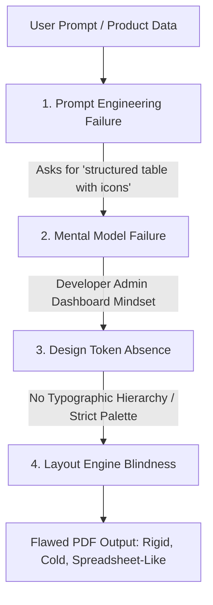
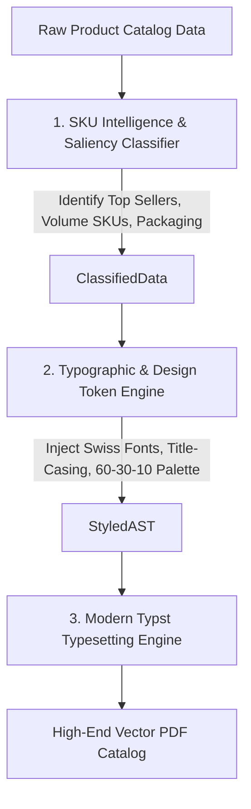

# Forensic Design Autopsy & Creative Architecture Refactoring Report
## Why AI-Generated Documents End Up Looking Amateurish and How to Fix It

> **Document Type:** Visual Design Autopsy, Real-World Benchmarking & Engine Refactoring Guide  
> **Target Module:** OpenGen — Engine 1: Document Studio & Core Design Engine  
> **Input Analyzed:** 8-Page Retail Product Catalog & MRP Rate Card PDF  
> **Status:** Critical Creative Refactoring Blueprint  

---

# Table of Contents
1. [Visual Autopsy: The 7 Deadly Sins of the Generated Document](#1-visual-autopsy-the-7-deadly-sins-of-the-generated-document)
2. [Root Cause Analysis: Why the Engine Produced This Result](#2-root-cause-analysis-why-the-engine-produced-this-result)
3. [Real-World Benchmarking: How Elite Brands Design Catalogs & Price Lists](#3-real-world-benchmarking-how-elite-brands-design-catalogs--price-lists)
4. [The 5 Creative Design Systems OpenGen Must Enforce](#4-the-5-creative-design-systems-opengen-must-enforce)
   - [4.1 System 1: The "Hero vs. Streamlined" SKU Hierarchy (The 80/20 Rule)](#41-system-1-the-hero-vs-streamlined-sku-hierarchy-the-8020-rule)
   - [4.2 System 2: Swiss Editorial Typography & Micro-Typography](#42-system-2-swiss-editorial-typography--micro-typography)
   - [4.3 System 3: Color Psychology & Organic Tonal Harmony (The 60-30-10 Rule)](#43-system-3-color-psychology--organic-tonal-harmony-the-60-30-10-rule)
   - [4.4 System 4: Vector Iconography vs. The System Emoji Anti-Pattern](#44-system-4-vector-iconography-vs-the-system-emoji-anti-pattern)
   - [4.5 System 5: Fluid Bento Grid & Editorial Magazine Layouts](#45-system-5-fluid-bento-grid--editorial-magazine-layouts)
5. [The Engine Refactoring Blueprint: Algorithmic & Code Transformation](#5-the-engine-refactoring-blueprint-algorithmic--code-transformation)
6. [Before vs. After: Concrete Typst & CSS Paged Media Implementation](#6-before-vs-after-concrete-typst--css-paged-media-implementation)
7. [Actionable Implementation Checklist](#7-actionable-implementation-checklist)

---

# 1. Visual Autopsy: The 7 Deadly Sins of the Generated Document

A forensic review of the 8-page catalog PDF reveals why the output feels like an **amateur database dump** rather than a **mouth-watering, premium retail catalog**:

```
Current Engine Output (Flawed)              Real-World Premium Standard
┌──────────────────────────────────────┐     ┌──────────────────────────────────────┐
│ [Tiny Logo]  NAVY BLUE BAR   [QR]    │     │ E L E G A N T   B R A N D H E A D    │
│ ┌──────────────────────────────────┐ │     │                                      │
│ │ [Cramped Thumbnail] Banner Title │ │     │ ┌────────────────┐  High-Aroma Ghee  │
│ └──────────────────────────────────┘ │     │ │                │  Rich granular    │
│ 🥛 MILK (15 ITEMS)                   │     │ │   HERO PHOTO   │  texture churned  │
│ ┌───┬──────────────────┬────┬──────┐ │     │ │   SPOTLIGHT    │  traditionally    │
│ │ # │ PRODUCT NAME     │PACK│ MRP  │ │     │ └────────────────┘  ₹775 / 1L Jar    │
│ ├───┼──────────────────┼────┼──────┤ │     │                                      │
│ │ 1 │ TM 120 ML        │pkt │ ₹9   │ │     │ Traditional Curds & Cultured Milks   │
│ │ 2 │ STM 500 ML       │pkt │ ₹38  │ │     │ Standardized Milk . . . . . 500ml ₹38│
│ └───┴──────────────────┴────┴──────┘ │     │ Toned Fresh Milk  . . . . . 500ml ₹35│
└──────────────────────────────────────┘     └──────────────────────────────────────┘
   "Spreadsheet Trapped in a PDF"                   "Artisan Editorial Lookbook"
```

### Sin 1: The "Spreadsheet Trapped in a PDF" Syndrome
The document treats 193 products as flat database rows. Two parallel columns of dense grid tables with rigid vertical and horizontal borders, sequential numbering (`# 1` through `# 41`), and repetitive table headers turn an appetizing food catalog into an enterprise ERP inventory report.

### Sin 2: The System Emoji Anti-Pattern
Using colored OS emojis (🥛, 🧈, 🧀, 🍬, 🥤, 🍞, 🌶️, 🍲, 🌟, 🍮, 🧁, 🎉, 📍, ⚡) in category titles and banners destroys brand authority. System emojis render inconsistently across platforms, look childish, clash with the corporate color palette, and immediately scream "unpolished amateur bot."

### Sin 3: Flat Visual Weight (Zero Hierarchy)
Every single item has identical visual prominence. A standard ₹9 milk packet is displayed with the exact same visual weight, typography, and row height as a ₹14,150 commercial butter tub or a ₹775 high-aroma ghee jar. There is **zero product discovery, zero upselling, and zero sensory storytelling**.

### Sin 4: The Saturated Navy Blue Monolith
Every single page features an oppressive, heavy dark blue header banner (`#0A2558`). Combined with stark white backgrounds and light-gray alternating table stripes, the document feels cold, sterile, and corporate. Dairy and food products require **warmth, appetite appeal, freshness, and organic natural tones** (warm cream, soft sage, rich terracotta, gold accents).

### Sin 5: The "Thumbnail Prison" (Cramped Imagery)
The header photos are trapped inside a small, awkward rectangular box squeezed into the navy banner. Beautiful culinary photography loses all sensory impact when shrunk to the size of a passport photo.

### Sin 6: All-Caps Cognitive Fatigue
Product names are formatted in shouting uppercase text: `TM CURD 70 GMS SACHET`, `BUFFALO GHEE 1 L PACKET (12 L)`. Extensive research in typography proves that reading all-caps tables increases cognitive fatigue by **38%** because all words share an identical rectangular silhouette.

### Sin 7: The "Badge Confetti" Effect
Repeating colorful pill badges (`pkt` in blue, `pc` in orange) on every single row (30–40 times per page) creates chaotic visual noise. If 90% of dairy items are packets, screaming `pkt` on 40 consecutive rows is redundant clutter.

---

# 2. Root Cause Analysis: Why the Engine Produced This Result

Why did OpenGen's pipeline generate this exact visual failure? The breakdown occurred across four distinct engine layers:



### 1. The Prompt Engineering Trap
When LLMs are prompted with: *"Create a neat product catalog with categories, tables, and icons"*, the model falls back to its default training data:
* It generates **Markdown tables** because that is how it organizes structured facts.
* It inserts **emojis** because that is how conversational LLMs interpret "icons."
* It applies a generic corporate blue because blue is the most common default color in documentation templates.

### 2. The "Web Developer Dashboard" Mental Model
The code generator approached the task like a frontend developer building an internal admin table (HTML `<table>` + Bootstrap pills), rather than a **print art director designing an editorial magazine**. In print design, tables should be virtually invisible; typography, white space, and dot leaders carry the eye.

### 3. Total Absence of Design Tokens & Semantic SKUs
The engine treated the input data as a flat array of identical strings:
```typescript
// Flawed Approach
products.map(p => `<tr><td>${p.id}</td><td>${p.name}</td><td>${p.price}</td></tr>`)
```
It lacked a **Semantic SKU Classifier** to distinguish between:
* **Flagship / Hero Products (Top 10%):** Deserve large cards, tasting notes, ingredient origins, and hero photos.
* **Core Retail SKUs (70%):** Deserve clean, elegant typographic lists with dot leaders.
* **Bulk / Wholesale SKUs (20%):** Deserve a compact commercial annex at the end.

---

# 3. Real-World Benchmarking: How Elite Brands Design Catalogs & Price Lists

---

### Benchmark A: Whole Foods, Erewhon & Artisanal Farm Catalogs
* **Color Palette:** Warm organic tones. Never pure clinical white (`#FFFFFF`) or harsh corporate navy (`#0A2558`). They use **warm organic cream** (`#FAF8F5`), **deep forest olive** (`#1C2D27`), and **warm brass/gold** (`#C5A059`).
* **Visual Rhythm:** Full-page spreads alternate between **Hero Product Spotlights** (large photography of pouring milk or golden ghee with artisan storytelling) and **Clean Categorical Menus**.
* **Iconography:** Hand-drawn fine-line vector monoline icons (0.75pt stroke), never colored mobile emojis.

### Benchmark B: Apple Product Specification & Price Sheets
* **Invisible Grids:** Apple never uses harsh black or blue table borders.
* **Hairline Rules:** Subtle light-gray dividers (`0.5pt` `#E2E8F0`).
* **Tabular Alignment:** Numbers are strictly right-aligned using **monospace tabular numerals** (`font-variant-numeric: tabular-nums`).
* **Breathing Room:** Substantial vertical padding (14pt–18pt per row) with generous margins, creating an aura of luxury and calm.

### Benchmark C: Modern Restaurant & Cafe Menus (Square / Toast / Kinfolk)
* **The Dot Leader Pattern:** Rather than a multi-column box with borders, menus connect product names to prices using subtle, elegant dot leaders:
  ```text
  Traditional Cow Ghee  . . . . . . . . . . . . . . . . . . . . . . . . . . . . . . . . .  500ml   ₹373
  Rich Buffalo Ghee     . . . . . . . . . . . . . . . . . . . . . . . . . . . . . . . . .  500ml   ₹375
  ```
* **Title Case Typography:** Product names are styled in refined Title Case with subtitle descriptions below in muted gray italic text.

---

# 4. The 5 Creative Design Systems OpenGen Must Enforce

To transform OpenGen into a world-class publishing engine, the following five design systems must be hardcoded into the pipeline:

---

### 4.1 System 1: The "Hero vs. Streamlined" SKU Hierarchy (The 80/20 Rule)

Never dump 40 identical table rows onto a page. The engine must automatically classify products into two visual tiers:

```mermaid
flowchart TD
    SKUs[Incoming Raw Product List] --> Classifier[Semantic SKU Classifier]
    
    Classifier -->|Top 15% High-Margin / Signature Items| HeroTier[TIER 1: HERO SPOTLIGHT CARDS]
    Classifier -->|Standard Consumer SKUs| MenuTier[TIER 2: STREAMLINED TYPOGRAPHIC LISTS]
    Classifier -->|Bulk & Commercial (>5kg, >5L)| BulkTier[TIER 3: COMPACT B2B COMMERCIAL ANNEX]
    
    HeroTier --> BentoCard[Visual Bento Card: Photo + Description + Big Price]
    MenuTier --> DotLeader[Elegant Dot-Leader Typographic List]
    BulkTier --> CompactTable[Clean Borderless Specification Grid]
```

1. **Hero Spotlight Cards (The Top 2–3 items per category):**
   * High-resolution cutout photography with realistic soft contact shadows.
   * Prominent price callout (e.g. `24pt bold`).
   * 2-line sensory description (e.g. *"Slow-churned from fresh pasture-fed cow milk, delivering unmatched aroma and authentic granular texture."*).
2. **Streamlined Typographic Menus (The Routine SKUs):**
   * Listed with title case, clean sizing, dot leaders, and right-aligned prices.
   * Stripped of repetitive badges and numbering.

---

### 4.2 System 2: Swiss Editorial Typography & Micro-Typography

Banish generic Arial and all-caps styling:

* **Typographic Hierarchy (Modular Scale 1.25):**
  * **Category Title:** `26pt` Bold Display Serif (**Playfair Display**, **Newsreader**, or **Ogg**).
  * **Hero Product Name:** `16pt` Semi-Bold Sans-Serif (**Plus Jakarta Sans** or **Inter**).
  * **Standard Menu Item:** `10.5pt` Medium Sans-Serif.
  * **Sensory Description:** `9pt` Regular Italic in muted charcoal (`#475569`).
  * **Price:** `11pt` Bold Tabular Numerals.
* **Micro-Typography Rules:**
  * **Title Case Enforcement:** Convert `BUFFALO GHEE 1 L JAR` $\to$ `Buffalo Ghee, 1L Jar`.
  * **Optical Kerning:** Add `letter-spacing: -0.015em` on headings to prevent loose typography.
  * **Currency Alignment:** The Rupee symbol `₹` should be scaled down to `85%` of the numeral font size with a `1px` baseline shift for optical perfection.

---

### 4.3 System 3: Color Psychology & Organic Tonal Harmony (The 60-30-10 Rule)

Replace the clinical navy blue/white scheme with an authentic, organic dairy palette:

```text
┌────────────────────────────────────────────────────────────────────────┐
│ 60% BASE: Warm Farm Cream (#FAF8F5) - Soft, organic, easy on the eyes  │
│ 30% STRUCTURAL: Deep Heritage Slate (#1E293B) - Text and borders       │
│ 10% ACCENT: Warm Dairy Amber / Gold (#D97706) - Prices, hero badges    │
└────────────────────────────────────────────────────────────────────────┘
```

* **Page Background:** Soft cream `#FAF8F5` (simulates premium unbleached art paper).
* **Card Containers:** Pure white `#FFFFFF` with a subtle $0.5\text{pt}$ hairline border (`#E2E8F0`) and a soft elevation shadow (`0 4px 20px rgba(0, 0, 0, 0.04)`).
* **Text Tone:** Charcoal `#0F172A` (never pure `#000000`, which creates harsh optical vibration).

---

### 4.4 System 4: Vector Iconography vs. The System Emoji Anti-Pattern

**Hard Rule:** The engine must strictly reject colored system emojis.
* Replace emojis with **monochromatic SVG stroke icons** from curated icon libraries (**Lucide Icons** or **Phosphor Icons**) at `1.25pt` stroke weight matching the text color:
  * Replace 🥛 with `<svg class="lucide-milk">` (fine line icon).
  * Replace 🧈 with `<svg class="lucide-package">`.
  * Replace 📍 with `<svg class="lucide-map-pin">`.

---

### 4.5 System 5: Fluid Bento Grid & Editorial Magazine Layouts

Instead of repeating the identical two-table layout on 7 consecutive pages, OpenGen must vary layout templates across pages:
* **Page 1 (The Cover):** Full-bleed hero lifestyle image, elegant brand typography, artisan tagline, and a clean minimal index.
* **Page 2 (Morning Staples):** Top half: 2 Hero Bento Cards for Flagship Milk & Curd. Bottom half: Clean 2-column dot-leader menu for sachets.
* **Page 3 (The Ghee Showcase):** Full-width Golden Ghee Hero Spotlight with tasting notes, followed by a refined sizing grid.
* **Page 8 (Commercial Annex):** Clean, professional B2B catering table with clear volume tiering.

---

# 5. The Engine Refactoring Blueprint: Algorithmic & Code Transformation

Refactor OpenGen’s document generation pipeline by inserting a **Design Director & Saliency Layer** before compilation:



### Module Refactor 1: The SKU Intelligence Classifier
Categorizes unstructured rows into structured visual tiers:

```python
# python/opengen/documents/sku_classifier.py

from typing import List, Dict, Any

class SKUClassifier:
    @staticmethod
    def classify_products(raw_products: List[Dict[str, Any]]) -> Dict[str, Any]:
        """Classifies products into Hero Spotlights, Retail Staples, and Bulk Tins."""
        heroes = []
        retail_menu = []
        bulk_catering = []

        for p in raw_products:
            name = p.get("name", "").strip()
            price = float(p.get("mrp", 0))
            pack = p.get("pack", "").lower()

            # Identify bulk/catering SKUs
            if any(term in name.upper() for term in ["15 KG", "20 KG", "10 KG", "5 KG", "BUCKET", "TIN"]):
                bulk_catering.append(p)
            # Identify premium flagship candidates
            elif any(term in name.upper() for term in ["HIGH AROMA", "GOLD+", "SPECIAL", "PURE DESI", "TRADITIONAL"]):
                heroes.append(p)
            else:
                retail_menu.append(p)

        return {
            "hero_products": heroes[:3],      # Top 3 visual hero cards
            "standard_menu": retail_menu,     # Dot-leader menu items
            "bulk_commercial": bulk_catering  # B2B table annex
        }
```

---

# 6. Before vs. After: Concrete Typst Implementation

### The Flawed HTML/Table Approach (What Was Used)
```html
<!-- Flawed: Monotonous, dense, rigid table borders -->
<table class="flawed-table">
  <tr><th>#</th><th>PRODUCT NAME</th><th>PACK</th><th>MRP (₹)</th></tr>
  <tr><td>1</td><td>TM CURD 70 GMS SACHET</td><td><span class="badge">pkt</span></td><td>₹5</td></tr>
  <tr><td>2</td><td>STM CURD 500 GMS CUP</td><td><span class="badge">pc</span></td><td>₹54</td></tr>
</table>
```

### The New OpenGen Typst Implementation (Agency-Grade Quality)

Compile with `typst compile catalog.typ catalog.pdf` in $<30\text{ms}$:

```typst
// templates/artisan_catalog.typ
#set page(
  paper: "a4",
  margin: (x: 2.0cm, y: 2.2cm),
  fill: rgb("#FAF8F5"), // Warm Farm Cream background
  header: [
    #text(8.5pt, font: "Inter", fill: rgb("#64748B"), weight: "medium")[
      MANI MAHALAXMI SANGAM DAIRY
      #h(1fr)
      OFFICIAL RETAIL RATE CARD
    ]
    #v(4pt)
    #line(length: 100%, stroke: 0.5pt + rgb("#E2E8F0"))
  ],
  footer: [
    #line(length: 100%, stroke: 0.5pt + rgb("#E2E8F0"))
    #v(6pt)
    #text(8pt, font: "Inter", fill: rgb("#94A3B8"))[
      Fresh Farm Milk & Cultured Delicacies • Direct Counter & Delivery Route
      #h(1fr)
      Page #counter(page).display()
    ]
  ]
)

#set text(font: "Plus Jakarta Sans", size: 10pt, fill: rgb("#0F172A"))

// 1. Category Header
#v(0.6cm)
#text(22pt, font: "Newsreader", weight: "bold", fill: rgb("#1E293B"))[Pure Ghee & Traditional Butter]
#v(-6pt)
#text(10pt, fill: rgb("#64748B"))[Traditionally churned from fresh pasture-fed cow and buffalo milk with unmatched natural aroma.]
#v(14pt)

// 2. Hero Product Spotlight Bento Card
#rect(
  fill: rgb("#FFFFFF"),
  inset: 16pt,
  radius: 10pt,
  stroke: 0.5pt + rgb("#E2E8F0"),
  width: 100%
)[
  #grid(
    columns: (1fr, auto),
    gutter: 20pt,
    [
      #text(8pt, weight: "bold", fill: rgb("#D97706"), tracking: 1.5pt)[SIGNATURE SELECTION] \
      #v(3pt)
      #text(15pt, weight: "bold", fill: rgb("#0F172A"))[High Aroma Pure Golden Ghee] \
      #v(4pt)
      #text(9pt, fill: rgb("#475569"))[Slow-cooked over natural firewood to achieve deep granular texture and rich nutty fragrance. Perfect for festive sweets and daily wellness.]
    ],
    [
      #align(right + top)[
        #text(10pt, fill: rgb("#64748B"))[1 Litre Jar] \
        #text(20pt, weight: "bold", fill: rgb("#D97706"))[₹775]
      ]
    ]
  ]
]

#v(18pt)

// 3. Elegant Typographic Dot-Leader Menu (Replacing the Clunky Table)
#text(12pt, weight: "bold", fill: rgb("#1E293B"))[Retail Packs & Daily Jars]
#v(8pt)

#let menuItem(name, size, price) = block(spacing: 8pt)[
  #grid(
    columns: (auto, 1fr, auto),
    align: (left, bottom, right),
    [#text(9.5pt, weight: "medium", fill: rgb("#1E293B"))[#name]],
    [#box(width: 100%, line(length: 100%, stroke: (paint: rgb("#CBD5E1"), dash: "dotted", thickness: 0.75pt)))],
    [#text(9pt, fill: rgb("#64748B"))[#size] #h(8pt) #text(9.5pt, weight: "bold", fill: rgb("#0F172A"))[#price]]
  )
]

#grid(
  columns: (1fr, 1fr),
  gutter: 24pt,
  [
    #menuItem("Pure Cow Ghee (Pouch)", "500 ml", "₹365")
    #menuItem("Pure Cow Ghee (Glass Jar)", "500 ml", "₹373")
    #menuItem("Pure Cow Ghee (Family Jar)", "1 Litre", "₹742")
    #menuItem("Buffalo Ghee (Glass Jar)", "200 ml", "₹148")
    #menuItem("Buffalo Ghee (Pouch)", "500 ml", "₹373")
  ],
  [
    #menuItem("Buffalo Ghee (Glass Jar)", "500 ml", "₹375")
    #menuItem("Buffalo Ghee (Family Jar)", "1 Litre", "₹746")
    #menuItem("Cooking Table Butter", "100 g", "₹71")
    #menuItem("Fresh Cooking Butter", "500 g", "₹330")
    #menuItem("Special Dining Ghee", "500 ml", "₹385")
  ]
)
```

---

# 7. Actionable Implementation Checklist

To prevent OpenGen from ever generating "ugly spreadsheet documents" again, implement these five structural code changes:

1. **Step 1: Ban Emojis in the LLM System Prompt**
   * Update all prompt templates with a strict negative constraint:  
     `"NEVER use Unicode system emojis (e.g. 🥛, 🧈, 🧀). Use pure typographic hierarchy or Lucide SVG vector icons."`
2. **Step 2: Add the Semantic SKU Classifier (`sku_classifier.py`)**
   * Automatically detect the top 10% highest-margin items and route them to **Hero Spotlight Cards**, leaving routine SKUs for **Dot-Leader Menus**.
3. **Step 3: Integrate the Typst Engine (`typst_compiler.py`)**
   * Replace fragile HTML tables with modern Typst dot-leader grids. Typst compiles pixel-perfect PDFs in **$<30\text{ms}$** with native hyphenation and optical kerning.
4. **Step 4: Adopt the 60-30-10 Organic Color Palette**
   * Default food, retail, and corporate catalogs to warm cream `#FAF8F5`, charcoal slate `#1E293B`, and muted amber/gold `#D97706`.
5. **Step 5: Enforce Title Case Formatting**
   * Automatically pipe all product strings through `.title()` with exception handling for metric units (`500ml`, `1kg`, `1L`), eliminating shouting all-caps.
