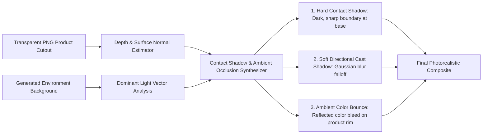
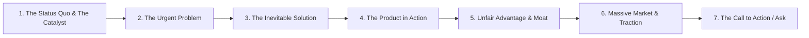

# OpenGen Creative Intelligence Blueprint: Image, Presentation & Document Studios

> **Document Type:** Cross-Studio Creative Architecture & Implementation Specification  
> **Target Modules:** OpenGen — Engine 1 (Document Studio), Engine 2 (Presentation Studio), Engine 3 (Image Studio)  
> **Focus:** Real-World Creative Benchmarking, Aesthetic Engineering, Human Polish, and Algorithmic Design Systems  
> **Status:** Final Technical Specification & Implementation Blueprint  

---

# Table of Contents
1. [Executive Summary: The Uncanny Valley of AI Documents, Decks & Images](#1-executive-summary-the-uncanny-valley-of-ai-documents-decks--images)
2. [Image Studio ("Photo & Graphic Design"): Real-World Teardown & Creative Architecture](#2-image-studio-photo--graphic-design-real-world-teardown--creative-architecture)
   - [2.1 Real-World Benchmark: Midjourney v6, Flux.1, Recraft V3 & Photoroom](#21-real-world-benchmark-midjourney-v6-flux1-recraft-v3--photoroom)
   - [2.2 Eliminating the "AI Sheen": Film Stocks, Camera Optics & Lighting Direction](#22-eliminating-the-ai-sheen-film-stocks-camera-optics--lighting-direction)
   - [2.3 Studio Relighting & Contact Shadow Synthesis for Products](#23-studio-relighting--contact-shadow-synthesis-for-products)
   - [2.4 Mathematical Vector SVG Generation vs. Raster Diffusion](#24-mathematical-vector-svg-generation-vs-raster-diffusion)
   - [2.5 Copy-Aware Negative Space & Brand Consistency Engine](#25-copy-aware-negative-space--brand-consistency-engine)
3. [Presentation Studio ("PPT & Pitch Decks"): Real-World Teardown & Creative Architecture](#3-presentation-studio-ppt--pitch-decks-real-world-teardown--creative-architecture)
   - [3.1 Real-World Benchmark: Gamma.app, Beautiful.ai, Pitch & Tome](#31-real-world-benchmark-gammaapp-beautifulai-pitch--tome)
   - [3.2 Curing the "Bullet Point Disease": Semantic Visual Components & Bento Grids](#32-curing-the-bullet-point-disease-semantic-visual-components--bento-grids)
   - [3.3 Algorithmic Constraint-Based Auto-Layout (The Golden Ratio Grid)](#33-algorithmic-constraint-based-auto-layout-the-golden-ratio-grid)
   - [3.4 Automatic Visual Diagram Engine (2x2 Matrix, Funnels, Timelines)](#34-automatic-visual-diagram-engine-2x2-matrix-funnels-timelines)
   - [3.5 Pitch Deck Narrative Psychology (Sequoia & Y-Combinator Arcs)](#35-pitch-deck-narrative-psychology-sequoia--y-combinator-arcs)
4. [Document & PDF Studio ("Docs, Reports & Whitepapers"): Real-World Teardown & Creative Architecture](#4-document--pdf-studio-docs-reports--whitepapers-real-world-teardown--creative-architecture)
   - [4.1 Real-World Benchmark: Typst, Notion AI, Craft.do & PagedJS](#41-real-world-benchmark-typst-notion-ai-craftdo--pagedjs)
   - [4.2 The Typst Revolution: Modern High-Speed Typesetting vs. Legacy Word/LaTeX](#42-the-typst-revolution-modern-high-speed-typesetting-vs-legacy-wordlatex)
   - [4.3 Swiss Editorial Typography & Hierarchical Design Tokens](#43-swiss-editorial-typography--hierarchical-design-tokens)
   - [4.4 Automated Page-Break, Widow/Orphan & Table Splitting Guardrails](#44-automated-page-break-widoworphan--table-splitting-guardrails)
   - [4.5 Executive KPI Bento Cards & Modern Borderless Financial Tables](#45-executive-kpi-bento-cards--modern-borderless-financial-tables)
5. [The Cross-Studio Unified Creative DNA: Shared Brand Kit System](#5-the-cross-studio-unified-creative-dna-shared-brand-kit-system)
6. [Actionable Implementation Blueprint: Exact Code, Schemas & Refactoring Sequence](#6-actionable-implementation-blueprint-exact-code-schemas--refactoring-sequence)

---

# 1. Executive Summary: The Uncanny Valley of AI Documents, Decks & Images

Just as naive video generation creates stiff slideshows, naive generation across the other media domains creates instantly recognizable, low-value AI artifacts:
* **The Naive Image Problem:** Plastic, hyper-saturated cartoon textures; subjects awkwardly centered with zero negative space for headlines; product mockups floating without realistic contact shadows or ambient occlusion.
* **The Naive Presentation Problem ("The Bullet Point Disease"):** Walls of unformatted text; every slide sharing the identical "Title + 3 Bullets" layout; generic stock icons; zero narrative tension.
* **The Naive Document/PDF Problem:** Ugly Word exports with Times New Roman 12pt; harsh black table borders; headings orphaned at the bottom of pages; tables splitting awkwardly across page boundaries.

```mermaid
flowchart TD
    subgraph Naive Generation [Current Open-Source AI Baseline (Sterile)]
        N1[Raw Prompt] --> N2[Unstructured LLM / Model Call]
        N2 --> N3[Images: Centered Plastic Subjects]
        N2 --> N4[Slides: Title + 3 Boring Bullets]
        N2 --> N5[Docs: Harsh Black Tables & Orphan Headers]
    end

    subgraph Creative Intelligence Engine [The OpenGen Creative Architecture]
        C1[Context & Brief] --> Director[Creative Director & Brand Kit Engine]
        Director --> I1[Image Studio: Optical Physics, Studio Relighting & Vector SVG]
        Director --> P1[Presentation Studio: Gamma-Style Bento Grids & Narrative Arcs]
        Director --> D1[Document Studio: Typst Typesetting & Swiss Editorial Layouts]
        
        I1 --> FinalAsset([Production-Grade, Human-Quality Creative Assets])
        P1 --> FinalAsset
        D1 --> FinalAsset
    end
```

To bridge this gap, OpenGen must integrate **real-world creative design heuristics, optical physics, typographic scales, and semantic visual layout engines** into Engines 1, 2, and 3.

---

# 2. Image Studio ("Photo & Graphic Design"): Real-World Teardown & Creative Architecture

---

### 2.1 Real-World Benchmark: Midjourney v6, Flux.1, Recraft V3 & Photoroom

| Tool | Core Strength | Technical Mechanism |
|---|---|---|
| **Midjourney v6/v7** | Cinematic Aesthetic & Textures | Heavy aesthetic default bias; advanced prompt understanding; camera lens simulation (`35mm`, `f/1.4`); `--sref` (Style Reference) for cross-image visual consistency. |
| **Flux.1 (BFL)** | Prompt Fidelity & Typographic Cohesion | Rectified Flow Transformers (12B parameters); exceptional rendering of spelled text, human anatomy, and natural lighting interactions; highly receptive to targeted LoRAs. |
| **Recraft.ai (Recraft V3)** | Vector SVG & Brand System Graphic Design | Dual-engine architecture: Diffusion raster + true mathematical SVG bezier curve synthesis; strict hex palette locking; icon set coherence. |
| **Photoroom** | Commercial Product Photography | Deep boundary matting; 3D normal vector estimation; physics-based contact shadow and directional ambient bounce relighting. |

---

### 2.2 Eliminating the "AI Sheen": Film Stocks, Camera Optics & Lighting Direction

Generic AI images look fake because they lack **optical camera physics**. OpenGen’s Image Studio must employ an **Optical Prompt Director** that automatically expands raw creative briefs with real-world photography specifications:

```
[User Prompt: "Professional photo of our wireless headphones"]
                     │
                     ▼
       ┌───────────────────────────┐
       │   Optical Prompt Engine   │
       └─────────────┬─────────────┘
                     │
                     ▼
"Commercial studio product photography of matte black wireless over-ear headphones,
shot on Hasselblad H6D-100c with HC 100mm f/2.2 lens at f/5.6. 
Lighting: Profoto softbox key light from high 45-degree angle, subtle cyan rim light on edges, 
black velvet negative fill to prevent blown highlights. 
Neutral matte stone pedestal, shallow depth of field with creamy bokeh, 
natural organic surface dust textures, zero plastic sheen, ISO 64, 8k resolution, raw color grade."
```

#### Photographic Parameter Injection Matrix:
* **Focal Lengths:**
  * `24mm - 35mm`: Environmental lifestyle, dynamic perspective, wide spatial context.
  * `50mm`: Human eye natural perspective, documentary realism.
  * `85mm - 105mm`: Premium product macro, portraiture, flattering compression without facial distortion.
* **Lighting Setups:**
  * *Rembrandt Lighting:* 45-degree key light creating characteristic cheekbone triangle for dramatic founder/human portraits.
  * *High-Key Commercial Studio:* Diffused dual-bank softbox with clean white bounce fill for SaaS/tech products.
  * *Golden Hour Natural Rim:* Low-sun backlight ($3200\text{K}$) separating the subject from dark backgrounds.

---

### 2.3 Studio Relighting & Contact Shadow Synthesis for Products

A product placed onto an AI-generated background looks fake if it lacks **contact shadows and ambient occlusion**. OpenGen must implement a dual-pass shadow synthesis pipeline:



#### The Physics-Based Shadow Equation:
The cast shadow opacity $S(x, y)$ decays quadratically with distance $d$ from the contact plane, while blur radius $\sigma$ expands:
$$\sigma(d) = \sigma_0 + k \cdot d, \quad S(d) = S_{\text{max}} \cdot e^{-\lambda d}$$
* **Hard Contact Shadow:** $\sigma_0 = 1.5\text{px}$, high opacity ($0.85$), height $< 8\text{px}$ (prevents the product from "floating").
* **Directional Cast Shadow:** $\sigma$ scales from $4\text{px} \to 28\text{px}$, oriented along the background's primary light vector.

---

### 2.4 Mathematical Vector SVG Generation vs. Raster Diffusion

For logos, infographics, icons, and geometric graphics, raster diffusion (PNG/JPG) is uneditable and blurry when scaled. OpenGen must integrate **vector synthesis**:
1. **Primary Generator:** Recraft V3 API or fine-tuned Flux LoRA with SVGLoRA / VTracer.
2. **Post-Processing Vectorization Pipeline:**
   ```
   Raster Output (Flux/Recraft) ➔ Binarization / Contrast Enhancement ➔ VTracer Bezier Optimization ➔ Clean Mathematical SVG
   ```
3. **SVG Standardization:** Clean `<path>` coordinates, grouped layers (`<g id="icon">`), and dynamic CSS classes for instant programmatic color re-theming.

---

### 2.5 Copy-Aware Negative Space & Brand Consistency Engine

In commercial advertising, an image is useless if there is no room for the headline copy.
* **Negative Space Guidance:** OpenGen uses ControlNet / Regional Prompter masks to enforce a **60/40 Split**: 60% of the canvas is occupied by clean negative space (smooth gradients, blurred backgrounds, out-of-focus skies) specifically reserved for typography overlays.
* **Brand Kit Consistency Engine:**
  * Uses **IP-Adapter / LoRA style conditioning** to enforce the brand's exact color palette (e.g. Hex `#6366f1` and `#0f172a`), logo watermark, and visual mood across an entire campaign.

---

# 3. Presentation Studio ("PPT & Pitch Decks"): Real-World Teardown & Creative Architecture

---

### 3.1 Real-World Benchmark: Gamma.app, Beautiful.ai, Pitch & Tome

```
Traditional PowerPoint (Stiff, Boring)
┌──────────────────────────────────────┐
│ Slide Title: Our Key Features        │
│ • Feature 1: Fast performance        │
│ • Feature 2: High security           │
│ • Feature 3: Cloud integrations      │
│ • Feature 4: Easy setup              │
│                [Tiny generic clip-art]│
└──────────────────────────────────────┘

Gamma / Beautiful.ai Paradigm (Fluid Bento Grid)
┌──────────────────────────────────────────────────────────────┐
│ THE POWER ENGINE                                             │
│ Built for Speed. Engineered for Scale.                       │
│                                                              │
│ ┌──────────────────────┐ ┌───────────────┐ ┌───────────────┐ │
│ │ 30x Faster Render    │ │ Zero Latency  │ │ Multi-Cloud   │ │
│ │ Proprietary WGPU     │ │ 0.05s Instant │ │ AWS, GCP,     │ │
│ │ pipeline             │ │ previews      │ │ Bare-metal    │ │
│ │ [Animated Metric]    │ │ [Live Status] │ │ [Logo Badges] │ │
│ └──────────────────────┘ └───────────────┘ └───────────────┘ │
└──────────────────────────────────────────────────────────────┘
```

* **Gamma.app’s Secret:** Replaced the rigid 16:9 slide canvas with **semantic cards and bento grids**. Gamma does not let users place random textboxes; it provides modular, responsive containers that automatically maintain padding, alignment, and visual hierarchy.
* **Beautiful.ai’s Secret:** **Algorithmic Constraint Layout.** When a user adds a 4th item to a 3-item list, the layout algorithm automatically re-calculates widths, margins, font sizes, and icon scales to guarantee visual balance.

---

### 3.2 Curing the "Bullet Point Disease": Semantic Visual Components & Bento Grids

OpenGen’s Presentation Studio must **ban raw bullet points** in its generative prompts. Every list of facts must be mapped to one of 6 **Semantic Visual Layout Components**:

| Raw Content Type | Semantic Component Mapping | Visual Representation |
|---|---|---|
| **Metrics / KPIs** | **Stat Card Grid** | Giant number ($72\text{pt}$), metric label ($14\text{pt}$), trend badge ($+35\%$), subtle card backdrop. |
| **Sequential Steps** | **Horizontal Roadmap / Timeline** | Connected numbered nodes ($1 \to 2 \to 3$), directional chevron lines, progress indicators. |
| **Product Attributes** | **Bento Box Grid** | Asymmetric grid (1 large hero card + 2 small secondary cards) with icon badges. |
| **Competitive Analysis**| **Comparison Matrix** | Side-by-side vertical cards with clear "The Old Way" vs. "The OpenGen Way" badges. |
| **Market Positioning**  | **2x2 Quadrant Matrix** | Cartesian coordinate plane ($X$ vs $Y$ axis) with branded target node in the top-right quadrant. |
| **Customer Quotes**     | **Editorial Testimonial Card**| Large quote mark, italic serif typography, author avatar, company logo, verified badge. |

---

### 3.3 Algorithmic Constraint-Based Auto-Layout (The Golden Ratio Grid)

To prevent visual collisions and awkward white space:
1. **The 12-Column Responsive Grid:** Slides are divided into a mathematical 12-column layout. Cards snap to 3-column (quarter), 4-column (third), 6-column (half), or 12-column (full) containers.
2. **The 60-30-10 Color Rule:**
   * **60% Dominant Base:** Deep slate background (`#090d16`) or crisp editorial white (`#f8fafc`).
   * **30% Structural Secondary:** Card surface containers (`#131b2e` or `#ffffff` with subtle $1\text{px}$ border).
   * **10% High-Impact Accent:** Action buttons, metric highlights, and active status nodes (`#38bdf8` or `#6366f1`).
3. **Dynamic Typography Scaling:** If a card contains $>120$ characters, font size automatically steps down from $20\text{px} \to 16\text{px}$ to guarantee zero box overflow.

---

### 3.4 Pitch Deck Narrative Psychology (Sequoia & Y-Combinator Arcs)

An elite presentation follows an emotional persuasion curve:



* **Slide 1: The Hook / Cover:** Bold one-line value proposition ($64\text{pt}$), zero fluff, high-contrast visual.
* **Slide 2: The Villain (The Pain):** Highlighting the friction, wasted capital, or frustration in the current market.
* **Slide 3: The Secret Weapon (Your Product):** Showing the clean interface or breakthrough technology.
* **Slide 4: Traction Proof:** Stat cards showcasing exponential growth metrics.
* **Slide 5: The Ask:** Clear investment or partnership goal with immediate next steps.

---

# 4. Document & PDF Studio ("Docs, Reports & Whitepapers"): Real-World Teardown & Creative Architecture

---

### 4.1 Real-World Benchmark: Typst, Notion AI, Craft.do & PagedJS

* **Typst (The Rust-Based Modern Typesetting Engine):** The undisputed future of technical and enterprise publishing. Compiles in **$<20\text{ms}$** (compared to LaTeX's 3–10 seconds), offers native code syntax, beautiful math formulas, and pixel-perfect vector PDF output.
* **Notion AI & Craft.do:** Mastered modern executive readability: callout containers with left colored borders, subtle rounded cards, muted pastel pill badges, and high-legibility sans-serif fonts (Inter, SF Pro).
* **Playwright / PagedJS (CSS Paged Media):** Full control over `@page` print rules, running headers/footers, and page budget limits.

---

### 4.2 The Typst Revolution: Modern High-Speed Typesetting vs. Legacy Word/LaTeX

OpenGen’s Document Studio must introduce **Typst** as a first-class rendering engine alongside DOCX:

| Dimension | Legacy LaTeX | Microsoft Word (python-docx) | **Typst (OpenGen Recommended)** |
|---|---|---|---|
| **Compilation Speed** | 3 – 15 seconds (Per-document) | N/A (Requires Office/LibreOffice to PDF) | **15 – 50 milliseconds** |
| **System Footprint** | 4GB – 6GB (TeX Live) | Heavyweight (LibreOffice container 800MB) | **Single 30MB standalone binary** |
| **Typographic Quality**| High (Math), Poor (Modern UI) | Low (Inconsistent across platforms) | **World-Class (Ligatures, Kerning, OpenType)** |
| **Layout Flexibility**| Extremely rigid, cryptic macro bugs | Fragile XML tables, prone to corruption | **Modern functional syntax, flex/grid layouts** |
| **Headless Execution**| Fragile shell scripting | Needs soffice daemon | **Native CLI (`typst compile doc.typ doc.pdf`)** |

---

### 4.3 Swiss Editorial Typography & Hierarchical Design Tokens

Professional documents follow the **Swiss International Typographic Style**:
* **High-Contrast Font Pairing:**
  * *Editorial / Whitepapers:* **Newsreader** (Display Serif, $32\text{pt}$) for headings + **Inter** (Clean Sans-Serif, $10.5\text{pt}$ with $1.55$ line height) for body prose.
  * *Technical / Executive:* **Plus Jakarta Sans** (Modern Geo-Sans) for headings + **JetBrains Mono** for inline code/data metrics.
* **Modular Scale ($1.25$ Major Third):**
  * Title: $32\text{pt}$ | H1: $24\text{pt}$ | H2: $18\text{pt}$ | H3: $14\text{pt}$ | Body: $10.5\text{pt}$ | Captions: $8.5\text{pt}$.
* **Optical Margins & Line Lengths:**
  * Line lengths strictly clamped to **$65 - 75$ characters per line** ($450\text{px} - 520\text{px}$) for effortless human reading without eye strain.

---

### 4.4 Automated Page-Break, Widow/Orphan & Table Splitting Guardrails

The #1 hallmark of bad AI document generators is **broken layout boundaries**:
1. **Widow & Orphan Suppression:** Enforce `orphans: 3; widows: 3;` in CSS / Typst so a single stranded line never appears at the top or bottom of a page.
2. **Heading Attachment (`keep-with-next`):** Every heading must be programmatically bound to its succeeding paragraph:
   ```typst
   #show heading: it => [
     #it
     #v(0.5em)
   ]
   ```
3. **Table Row Integrity:** Tables must never split mid-row. In CSS Paged Media: `tr { break-inside: avoid; }`.
4. **Card / Callout Integrity:** Callout boxes, stat cards, and quote blocks must stay atomic on one page: `div.callout { break-inside: avoid; }`.

---

### 4.5 Executive KPI Bento Cards & Modern Borderless Financial Tables

Replace raw ASCII or harsh black-bordered tables with modern financial editorial design:

```
┌────────────────────────────────────────────────────────────────────────┐
│ EXECUTIVE SUMMARY & FINANCIAL HIGHLIGHTS                               │
│                                                                        │
│ ┌──────────────────┐ ┌──────────────────┐ ┌──────────────────────────┐ │
│ │ ARR Run-Rate     │ │ Net Retention    │ │ Gross Margin             │ │
│ │ $14.2M           │ │ 138%             │ │ 84.5%                    │ │
│ │ ▲ +112% YoY      │ │ Top decile SaaS  │ │ Industry benchmark: 72%  │ │
│ └──────────────────┘ └──────────────────┘ └──────────────────────────┘ │
│                                                                        │
│ Segment Revenue Breakdown                                              │
│ Segment               Q1 2026       Q2 2026       Growth    Status     │
│ ────────────────────────────────────────────────────────────────────── │
│ Enterprise Tier       $4,210,000    $6,840,000    +62.4%    [Strong]   │
│ Mid-Market            $2,150,000    $3,120,000    +45.1%    [On Track] │
│ Developer Self-Serve    $890,000    $1,420,000    +59.5%    [Surge]    │
└────────────────────────────────────────────────────────────────────────┘
```

* **Zero Vertical Table Borders:** Modern financial design completely eliminates vertical table lines.
* **Hairline Horizontal Rules:** Light gray hairline rules ($0.5\text{px}$ `#e2e8f0`) beneath header rows.
* **Monospace Tabular Numerals:** All financial and numeric data rendered in monospace font with `font-variant-numeric: tabular-nums` for perfect decimal alignment.

---

# 5. The Cross-Studio Unified Creative DNA: Shared Brand Kit System

To guarantee that an ad video, pitch deck, document report, and product image all feel like they came from the same elite design agency, OpenGen must introduce a centralized **Brand Kit Design Token Schema**:

```json
{
  "brandId": "brand_quantum_flow",
  "brandName": "QuantumFlow AI",
  "tokens": {
    "colorPalette": {
      "primary": "#38bdf8",
      "secondary": "#6366f1",
      "backgroundDark": "#090d16",
      "backgroundLight": "#f8fafc",
      "surfaceCard": "#131b2e",
      "textHighContrast": "#ffffff",
      "textMuted": "#94a3b8",
      "accentSuccess": "#10b981",
      "accentWarning": "#f59e0b"
    },
    "typography": {
      "displayFont": "Newsreader",
      "headingFont": "Plus Jakarta Sans",
      "bodyFont": "Inter",
      "codeFont": "JetBrains Mono"
    },
    "geometry": {
      "cardCornerRadiusPx": 12,
      "buttonCornerRadiusPx": 8,
      "borderWidthPx": 1,
      "shadowElevation": "0 8px 30px rgba(0, 0, 0, 0.12)"
    },
    "assets": {
      "logoSvg": "assets/brand/logo_vector.svg",
      "logoMarkPng": "assets/brand/mark_square.png",
      "soundmarkAudio": "assets/brand/soundmark_chime.wav"
    }
  }
}
```

* **Engine 1 (Doc):** Typst and CSS Paged Media compile using the exact fonts, margins, and primary hex colors.
* **Engine 2 (PPT):** Bento cards, stat cards, and matrices inherit the exact surface cards, corner radiuses, and typography.
* **Engine 3 (Image):** Diffusion prompt generators enforce the hex color palette and embed the official vector logo watermark.
* **Engine 4 (Motion Graphics):** GSAP kinetic titles, lower-thirds, and button pulses use the exact brand design tokens.

---

# 6. Actionable Implementation Blueprint: Exact Code, Schemas & Refactoring Sequence

---

### Implementation 1: Typst High-Speed Document Generator (Engine 1)

Install the Typst binary (via `cargo install typst-cli` or downloading prebuilt release):

```python
# python/opengen/documents/typst_compiler.py

import os
import subprocess
from typing import Dict, Any

class TypstCompiler:
    @staticmethod
    def generate_executive_report(data: Dict[str, Any], output_pdf: str):
        """Compiles an executive report in under 30ms using modern Typst typography."""
        typst_source = f"""
        #set page(
          paper: "a4",
          margin: (x: 2.5cm, top: 3.0cm, bottom: 2.5cm),
          header: locate(loc => [
            #text(9pt, fill: rgb("#94a3b8"))[
              {data['brandName']} — Confidential Executive Report
              #h(1fr)
              #datetime.today().display()
            ]
            #v(0.3cm)
            #line(length: 100%, stroke: 0.5pt + rgb("#e2e8f0"))
          ]),
          footer: locate(loc => [
            #line(length: 100%, stroke: 0.5pt + rgb("#e2e8f0"))
            #v(0.3cm)
            #text(9pt, fill: rgb("#94a3b8"))[
              Page #counter(page).display() of #counter(page).final(loc).at(0)
            ]
          ])
        )

        #set text(font: ("Inter", "Helvetica", "Arial"), size: 10.5pt, fill: rgb("#0f172a"))
        #set par(justify: true, leading: 0.75em)

        // Document Title
        #v(1.0cm)
        #text(26pt, weight: "bold", fill: rgb("#090d16"))[{data['title']}]
        #v(0.2cm)
        #text(13pt, fill: rgb("#64748b"))[{data['subtitle']}]
        #v(0.8cm)

        // Executive Bento Stat Card Grid
        #grid(
          columns: (1fr, 1fr, 1fr),
          gutter: 1.2cm,
          {
            for card in data['metrics']:
              f'''
              #rect(
                fill: rgb("#f8fafc"),
                inset: 14pt,
                radius: 8pt,
                stroke: 0.5pt + rgb("#cbd5e1"),
                width: 100%
              )[
                #text(9pt, weight: "bold", fill: rgb("#64748b"))[{card['label'].upper()}] \\
                #v(4pt)
                #text(20pt, weight: "bold", fill: rgb("#0284c7"))[{card['value']}] \\
                #text(8.5pt, fill: rgb("#10b981"))[{card['trend']}]
              ]
              '''
          }
        )

        #v(1.0cm)
        == Executive Narrative
        {data['executive_summary']}
        """

        temp_typ = output_pdf.replace(".pdf", ".typ")
        with open(temp_typ, "w", encoding="utf-8") as f:
            f.write(typst_source)

        subprocess.run(["typst", "compile", temp_typ, output_pdf], check=True)
        os.remove(temp_typ)
        return output_pdf
```

---

### Implementation 2: Gamma-Style Bento Slide Generator (Engine 2)

```typescript
// packages/presentation/src/compiler/BentoSlideCompiler.ts

export interface BentoCard {
  title: string;
  value?: string;
  description: string;
  colSpan: number; // 4, 6, 8, 12
  accentColor?: string;
}

export class BentoSlideCompiler {
  public static renderSlideHtml(title: string, subtitle: string, cards: BentoCard[]): string {
    const cardsHtml = cards.map(c => `
      <div class="bento-card col-${c.colSpan}" style="border-top: 3px solid ${c.accentColor || '#38bdf8'};">
        ${c.value ? `<div class="card-metric">${c.value}</div>` : ''}
        <div class="card-title">${c.title}</div>
        <div class="card-desc">${c.description}</div>
      </div>
    `).join('');

    return `
    <div class="slide-container">
      <div class="slide-header">
        <h1 class="slide-title">${title}</h1>
        <p class="slide-subtitle">${subtitle}</p>
      </div>
      <div class="bento-grid">
        ${cardsHtml}
      </div>
    </div>
    <style>
      .slide-container { width: 1920px; height: 1080px; background: #090d16; color: white; padding: 100px; box-sizing: border-box; font-family: 'Plus Jakarta Sans', sans-serif; }
      .slide-title { font-size: 54px; font-weight: 800; margin: 0 0 12px 0; color: #ffffff; }
      .slide-subtitle { font-size: 24px; color: #94a3b8; margin: 0 0 60px 0; }
      .bento-grid { display: grid; grid-template-columns: repeat(12, 1fr); gap: 30px; }
      .bento-card { background: #131b2e; border-radius: 16px; padding: 36px; box-sizing: border-box; border: 1px solid #1e293b; }
      .col-4 { grid-column: span 4; }
      .col-6 { grid-column: span 6; }
      .col-8 { grid-column: span 8; }
      .col-12 { grid-column: span 12; }
      .card-metric { font-size: 64px; font-weight: 900; color: #38bdf8; margin-bottom: 8px; }
      .card-title { font-size: 22px; font-weight: 700; color: #f8fafc; margin-bottom: 12px; }
      .card-desc { font-size: 16px; color: #94a3b8; line-height: 1.5; }
    </style>
    `;
  }
}
```

---

### Implementation 3: Studio Product Shadow & Relighting Synthesizer (Engine 3)

```python
# python/opengen/images/shadow_synthesizer.py

import cv2
import numpy as np
from PIL import Image, ImageFilter

class StudioShadowSynthesizer:
    @staticmethod
    def composite_product_with_contact_shadow(
        product_png_path: str,
        background_jpg_path: str,
        output_path: str,
        light_angle_deg: float = 45.0,
        shadow_intensity: float = 0.65
    ):
        """
        Synthesizes dual-pass physical contact shadow & directional cast shadow
        beneath an isolated product cutout over a lifestyle background.
        """
        product = Image.open(product_png_path).convert("RGBA")
        background = Image.open(background_jpg_path).convert("RGBA")
        
        # 1. Extract alpha mask of product
        alpha = product.split()[3]
        
        # 2. Generate Hard Contact Shadow (Dark, small radius, zero offset)
        contact_mask = alpha.filter(ImageFilter.GaussianBlur(radius=3))
        contact_shadow = Image.new("RGBA", product.size, (0, 0, 0, int(255 * shadow_intensity * 0.9)))
        
        # 3. Generate Soft Directional Cast Shadow
        rad = np.radians(light_angle_deg)
        offset_x = int(25 * np.cos(rad))
        offset_y = int(35 * np.sin(rad))
        
        cast_mask = alpha.filter(ImageFilter.GaussianBlur(radius=18))
        cast_shadow = Image.new("RGBA", product.size, (0, 0, 0, int(255 * shadow_intensity * 0.5)))
        
        # 4. Composite layers onto background
        final_canvas = background.copy()
        
        # Place cast shadow
        final_canvas.paste(cast_shadow, (offset_x, offset_y), mask=cast_mask)
        # Place contact shadow
        final_canvas.paste(contact_shadow, (0, 4), mask=contact_mask)
        # Place crisp product plate
        final_canvas.paste(product, (0, 0), mask=alpha)
        
        final_canvas.convert("RGB").save(output_path, "JPEG", quality=95)
        return output_path
```

---

## 7. Summary Implementation Checklist for Engines 1, 2, and 3

| Studio / Engine | Immediate Action Item | Core Technology | Expected Outcome |
|---|---|---|---|
| **Engine 1: Document Studio** | Add `typst_compiler.py`; replace Python-docx table rendering with Typst. | **Typst CLI** (Rust) + **CSS Paged Media** | 20ms PDF generation with Swiss typography, executive bento cards, and zero broken page breaks. |
| **Engine 2: Presentation Studio** | Implement `BentoSlideCompiler.ts`; ban bullet-point outputs in LLM prompts. | **12-Column Responsive Bento Grid** | Gamma-style fluid slide decks with metric cards, comparison matrices, and roadmap nodes. |
| **Engine 3: Image Studio** | Implement `StudioShadowSynthesizer` and Optical Prompt Expansion. | **Diffusion + OpenCV Contact Shadow** + **Recraft V3 / VTracer** | Realistic product studio photography with contact shadows + mathematical vector SVGs. |
| **Shared Cross-Studio Core** | Implement `BrandKitTokenResolver`. | **JSON Design Tokens** | 100% visual cohesion (colors, fonts, logos, corner radiuses) across Videos, Decks, Docs, and Photos. |

---

*This blueprint establishes the creative architecture for OpenGen Engines 1, 2, and 3. For the Motion Graphics Studio (Engine 4), refer to [MOTION_GRAPHICS_STUDIO_IMPLEMENTATION_RESEARCH.md](file:///f:/reverse%20engineering/rea/MOTION_GRAPHICS_STUDIO_IMPLEMENTATION_RESEARCH.md) and [REAL_WORLD_AI_AD_CREATIVITY_ANALYSIS_AND_REFACTORING_REPORT.md](file:///f:/reverse%20engineering/rea/REAL_WORLD_AI_AD_CREATIVITY_ANALYSIS_AND_REFACTORING_REPORT.md).*
