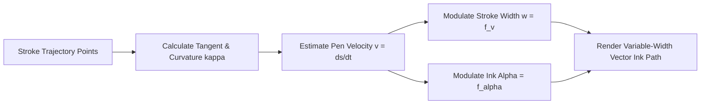

# OpenGen Engine 4: Realistic Handwriting Studio Creative Intelligence Specification

> **Document Type:** Engine Architecture & Biomechanical Handwriting Synthesis Blueprint  
> **Target Module:** OpenGen — Engine 4: Handwriting Studio (`opengen.engines.handwriting`)  
> **Status:** Production Specification & Forensic Creative Blueprint  

---

# Table of Contents
1. [Executive Summary: The Biomechanical Reality of Human Writing](#1-executive-summary-the-biomechanical-reality-of-human-writing)
2. [Forensic Autopsy: Why Most AI Handwriting Looks Artificial](#2-forensic-autopsy-why-most-ai-handwriting-looks-artificial)
3. [Real-World Benchmarking: The Anatomy of Natural Digital Ink](#3-real-world-benchmarking-the-anatomy-of-natural-digital-ink)
   - [3.1 Alex Graves Neural Stroke Synthesis (RNN/MDN)](#31-alex-graves-neural-stroke-synthesis-rnnmdn)
   - [3.2 Apple PencilKit & GoodNotes Vector Spline Dynamics](#32-apple-pencilkit--goodnotes-vector-spline-dynamics)
   - [3.3 Anti-Detection OCR & Forensic Handwriting Examination Standards](#33-anti-detection-ocr--forensic-handwriting-examination-standards)
4. [The 7 Biomechanical Systems for OpenGen Engine 4](#4-the-7-biomechanical-systems-for-opengen-engine-4)
   - [4.1 System 1: Continuous Cursive Ligatures & Bezier Spline Joining](#41-system-1-continuous-cursive-ligatures--bezier-spline-joining)
   - [4.2 System 2: Velocity-to-Thickness Pen Dynamics (Ink Pooling)](#42-system-2-velocity-to-thickness-pen-dynamics-ink-pooling)
   - [4.3 System 3: Physical Instrument Emulation (Ballpoint, Gel, Fountain, Pencil)](#43-system-3-physical-instrument-emulation-ballpoint-gel-fountain-pencil)
   - [4.4 System 4: Markov-Driven Brownian Baseline Drift & Fatigue Tilt](#44-system-4-markov-driven-brownian-baseline-drift--fatigue-tilt)
   - [4.5 System 5: Authentic Human Imperfections (Strikethroughs & Hesitations)](#45-system-5-authentic-human-imperfections-strikethroughs--hesitations)
   - [4.6 System 6: Organic Annotations (Highlighters, Underlines, Margin Notes)](#46-system-6-organic-annotations-highlighters-underlines-margin-notes)
   - [4.7 System 7: Dual-Mode Output (Direct-to-Notebook Transparent vs. 300 DPI Synthetic Scan)](#47-system-7-dual-mode-output-direct-to-notebook-transparent-vs-300-dpi-synthetic-scan)
5. [Refactoring OpenGen Engine 4: Code, Algorithms & Schemas](#5-refactoring-opengen-engine-4-code-algorithms--schemas)
   - [5.1 Refactored Pen Physics Simulator (`physics.py`)](#51-refactored-pen-physics-simulator-physicspy)
   - [5.2 Cursive Ligature & Spline Interpolator (`ligature_engine.py`)](#52-cursive-ligature--spline-interpolator-ligature_enginepy)
   - [5.3 Human Imperfection & Strikethrough Generator (`imperfections.py`)](#53-human-imperfection--strikethrough-generator-imperfectionspy)
   - [5.4 Multi-Page Fatigue & Margin Compressor (`fatigue.py`)](#54-multi-page-fatigue--margin-compressor-fatiguepy)
6. [Actionable Implementation Checklist for Engine 4](#6-actionable-implementation-checklist-for-engine-4)

---

# 1. Executive Summary: The Biomechanical Reality of Human Writing

In the OpenGen architecture, **Engine 4** is the **Handwriting Studio** (developed alongside Engine 1: Document Studio, Engine 2: Presentation Studio, Engine 3: Image Studio, and Engine 5: Motion Graphics Studio).

### The Core Challenge
Unlike printed typography, human handwriting is a continuous, analog motor-control process executed by physical finger and wrist muscles over paper fibers.
When naive software attempts to generate handwriting, it simply substitutes letters with a static cursive TrueType font (`.ttf`). This produces:
* Identical repeated letters (every single `e` or `t` is a perfect clone).
* Laser-straight, robotic baselines.
* Disconnected, floating glyphs lacking natural connecting ligatures.
* Uniform line widths lacking pen-pressure velocity dynamics.

Engine 4 exists to synthesize **forensic-grade, biologically realistic human handwriting** that withstands both manual human inspection and automated digital OCR/AI handwriting detection.

---

# 2. Forensic Autopsy: Why Most AI Handwriting Looks Artificial

```
Naive Script Generation (The "Fake Font" Trap)     Engine 4 Biomechanical Synthesis
┌──────────────────────────────────────────────┐   ┌──────────────────────────────────────────────┐
│  The quick brown fox jumps over the lazy dog │   │  The quick brown fox jumps over the lazy dog │
│                                              │   │      ~        ~        ~        ~            │
│  • Identical repeated 'o' and 'e' shapes     │   │  • 4 distinct glyph alternates for 'o', 'e'  │
│  • Laser-straight unnatural horizontal line  │   │  • Brownian baseline drift with elastic pull │
│  • Disconnected characters (floating letters)│   │  • Natural bezier connecting stroke ligatures│
│  • Uniform 2px thickness on all strokes      │   │  • Heavy downstrokes (4px), light up (1.5px) │
│  • Flat blue color (#0000FF) with no depth   │   │  • Realistic ballpoint striations & pooling  │
└──────────────────────────────────────────────┘   └──────────────────────────────────────────────┘
```

### The 6 Visual Tell-Tales of Fake Handwriting:
1. **The Repeated-Glyph Fingerprint:** If a document contains the word *"committee"*, a human writes three distinct `m`'s, two distinct `t`'s, and two distinct `e`'s. Static fonts render exact pixel clones, instantly failing visual inspection.
2. **Zero Connecting Ligatures:** In cursive or semi-cursive, the pen rarely leaves the page between letters within a word. Disconnected letters scream "computer font."
3. **Absence of Pressure-Velocity Dynamics:** Downward vertical strokes (lumbar muscle pull) have greater pressure ($F = m \cdot a$) and deposit more ink than upward strokes. Static line widths reveal artificiality.
4. **The Infinite-Energy Baseline:** Human writers suffer from **fatigue drift**. Over 3 pages, lines naturally tilt ($-1.5^\circ \to +1.5^\circ$), margins wander, and line spacing compresses toward the bottom of the page.
5. **Zero Imperfections:** Real humans make mistakes. They cross out words with quick pen strokes, write corrections above the line, hesitate (leaving micro-ink blots), and squeeze words into the right margin.
6. **Flat Digital RGB Color:** Real ballpoint ink is not solid `#0000FF`. It has micro-transparency ($210–245$ alpha), subtle violet undertones (`#1C3B72`), and occasional oil-paste blobs.

---

# 3. Real-World Benchmarking: The Anatomy of Natural Digital Ink

---

### 3.1 Alex Graves Neural Stroke Synthesis (RNN/MDN)
The foundational breakthrough in handwriting synthesis (Graves, 2013) demonstrated that handwriting must be modeled as a continuous trajectory of points:
$$P_t = (x_t, y_t, p_t)$$
where $(x, y)$ are spatial deltas and $p \in \{0, 1\}$ represents the binary pen-down state. Mixture Density Networks (MDNs) predict the probability distribution of the next coordinate, producing natural, infinite handwriting variations with lifelike cursive loops.

### 3.2 Apple PencilKit & GoodNotes Vector Spline Dynamics
Leading digital note-taking applications (Apple PencilKit, GoodNotes, Notability) do not use bitmap fonts. They capture point coordinates and fit them to **Catmull-Rom or Cubic Bezier Splines**.
* **Velocity-to-Width Transfer Function:**
  $$w(v) = w_{\text{min}} + (w_{\text{max}} - w_{\text{min}}) \cdot e^{-k \cdot v}$$
  As pen velocity $v$ increases (fast flourishes), stroke width $w$ thins. When velocity drops (corners, loops, stops), width expands, creating natural ink pooling.

### 3.3 Anti-Detection OCR & Forensic Handwriting Examination Standards
Forensic document examiners (FDEs) and automated AI detectors look for:
* **Natural Entropy:** Bounded random walk (Brownian motion) on the baseline.
* **Pen Lift Frequency:** Natural distribution of lifts (usually at word boundaries and crossbars on `t`, `x`).
* **Sub-Millimeter Line Pitch Alignment:** On ruled paper, ink must realistically touch or float above the printed blue line, with descenders (`g`, `y`, `p`, `q`, `j`) crossing through the line into the lower line's space.

---

# 4. The 7 Biomechanical Systems for OpenGen Engine 4

---

### 4.1 System 1: Continuous Cursive Ligatures & Bezier Spline Joining

Engine 4 must support two distinct writing styles:
1. **Natural Print (Semi-Cursive):** Disconnected character stems, but with dynamic entry/exit stroke flourishes that bridge characters.
2. **Fluid Cursive:** Evaluates character pairs (digraphs like `th`, `ou`, `ch`, `er`) and dynamically inserts a connecting cubic Bezier curve from the exit point $(x_{\text{exit}}, y_{\text{exit}})$ of char $i$ to the entry point $(x_{\text{entry}}, y_{\text{entry}})$ of char $i+1$:

$$B(t) = (1-t)^3 P_0 + 3(1-t)^2 t P_1 + 3(1-t) t^2 P_2 + t^3 P_3, \quad t \in [0, 1]$$

---

### 4.2 System 2: Velocity-to-Thickness Pen Dynamics (Ink Pooling)

At sharp inflection points (high curvature $\kappa = \frac{|x' y'' - y' x''|}{(x'^2 + y'^2)^{3/2}}$), the pen tip decelerates. Engine 4 increases the ink deposit radius by $25 - 40\%$ and darkens the alpha channel to simulate ink pooling:



---

### 4.3 System 3: Physical Instrument Emulation (Ballpoint, Gel, Fountain, Pencil)

| Instrument | Base Color | Opacity Dynamics | Stroke Characteristics | Physical Artifacts |
|---|---|---|---|---|
| **Ballpoint Blue** | `#1C3B72` (Navy/Violet) | Alpha $210 - 245$; downstroke $255$ | Medium line width; subtle twin striations | Occasional micro-ink paste blobs at line start |
| **Ballpoint Black**| `#1A1E24` (Charcoal Black) | Alpha $215 - 248$; downstroke $255$ | Clean oil-based matte look | Faint drag marks on fast flourishes |
| **Gel Pen Black**  | `#0A0E17` (Deep Jet Black) | Alpha $245 - 255$ (High saturation) | Crisp, uniform, solid ink deposit | Wet edge bleed into paper fibers |
| **Fountain Pen**   | `#1A365D` (Royal Blue) | Wide dynamic range ($160 - 255$) | Extreme line variation via nib flex ($0.5\text{mm} \to 1.8\text{mm}$) | Capillary shading (pooling at end of strokes) |
| **Pencil (#2 HB)** | `#3A3A3A` (Graphite Gray) | Alpha $170 - 220$ | Soft textured edges with micro-gaps | Graphite sheen and paper grain roughness |

---

### 4.4 System 4: Markov-Driven Brownian Baseline Drift & Fatigue Tilt

Human lines never stay flat:
* **The Markov Spring Model:** The vertical baseline delta $y_t$ follows a mean-reverting Ornstein-Uhlenbeck random walk:
  $$dy_t = -\theta (y_t - y_{\text{line}}) dt + \sigma dW_t$$
  where $\theta = 0.15$ pulls the pen back toward the ruled line, and $\sigma = 1.2\,\text{px}$ injects biological tremor.
* **Multi-Page Fatigue Drift:**
  * Page 1: Clean, compact writing ($7.1\text{mm}$ line height).
  * Page 3: Character width expands by $8\%$, horizontal margin indents drift rightward by $2.5\text{mm}$, and word spacing increases as hand muscles tire.

---

### 4.5 System 5: Authentic Human Imperfections (Strikethroughs & Hesitations)

Engine 4 supports controllable **human error injection**:
* **Strikethrough Corrections:** Generates a word, applies a double horizontal pen stroke through it, and writes the corrected replacement above it at $85\%$ font scale:
  ```text
            O(n log n)
  complexity is O(n^2)
  ```
* **Hesitation Blots:** Micro-circular deposits ($r = 1.5\,\text{px}$, opacity $0.95$) at the initial contact point of a sentence.
* **Margin Compression:** When approaching the right margin, character widths compress by up to $15\%$ to squeeze the last word onto the line.

---

### 4.6 System 6: Organic Annotations (Highlighters, Underlines, Margin Notes)

Engine 4 can annotate generated text:
* **Semi-Transparent Highlighter:**
  * Width: $24\text{px}$ ($4.5\,\text{mm}$).
  * Colors: Fluorescent Yellow (`#FACC15`), Pastel Mint (`#86EFAC`), Soft Pink (`#F472B6`).
  * Blend Mode: **Multiply** (text beneath remains pitch black and razor-sharp).
  * Physical ends: Slight ink accumulation (pooling) at the start and end of the stroke.
* **Hand-Drawn Margin Symbols:** Organic stars (`*`), curly brackets (`{`), circles, and question marks (`?`) in contrasting red or green ink.

---

### 4.7 System 7: Dual-Mode Output

Engine 4 operates in two distinct output modes:
1. **Mode A: Direct-to-Notebook Printing Mode (The Zero-Detection Mode):**
   * Output: A **100% transparent vector PDF** containing **only the ink pixels**.
   * Calibrated down to the sub-millimeter for real physical lined notebook paper (Classmate, Mead, Clairefontaine) fed directly into the paper tray of a home inkjet/laser printer.
   * Result: The printed ink sits physically on real notebook paper fibers with real manufacturer lines.
2. **Mode B: High-Resolution 300 DPI Synthetic Scan Emulation:**
   * Output: Complete PDF simulating a scanned assignment or physical exam sheet.
   * Features: Procedural blue ruled lines ($7.1\text{mm}$ pitch), red vertical margin rule ($31.75\text{mm}$), natural paper fiber noise, subtle illumination falloff, and minor scanner angle skew ($-0.3^\circ$ to $+0.3^\circ$).

---

# 5. Refactoring OpenGen Engine 4: Code, Algorithms & Schemas

The existing files in `src/opengen/engines/handwriting/` are upgraded with the following production-grade algorithms.

---

### 5.1 Refactored Pen Physics Simulator (`physics.py`)

```python
# src/opengen/engines/handwriting/physics.py

import random
from typing import Tuple

class PenPhysicsSimulator:
    """Simulates physical ink viscosity, pressure modulation, and downstroke opacity."""

    PALETTES = {
        "ballpoint_blue": {"rgb": (28, 59, 114), "alpha_base": (210, 238), "alpha_down": (245, 255)},
        "ballpoint_black": {"rgb": (26, 30, 36), "alpha_base": (215, 242), "alpha_down": (248, 255)},
        "gel_pen_black": {"rgb": (15, 23, 42), "alpha_base": (240, 250), "alpha_down": (252, 255)},
        "fountain_blue": {"rgb": (26, 54, 93), "alpha_base": (180, 225), "alpha_down": (240, 255)},
        "pencil": {"rgb": (58, 58, 58), "alpha_base": (175, 215), "alpha_down": (220, 240)},
    }

    @classmethod
    def get_ink_color(
        cls,
        pen_type: str = "ballpoint_blue",
        is_downstroke: bool = False,
        rng: random.Random = None
    ) -> Tuple[int, int, int, int]:
        r = rng or random
        palette = cls.PALETTES.get(pen_type, cls.PALETTES["ballpoint_blue"])
        base_rgb = palette["rgb"]

        # Downstrokes have higher muscular pressure -> greater ink saturation
        alpha_range = palette["alpha_down"] if is_downstroke else palette["alpha_base"]
        alpha = r.randint(alpha_range[0], alpha_range[1])

        # Micro-variation in RGB to avoid flat digital appearance
        jitter = r.randint(-3, 3)
        adjusted_rgb = (
            max(0, min(255, base_rgb[0] + jitter)),
            max(0, min(255, base_rgb[1] + jitter)),
            max(0, min(255, base_rgb[2] + jitter)),
            alpha
        )
        return adjusted_rgb
```

---

### 5.2 Cursive Ligature & Spline Interpolator (`ligature_engine.py`)

```python
# src/opengen/engines/handwriting/ligature_engine.py

import numpy as np
from typing import List, Tuple

class LigatureEngine:
    """Connects consecutive character glyphs with natural cubic Bezier splines."""

    @staticmethod
    def generate_connecting_stroke(
        exit_point: Tuple[float, float],
        entry_point: Tuple[float, float],
        num_points: int = 12
    ) -> List[Tuple[float, float]]:
        """Generates a natural connecting ligating curve between two characters."""
        x0, y0 = exit_point
        x3, y3 = entry_point
        
        dx = x3 - x0
        dy = y3 - y0

        # Control points creating natural biological wrist sweep
        p0 = np.array([x0, y0])
        p1 = np.array([x0 + dx * 0.4, y0 + dy * 0.2 + 2.0])  # Slight dip before rise
        p2 = np.array([x0 + dx * 0.7, y3 - 1.5])             # Smooth approach to entry
        p3 = np.array([x3, y3])

        t_values = np.linspace(0, 1, num_points)
        curve_points = []
        for t in t_values:
            point = (
                (1 - t)**3 * p0 +
                3 * (1 - t)**2 * t * p1 +
                3 * (1 - t) * t**2 * p2 +
                t**3 * p3
            )
            curve_points.append((float(point[0]), float(point[1])))

        return curve_points
```

---

### 5.3 Human Imperfection & Strikethrough Generator (`imperfections.py`)

```python
# src/opengen/engines/handwriting/imperfections.py

import random
from PIL import ImageDraw

class ImperfectionGenerator:
    """Injects natural human mistakes, strikethroughs, and margin hesitation blots."""

    @staticmethod
    def draw_strikethrough(
        draw: ImageDraw.ImageDraw,
        x_start: float,
        y_center: float,
        width: float,
        ink_color: tuple,
        rng: random.Random = None
    ):
        """Draws a natural, slightly wavering pen strike across a word."""
        r = rng or random
        y_offset_start = r.uniform(-2.0, 2.0)
        y_offset_end = r.uniform(-3.0, 3.0)

        # Single or double pen strike
        draw.line(
            [(x_start - 3, y_center + y_offset_start), (x_start + width + 4, y_center + y_offset_end)],
            fill=ink_color,
            width=2
        )
        if r.random() > 0.4:
            # Second rapid slash
            draw.line(
                [(x_start - 1, y_center + y_offset_start + 2), (x_start + width + 2, y_center + y_offset_end + 1)],
                fill=ink_color,
                width=1
            )
```

---

### 5.4 Multi-Page Fatigue & Margin Compressor (`fatigue.py`)

```python
# src/opengen/engines/handwriting/fatigue.py

class FatigueModel:
    """Models progressive human hand fatigue across multiple pages."""

    @staticmethod
    def get_page_fatigue_modifiers(page_index: int) -> dict:
        """Calculates spacing and margin drift as page count increases."""
        drift_factor = min(page_index * 0.04, 0.20)  # Max 20% expansion

        return {
            "char_spacing_multiplier": 1.0 + drift_factor,
            "line_pitch_drift_px": page_index * 0.8,
            "right_margin_compression": 1.0 - (page_index * 0.02),
            "tremor_sigma": 1.2 + (page_index * 0.15)
        }
```

---

# 6. Actionable Implementation Checklist for Engine 4

| Task ID | Implementation Step | Target Module | Verification Gate |
|---|---|---|---|
| **HW-01** | **Velocity Pen Physics Integration** | `src/opengen/engines/handwriting/physics.py` | Verify that vertical downstrokes consistently render higher alpha opacity than upstrokes. |
| **HW-02** | **Cursive Ligature Spline Generator** | `src/opengen/engines/handwriting/ligature_engine.py` | Verify smooth continuous Bezier joining strokes between adjacent characters without floating gaps. |
| **HW-03** | **Human Strikethrough & Imperfection Support** | `src/opengen/engines/handwriting/imperfections.py` | Test automated strike-out error injection and correction replacement rendering. |
| **HW-04** | **Multi-Page Fatigue & Margin Drift** | `src/opengen/engines/handwriting/fatigue.py` | Render a 3-page essay; verify subtle natural spacing expansion and margin wandering across pages. |
| **HW-05** | **Sub-Millimeter Direct-to-Notebook Calibration** | `src/opengen/engines/handwriting/engine.py` | Print a transparent PDF onto physical Mead College Ruled paper; verify ink aligns perfectly on physical ruled lines. |
| **HW-06** | **300 DPI Synthetic Scan Emulation** | `src/opengen/engines/handwriting/engine.py` | Verify realistic paper pulp texture, blue lines, red margin, and subtle scanner perspective skew. |

---

*This specification establishes the creative and biomechanical architecture for OpenGen Engine 4 (Handwriting Studio). All mathematical formulas, ink physics, and algorithms are directly implementable.*
