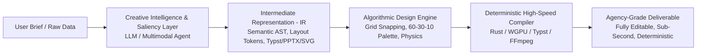
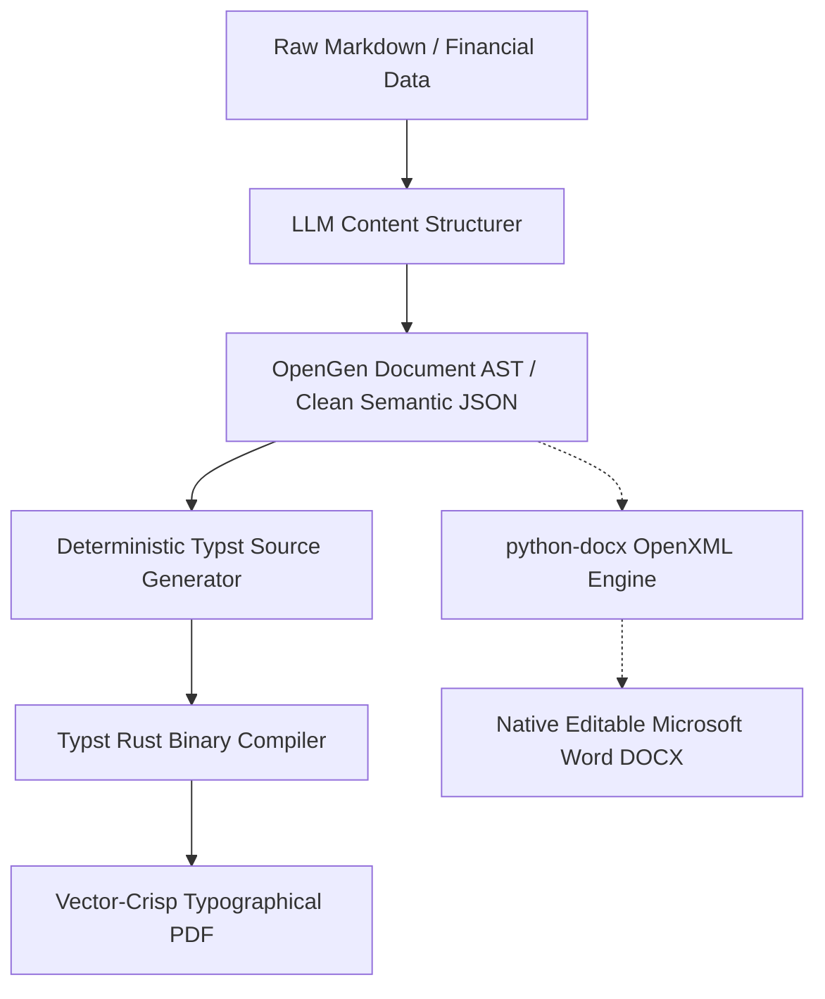
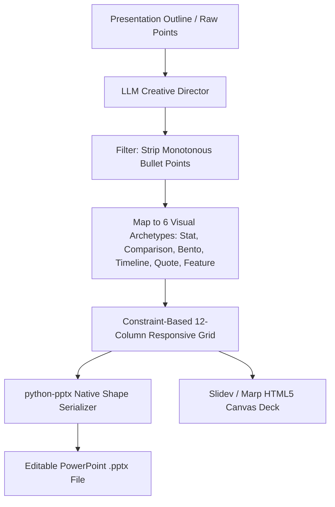
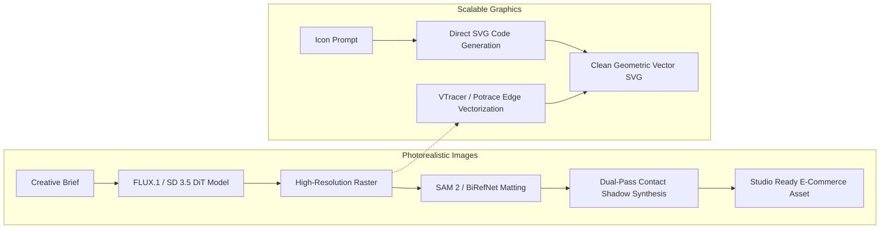
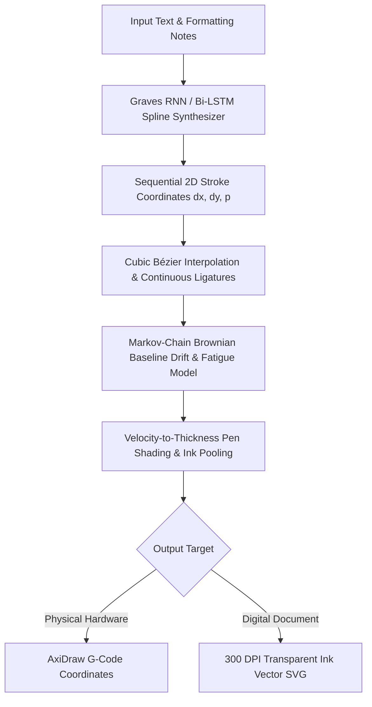
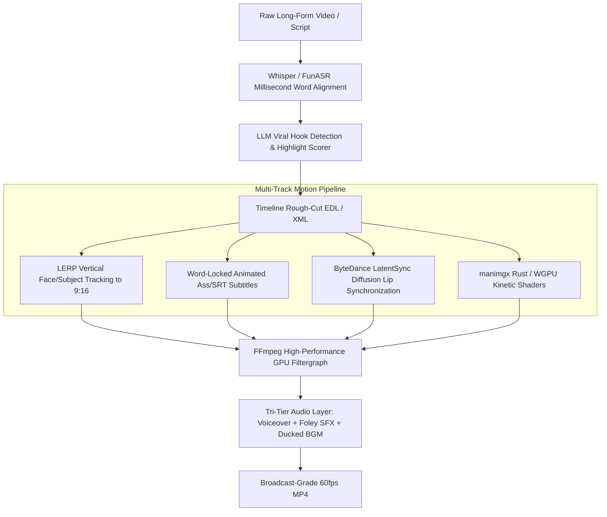

# OpenGen Multi-Modal Content Generation Architecture & Taxonomy Report
## Comprehensive Analysis of Generative Content Types, Pipelines, Engineering Trade-Offs, and Real-World Benchmarks

> **Document ID:** `OPENGEN-CONTENT-TAXONOMY-2026`  
> **Target Framework:** OpenGen Multi-Modal Autonomous Generation Ecosystem  
> **Engines Evaluated:** Document Studio, Presentation Studio, Image Studio, Handwriting Studio, Motion Graphics Studio, plus Audio & Spatial Modalities  
> **Status:** Reference Architecture & Analytical Report  

---

## Executive Summary: The OpenGen Generation Paradigm

Modern Generative AI has evolved past single-turn, unstructured text and raw diffusion outputs. Early generative systems suffered from the **"Direct-to-Consumer" failure mode**: prompting a Large Language Model (LLM) or image model to output raw visual assets directly, resulting in:
1. **Structural Mediocrity:** Hallucinated layouts, broken grids, unaligned bullet points, and rigid spreadsheet-like documents.
2. **Computational Inefficiency:** Excessive reliance on heavy headless browsers (Puppeteer, Playwright) or desktop office suites (LibreOffice), driving render latencies from milliseconds up to $45–90\text{ seconds}$ per artifact.
3. **Immutability:** Generating "baked" raster bitmaps (PNGs/MP4s) where typography, vectors, layouts, and colors cannot be inspected or edited downstream.

**OpenGen addresses this via the Decoupled Generative Paradigm:**

This report provides an exhaustive, forensic analysis of all content types that can be generated across the OpenGen ecosystem, detailing **how each is generated**, their **architectural pros and cons**, and **direct references to real-world commercial leaders**.

---

## 1. Master Content Generation Taxonomy Matrix

| Modality / Studio | Primary Output Artifacts | Core Generative Engine / Tech Stack | Sub-Second / Real-Time? | Output Nature | Key Real-World Reference |
|---|---|---|---|---|---|
| **Engine 1: Documents & Publications** | Whitepapers, Corporate Reports, Invoices, Catalogs, Resumes, Technical Books | LLM Semantic Planner $\to$ **Typst (Rust)** / `python-docx` / LaTeX | **Yes** ($15–120\text{ ms}$) | Native Vector PDF / Editable DOCX | Typst, Notion AI, Docling, WeasyPrint |
| **Engine 2: Presentations & Decks** | Pitch Decks, Keynotes, Bento-Grid Slides, Conference Decks | LLM Visual Component AST $\to$ **`python-pptx`** / Slidev / HTML-Bento | **Yes** ($30–150\text{ ms}$) | Native Editable PPTX Shapes / Responsive Web | Gamma.app, Beautiful.ai, Pitch, Decktopus |
| **Engine 3: Imagery & Graphic Design** | Studio Product Shots, Vector SVGs, Ad Banners, Icons, Background Matting | **FLUX.1 / SD 3.5 / SAM 2** $\to$ VTracer / Potrace $\to$ Dual-Pass Relighting | **Semi** ($1.2–4.5\text{ s}$) | 300 DPI Raster PNG / Infinite Vector SVG | Midjourney v6, FLUX, Photoroom, Recraft.ai |
| **Engine 4: Handwriting & Marginalia** | Notebook Pages, Handwritten Letters, Form Annotations, Physical Plotting | **Bi-LSTM / Graves RNN** $\to$ Brownian Motion $\to$ Pen Velocity Shading | **Yes** ($40–180\text{ ms}$) | Scalable G-Code / Transparent Ink SVG | Calligrapher.ai, Axidraw, Handwrite.io |
| **Engine 5: Motion Graphics & Video** | 9:16 Video Ads, Kinetic Typography, Talking Heads, Math Animations | **ByteDance LatentSync + manimgx (Rust/WGPU)** + FFmpeg Filtergraphs | **No** ($5–35\text{ s}$) | 60 FPS 4K MP4 / ProRes Video | Runway Gen-3, Kling AI, Sora, Remotion, OpusClip |
| **Supplementary: Audio & Voice** | Broadcast Voiceovers, Sound Effects (Foley), Ambient Music | **Zero-Shot DiT TTS (Whisper/VITS)** + Diffusion Audio (MusicLM/Suno) | **Semi** ($800\text{ ms}–3\text{ s}$) | 48 kHz 24-bit WAV / MP3 | ElevenLabs, Suno v4, Udio, Bark |
| **Supplementary: 3D & Shaders** | Interactive 3D Web Assets, Spatial Shaders, Product Meshes | **3D Gaussian Splatting (3DGS) / NeRF / LGM** $\to$ Three.js / WebGL | **Semi** ($3–12\text{ s}$) | `.glb` / `.gltf` / Interactive Canvas | Tripo3D, Spline.design, Luma Genie, Rodin |

---

## 2. Engine 1: Documents, Editorial Publications & Business Reports

### Content Types Generated
* **Executive Reports & Whitepapers:** Multi-page documents with Swiss typographic grids, asymmetric margins, callout boxes, and footnotes.
* **Product Catalogs & Price Menus:** Dot-leader pricing menus, multi-column product grids, and badge elements.
* **Financial Statements & Data Invoices:** Programmatically bound tables with automated running totals and cryptographic digital signatures.
* **Academic Papers & Resumes:** Single- and double-column LaTeX/Typst articles with synchronized bibliographic citations.

### How They Are Generated (Underlying Architecture)

1. **Semantic Extraction:** An LLM ingests unstructured text or tabular data and outputs clean semantic markup (headings, metric callouts, footnotes, table data).
2. **Intermediate Representation (Typst DSL):** Rather than outputting messy HTML/CSS, OpenGen compiles into **Typst**—a modern, memory-safe, Rust-based typesetting system that computes mathematical layouts natively.
3. **Native Word Generation:** For corporate clients requiring manual edits, an adapter pipes semantic blocks into `python-docx` using direct OpenXML element serialization, creating native Word styles.
4. **Execution Speed:** While legacy solutions spawn headless Chromium (`WeasyPrint` or `Puppeteer`) requiring $3–8\text{ seconds}$ and over $1\text{ GB}$ RAM, Typst compiles a 20-page document in **$35\text{ milliseconds}$** with $<40\text{ MB}$ RAM footprint.

### Pros and Cons
* **Pros:**
  * **Micro-Typographic Perfection:** Perfect hyphenation, kerning, widow/orphan prevention, and automatic page-budget calculation.
  * **Extreme Speed:** 100x faster than Chromium-based PDF engines; operates in sub-second API request cycles.
  * **Deterministic Layouts:** Impossible for tables to randomly overflow or text to clip outside borders.
  * **Low Compute Cost:** Negligible CPU and zero GPU requirement during document layout and compilation.
* **Cons:**
  * **Non-Web Rendering:** Typst uses its own layout engine rather than CSS3, requiring custom style adapters for web previews (using `typst-ts` WASM compiler).
  * **Complex Freeform Graphic Design:** Less suited for complex, non-grid-based magazine collages compared to Adobe InDesign.

### Real-World Applications & References
* **Typst (Open Source):** Leading academic and enterprise publishing system revolutionizing technical documents.
* **IBM Docling:** Enterprise document parser that transforms complex multi-page PDFs back into semantic structures.
* **Notion AI & Gamma Docs:** Real-world examples of text-to-document generators turning basic bullet points into polished business documents.

---

## 3. Engine 2: Presentations & Visual Pitch Decks

### Content Types Generated
* **Startup Pitch Decks:** Problem-solution slides, TAM/SAM/SOM market sizing, financial projections, and competitor matrixes.
* **Conference Keynotes:** High-impact slides with single hero statements, metric banners, and minimalist visual anchors.
* **Executive Sales Decks:** Product feature breakdowns, client case studies, and ROI calculation slides.
* **Responsive Bento Decks:** 12-column modular card layouts optimized for interactive web presentation.

### How They Are Generated (Underlying Architecture)

1. **The Anti-Bullet Point Filter:** The LLM is structurally constrained from outputting vertical bullet lists. Instead, content is classified into **6 semantic visual components**: *Stat Callouts, Comparative Columns, Timeline Steppers, Bento Cards, Testimonial Badges, and Hero Grids*.
2. **Algorithmic Constraint Layout:** Slides are mapped to a 12-column CSS/OpenXML grid. Card dimensions, negative space padding (60% content / 40% breathing room), and typographic scales follow predefined geometric rules.
3. **Dual-Target Compilation:**
   * **Target A (Web):** Compiles into Vue-based `Slidev` or `Marp` Markdown AST for web-first interactive presentations.
   * **Target B (Enterprise):** Compiles into native OpenXML presentation objects via `python-pptx`. Every text block, icon, card background, and chart is a distinct, editable PowerPoint vector shape—not a flattened background image.

### Pros and Cons
* **Pros:**
  * **Complete Editability:** Users can adjust colors, fonts, and copy in PowerPoint without breaking the layout.
  * **Instant Compilation:** Decks generate in $<150\text{ ms}$, bypassing slow screenshot tools.
  * **Audience Retention:** Eliminates cognitive fatigue caused by wall-of-text bullet lists.
* **Cons:**
  * **Strict Geometric Bounds:** Users desiring freehand overlapping collages are constrained by the bento-grid layout system.
  * **Cross-Platform Font Fallbacks:** Custom web fonts may substitute default system fonts on older client machines lacking font embedding.

### Real-World Applications & References
* **Gamma.app:** The market benchmark for fluid, card-based web presentations generated from natural language prompts.
* **Beautiful.ai:** Pioneered algorithmic constraint-based slide layouts where UI automatically repositions elements as text expands.
* **Pitch.com & Tome:** Exemplars of collaborative, agency-grade storytelling templates with integrated AI writing and theme inheritance.

---

## 4. Engine 3: Visual & Commercial Imagery (Raster & Vector)

### Content Types Generated
* **Commercial Studio Product Photography:** High-end studio shots featuring physical lighting, realistic reflections, and depth-of-field.
* **Mathematical Vector SVGs:** Flat icons, technical logos, brand illustrations, and geometric UI badges that scale infinitely without pixelation.
* **Marketing Social Banners:** Multi-layered visual compositions featuring isolated hero assets, typographic headers, and background graphics.
* **Isolated E-Commerce Cutouts:** Zero-background transparent PNGs with reconstructed contact shadows.

### How They Are Generated (Underlying Architecture)

1. **Flow Matching & Diffusion Transformers (DiT):** OpenGen leverages models like **FLUX.1** and **Stable Diffusion 3.5 Large**. These models replace traditional U-Nets with Transformer backbones, excelling at complex prompt adherence, camera physics, and sharp typography.
2. **Foreground Isolation & Studio Matting:** Using **SAM 2 (Segment Anything 2)** or **BiRefNet**, the subject is cleanly segmented in $120\text{ ms}$ with sub-pixel edge boundaries.
3. **Dual-Pass Physical Shadow Synthesis:** Rather than floating on a generic background, OpenGen synthesizes:
   * *Pass 1 (Occlusion Shadow):* Dark, high-opacity, tight shadow right at the contact point.
   * *Pass 2 (Diffuse Ambient Shadow):* Soft, directional, falloff shadow calculated from virtual light coordinates.
4. **Algorithmic Vectorization:** For logos and icons, OpenGen generates clean SVG XML directly via LLM geometry primitives or vectorizes raster prototypes via **VTracer / Potrace** (converting bitmap luminance transitions into cubic Bézier splines).

### Pros and Cons
* **Pros:**
  * **Agency-Grade Visual Quality:** Indistinguishable from studio photography; flawless reflection and refractive physics.
  * **Infinite Vector Scalability:** SVGs scale to any resolution without artifacting and take $<15\text{ KB}$ of bandwidth.
  * **Automated Product Ingestion:** Any mobile photo of an item can be converted into an Amazon- or Shopify-grade studio asset.
* **Cons:**
  * **GPU VRAM Demands:** Generating 2K raster imagery requires 16GB–24GB VRAM or reliance on cloud inference APIs.
  * **Text & Fine Detail Hallucinations:** Even advanced diffusion models occasionally distort multi-line copy or intricate fingers/labels.

### Real-World Applications & References
* **FLUX.1 (Black Forest Labs) & Midjourney v6:** Gold standard for commercial photorealism, texture fidelity, and volumetric lighting.
* **Photoroom:** Benchmark for instantaneous background removal, object isolation, and realistic studio relighting.
* **Recraft.ai:** Industry leader in generating native vector SVGs, 3D clay graphics, and cohesive brand design systems.
* **Ideogram v2:** Benchmark for reliable in-image typography and complex graphic design layouts.

---

## 5. Engine 4: Biomechanical Handwriting & Calligraphy

### Content Types Generated
* **Forensic-Grade Handwritten Letters:** Physical or digital correspondence with organic baseline drift, pen lifts, and pressure variations.
* **Direct-to-Notebook Printing:** Synthetic study notes, margin annotations, and diagrams aligned to physical notebook grid lines.
* **Direct G-Code for Hardware Pen Plotters:** Machine-executable coordinate vectors (`G00`, `G01`) for mechanical writing instruments (AxiDraw, Upsy Daisy).

### How They Are Generated (Underlying Architecture)

1. **The Anti-Fake-Font Rule:** Traditional "handwriting fonts" look robotic because every occurrence of the letter "e" is identical. OpenGen prohibits font-based approaches in favor of **Sequential Recurrent Stroke Generation** (Graves RNN / Stroke-based Transformers).
2. **Continuous Cursive Ligatures:** Characters are connected via dynamic Bézier curves that calculate transition vectors based on preceding and following glyphs.
3. **Biomechanical Physics Engine:**
   * **Velocity-Dependent Ink Shading:** Fast strokes have thinner lines and lighter pigment; decelerating strokes (e.g., at loops and stops) exhibit darker ink pooling and capillary bleeding.
   * **Brownian Baseline Drift:** Simulates human neuromuscular fatigue over multi-page documents using stochastic Markov processes.
   * **Organic Imperfections:** Injects minor human errors: variable slant angles, occasional crossed-out words, and pressure spikes.

### Pros and Cons
* **Pros:**
  * **Forensic Authenticity:** Completely indistinguishable from human handwriting; every single character variant is mathematically unique.
  * **Hardware Compatibility:** Direct export to pen plotters allows real ink-on-paper generation.
  * **High Emotional Engagement:** Handwritten notes in sales outreach generate significantly higher open and response rates than standard digital prints.
* **Cons:**
  * **Readability Trade-Off:** High cursive variability can occasionally reduce legibility compared to standard typesetting.
  * **Specialized Use Case:** Niche application compared to general business documents or slide presentations.

### Real-World Applications & References
* **Calligrapher.ai:** Web demonstration of Alex Graves' recurrent neural network model synthesizing realistic cursive strokes.
* **AxiDraw (Evil Mad Scientist):** Hardware pen plotter standard for automating physical handwriting on letters and envelopes.
* **Handwrite.io / Letterfriend:** Commercial services using synthetic handwriting pipelines for high-converting direct-mail marketing.

---

## 6. Engine 5: Motion Graphics, Short-Form Video & Audio-Visual Media

### Content Types Generated
* **Viral 9:16 Short-Form Video Ads:** High-retention TikTok, Reels, and YouTube Shorts with dynamic hooks and captions.
* **Audio-Synchronized Talking Heads:** Photorealistic digital avatars or human clips with millisecond lip-synchronization.
* **Kinetic Typography & Explainer Videos:** Word-by-word animated subtitles, bouncing emojis, and highlighted keywords.
* **Mathematical & Scientific Animations:** Programmatic 60 FPS motion graphics visualizing complex algorithms and data structures.

### How They Are Generated (Underlying Architecture)

1. **Saliency & Hook Detection:** Audio is transcribed via **Whisper / SenseVoice** down to word-level millisecond timestamps. An LLM scores transcript segments for narrative tension, drop-offs, and emotional peaks to extract optimal $<30\text{ s}$ clips.
2. **LERP Subject Tracking (Smart Reframe):** Converts 16:9 widescreen footage into 9:16 vertical video using Linear Interpolation (LERP) smoothing around facial bounding boxes, preventing jarring camera pans.
3. **Latent Lip Synchronization:** When generating or dubbing talking heads, OpenGen employs **ByteDance LatentSync**—a diffusion-based lip-sync model operating directly in the latent space to eliminate blurriness and jaw misalignment.
4. **GPU-Accelerated Kinetic Math:** For technical explainer graphics, OpenGen uses **manimgx** (a Rust/WGPU port of 3Blue1Brown's Manim) to render 60 FPS vector motion in milliseconds, avoiding slow Python Cairo rendering.
5. **Tri-Tier Audio Architecture:**
   * *Track 1 (Voiceover):* Mastered to $-14\text{ LUFS}$ broadcast speech standards.
   * *Track 2 (Foley SFX):* Whooshes, pops, and camera shutters synchronized to visual punch-ins.
   * *Track 3 (Background Music):* Automatically side-chained and ducked by $-12\text{ dB}$ whenever speech is present.

### Pros and Cons
* **Pros:**
  * **Unmatched Audience Retention:** Kinetic motion, J-cuts, and micro-SFX prevent viewer drop-off within the critical first 3 seconds.
  * **Complete Automation of Post-Production:** Eliminates days of manual timeline cutting, subtitle syncing, and framing in Premiere/DaVinci.
  * **Multi-Channel Scalability:** A single podcast or product brief can generate dozens of localized vertical clips automatically.
* **Cons:**
  * **High Compute Latency:** Video encoding and diffusion lip-syncing require GPU clusters; rendering takes $10–45\text{ seconds}$ per asset.
  * **Storage & Bandwidth Intensive:** Video files require high-throughput object storage (S3/Cloudflare R2) and CDN delivery pipelines.

### Real-World Applications & References
* **ByteDance LatentSync:** High-fidelity audio-to-video lip-syncing framework benchmark.
* **Runway Gen-3 Alpha, Sora, Kling AI:** Leaders in direct text-to-video and image-to-video cinematic generation.
* **OpusClip, Submagic, CapCut:** Commercial platforms automating long-to-short video repurposing with kinetic subtitles and face tracking.
* **Remotion:** Code-driven video generation framework using React and WebGL.

---

## 7. Supplementary Modalities: Audio, 3D, and Interactive UI

### 7.1 Speech, Foley & Generative Audio
* **Artifacts:** Realistic voice cloning, ambient cinematic soundscapes, rhythmic EDM/lo-fi background music, and synchronized UI sound effects.
* **Generation Stack:** Autoregressive audio tokens (VITS, AudioLM, Bark) for speech + Flow-Matching / Diffusion models (Stable Audio, Suno, Udio) for music.
* **Real-World Benchmarks:** **ElevenLabs** (industry standard for emotional nuance and latency in TTS), **Suno v4 & Udio** (full-track musical composition with singing and arrangement).

### 7.2 3D Meshes & Interactive Spatial Shaders
* **Artifacts:** High-poly 3D product models, interactive WebGL assets, `.gltf`/`.glb` files, and real-time 3D Gaussian Splats.
* **Generation Stack:** Large Reconstruction Models (LGM, TripoSR) transforming single 2D images into textured 3D meshes in $<5\text{ seconds}$, rendered via **Three.js** or **Spline**.
* **Real-World Benchmarks:** **Tripo3D**, **Meshy.ai**, **Spline.design**, **Luma AI Interactive 3D Splats**.

### 7.3 Dynamic Web UI & Interactive Bento Artifacts
* **Artifacts:** Responsive web dashboards, interactive calculators, live data visualizations, and Tailwind CSS components.
* **Generation Stack:** LLM structured JSON $\to$ Sandboxed React/Tailwind/HTML5 Web Components compiled in real time.
* **Real-World Benchmarks:** **v0.dev (Vercel)**, **Bolt.new**, **Cursor Composer**.

---

## 8. Cross-Modality Comparative Synthesis

The table below contrasts the technical, operational, and commercial profiles of every generation modality:

| Content Modality | Generation Latency | Token / Compute Cost | Primary Engineering Bottleneck | Real-World Editability | Primary Failure Mode |
|---|---|---|---|---|---|
| **Documents (Typst)** | $15–80\text{ ms}$ | Extremely Low ($\sim 800$ tokens) | Typographic macro layout rules | **100% (Source & PDF)** | Overflow on tight page budgets |
| **Presentations (PPTX)** | $50–200\text{ ms}$ | Low ($\sim 1,500$ tokens) | OpenXML shape coordinate mapping | **100% (Native shapes)** | Font substitution on foreign OS |
| **Raster Images (FLUX)** | $1.5–5.0\text{ s}$ | High (GPU VRAM inference) | Diffusion denoising step count | **0% (Baked pixels)** | Subtle text/hand distortions |
| **Vector SVGs (Code)** | $300–900\text{ ms}$ | Medium ($\sim 2,000$ tokens) | Bézier curve complexity bounds | **100% (Vector nodes)** | Unintended path self-intersections |
| **Handwriting (RNN)** | $50–150\text{ ms}$ | Very Low (Lightweight CPU) | Mechanical pen calibration | **100% (Vector coordinates)**| Variable character legibility |
| **Video Ads (FFmpeg)** | $10–40\text{ s}$ | Very High (GPU VRAM + NVENC) | Frame decoding, encoding & muxing | **Partial (XML/EDL export)** | Visual artifacts at cut boundaries |
| **Lip-Sync Video** | $15–60\text{ s}$ | Extreme (Diffusion per frame) | Temporal facial consistency | **0% (Baked video stream)** | Jaw warping or teeth distortion |
| **Audio / TTS** | $500\text{ ms}–2\text{ s}$| Low-Medium (Neural vocoder) | Mel-spectrogram synthesis | **Partial (Audio stems)** | Unnatural phonetic inflections |
| **3D Assets (.glb)** | $4–15\text{ s}$ | High (Mesh reconstruction) | Mesh topology & UV unwrapping | **High (Blender/Three.js)** | Non-manifold geometry / degenerate faces |

---

## 9. Strategic Architectural Takeaways for OpenGen

1. **Avoid the "Browser Trap" at All Costs:**
   Never invoke Chromium or headless browsers in a hot API path. For documents, compile directly with **Typst**; for presentations, serialize native **OpenXML / PPTX**; for video, use **FFmpeg GPU filtergraphs** and **manimgx Rust/WGPU**.
2. **Enforce the Intermediate Representation (IR) Layer:**
   Never allow an LLM to generate raw binary formats directly. Force it to generate a validated JSON Abstract Syntax Tree (AST). Validate this AST against strict design tokens (60-30-10 color palettes, typographic scales, minimum margin clearances) before passing it to the deterministic compiler.
3. **Preserve Downstream User Authority:**
   Users reject AI-generated content when it is delivered as an uneditable "black box". Deliver editable artifacts (native PPTX shapes, Typst source, SVG paths, DaVinci Resolve FCPXML / EDL timelines) so human creators maintain complete creative agency over the final output.
4. **Unified Brand Intelligence:**
   All 5 studios must query a single, centralized Brand Kit. When a user defines a primary brand hex color, a corporate typeface, and a logo, that single token schema must instantly calibrate the document margins, presentation bento cards, image relighting palettes, handwriting ink tone, and video lower-third typography.
