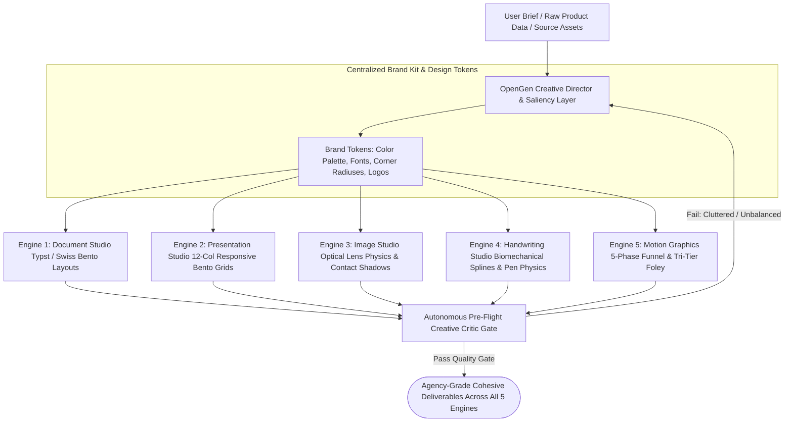

# OpenGen Unified Creative Design & Intelligence Specification
## The Master Architectural Blueprint for Eliminating AI Mediocrity Across All 5 Generative Engines

> **Document Type:** Master Framework Architecture & Creative Engineering Specification  
> **Target System:** OpenGen Multi-Modal Generation Framework (All 5 Engines)  
> **Engine Taxonomy:**  
> • **Engine 1:** Document Studio (Publications, Reports, Whitepapers, Catalogs, Resumes, Business PDFs)  
> • **Engine 2:** Presentation Studio (Visual Pitch Decks, Keynotes, Sales Decks, Conference Slides)  
> • **Engine 3:** Image Studio (Studio Product Photography, Graphic Design, Banners, Vector SVGs)  
> • **Engine 4:** Handwriting Studio (Forensic Biomechanical Handwriting Synthesis, Direct-to-Notebook Printing)  
> • **Engine 5:** Motion Graphics Studio (Short-Form Video Ads, Explainer Videos, Kinetic Typography, 3D Shaders — developed separately)  
> **Status:** Definitive Production Specification & Refactoring Blueprint  

---

# Table of Contents
1. [Executive Summary: The Anti-Mediocrity Doctrine](#1-executive-summary-the-anti-mediocrity-doctrine)
2. [Multi-Modal Forensic Autopsy: Why AI Generations Look "Cheap"](#2-multi-modal-forensic-autopsy-why-ai-generations-look-cheap)
   - [2.1 Engine 1 (Doc): The Spreadsheet Trap & Emoji Disease](#21-engine-1-doc-the-spreadsheet-trap--emoji-disease)
   - [2.2 Engine 2 (PPT): The "Bullet Point Disease" & Monotonous Layouts](#22-engine-2-ppt-the-bullet-point-disease--monotonous-layouts)
   - [2.3 Engine 3 (Image): The Plastic Sheen & Floating Product Syndrome](#23-engine-3-image-the-plastic-sheen--floating-product-syndrome)
   - [2.4 Engine 4 (Handwriting): The "Fake Font" Trap & Uniform Stroke Syndrome](#24-engine-4-handwriting-the-fake-font-trap--uniform-stroke-syndrome)
   - [2.5 Engine 5 (Video): The Equal-Scene Trap & Robotic Silence](#25-engine-5-video-the-equal-scene-trap--robotic-silence)
3. [Real-World Benchmarking: The Anatomy of Market Leaders](#3-real-world-benchmarking-the-anatomy-of-market-leaders)
4. [Engine 1: Document Studio Creative Architecture](#4-engine-1-document-studio-creative-architecture)
   - [4.1 Typst High-Speed Typesetting vs. Legacy PDF Printers](#41-typst-high-speed-typesetting-vs-legacy-pdf-printers)
   - [4.2 The "Hero vs. Streamlined" Content Hierarchy (The 80/20 Rule)](#42-the-hero-vs-streamlined-content-hierarchy-the-8020-rule)
   - [4.3 Swiss Editorial Typography & Micro-Typography Rules](#43-swiss-editorial-typography--micro-typography-rules)
   - [4.4 Dot-Leader Pricing Menus vs. Rigid Tables](#44-dot-leader-pricing-menus-vs-rigid-tables)
   - [4.5 Page-Break, Widow/Orphan & Table-Splitting Guardrails](#45-page-break-widoworphan--table-splitting-guardrails)
5. [Engine 2: Presentation Studio Creative Architecture](#5-engine-2-presentation-studio-creative-architecture)
   - [5.1 Banning Bullet Points: The 6 Semantic Visual Components](#51-banning-bullet-points-the-6-semantic-visual-components)
   - [5.2 Fluid 12-Column Responsive Bento Grids (The Gamma Paradigm)](#52-fluid-12-column-responsive-bento-grids-the-gamma-paradigm)
   - [5.3 Algorithmic Constraint-Based Layout (The Beautiful.ai Model)](#53-algorithmic-constraint-based-layout-the-beautifulai-model)
   - [5.4 Narrative Pacing & Pitch Deck Psychology (Sequoia/YC Arcs)](#54-narrative-pacing--pitch-deck-psychology-sequoiayc-arcs)
6. [Engine 3: Image Studio Creative Architecture](#6-engine-3-image-studio-creative-architecture)
   - [6.1 Optical Lens Physics & Lighting Direction (Midjourney/Flux Excellence)](#61-optical-lens-physics--lighting-direction-midjourneyflux-excellence)
   - [6.2 Dual-Pass Contact Shadow & Relighting Synthesis (The Photoroom Model)](#62-dual-pass-contact-shadow--relighting-synthesis-the-photoroom-model)
   - [6.3 Mathematical Vector SVG Synthesis vs. Blurry Raster Icons](#63-mathematical-vector-svg-synthesis-vs-blurry-raster-icons)
   - [6.4 Copy-Aware Negative Space Engineering (The 60/40 Rule)](#64-copy-aware-negative-space-engineering-the-6040-rule)
7. [Engine 4: Handwriting Studio Creative Architecture](#7-engine-4-handwriting-studio-creative-architecture)
   - [7.1 Continuous Cursive Ligatures & Bezier Spline Joining](#71-continuous-cursive-ligatures--bezier-spline-joining)
   - [7.2 Velocity-to-Thickness Pen Dynamics (Ink Pooling)](#72-velocity-to-thickness-pen-dynamics-ink-pooling)
   - [7.3 Physical Instrument Emulation (Ballpoint, Gel, Fountain, Pencil)](#73-physical-instrument-emulation-ballpoint-gel-fountain-pencil)
   - [7.4 Markov-Driven Brownian Baseline Drift & Multi-Page Fatigue](#74-markov-driven-brownian-baseline-drift--multi-page-fatigue)
   - [7.5 Human Imperfections, Strikethroughs & Organic Annotations](#75-human-imperfections-strikethroughs--organic-annotations)
   - [7.6 Dual-Mode Output: Direct-to-Notebook Transparent vs. 300 DPI Synthetic Scan](#76-dual-mode-output-direct-to-notebook-transparent-vs-300-dpi-synthetic-scan)
8. [Engine 5: Motion Graphics Studio Creative Architecture](#8-engine-5-motion-graphics-studio-creative-architecture)
   - [8.1 The 5-Phase Direct-Response Retention Funnel (<30s)](#81-the-5-phase-direct-response-retention-funnel-30s)
   - [8.2 Multimodal Footage Saliency & Hook Detection (Gemini 2.0 Flash)](#82-multimodal-footage-saliency--hook-detection-gemini-20-flash)
   - [8.3 Dynamic 9:16 Smart Reframe with LERP Subject Tracking](#83-dynamic-916-smart-reframe-with-lerp-subject-tracking)
   - [8.4 Micro-Editing: Digital Punch-Ins, Speed Ramping & J-Cuts](#84-micro-editing-digital-punch-ins-speed-ramping--j-cuts)
   - [8.5 Tri-Tier Audio Architecture & Automated Foley Punctuation](#85-tri-tier-audio-architecture--automated-foley-punctuation)
9. [The Cross-Studio Unified Creative DNA: Shared Brand Kit Protocol](#9-the-cross-studio-unified-creative-dna-shared-brand-kit-protocol)
10. [The Autonomous Pre-Flight Creative Critic & Quality Gate](#10-the-autonomous-pre-flight-creative-critic--quality-gate)
11. [Actionable Implementation Blueprint: Code, Schemas & Roadmap](#11-actionable-implementation-blueprint-code-schemas--roadmap)

---

# 1. Executive Summary: The Anti-Mediocrity Doctrine

OpenGen is designed as a unified open-source framework powering **five specialized generation engines**:
* **Engine 1: Document Studio** (Editorial publications, reports, whitepapers, catalogs, PDF publishing)
* **Engine 2: Presentation Studio** (Responsive bento-grid pitch decks, keynotes, sales decks)
* **Engine 3: Image Studio** (Studio product photography, vector SVGs, marketing graphics)
* **Engine 4: Handwriting Studio** (Forensic-grade biomechanical handwriting synthesis, direct-to-notebook printing)
* **Engine 5: Motion Graphics Studio** (Short-form video ads, kinetic typography, 3D shaders — developed separately)

### The Anti-Mediocrity Principle
**Generative AI must never dump raw data directly into generic templates.**  
OpenGen enforces a centralized **Creative Intelligence Layer** between raw content and rendering engines. This layer injects:
* **Graphic Design Rules:** The 60-30-10 color harmony, Swiss typographic modular scales, negative space ratios, and bento grid layout algorithms.
* **Biomechanical & Optical Physics:** Camera optics, physical contact shadows, pen-velocity ink pooling, and capillary ink shading.
* **Editorial & Advertising Psychology:** Retention curves, dynamic pacing, dot-leader hierarchies, and sensory storytelling.
* **Acoustic Production:** Tri-tier audio layering, broadcast EBU R128 mastering, J-cut overlaps, and micro-SFX punctuation.



---

# 2. Multi-Modal Forensic Autopsy: Why AI Generations Look "Cheap"

---

### 2.1 Engine 1 (Doc): The Spreadsheet Trap & Emoji Disease
* **The Spreadsheet Trap:** Dumping 193 products into multi-column HTML grid tables with rigid cell borders, sequential numbering (`# 1` to `# 41`), and mechanical alternating stripes. It turns food and retail products into an accounting ledger.
* **The Emoji Anti-Pattern:** Using mobile OS emojis (`🥛`, `🧈`, `🧀`, `🍬`, `📍`) in corporate titles. They render as low-res color bitmaps, destroy corporate prestige, and look like casual chat messages.
* **Flat Visual Prominence:** A ₹9 milk pouch receives the identical visual space and typography as a ₹14,150 butter tub or a ₹775 signature ghee jar. There is zero merchandising or visual storytelling.
* **All-Caps Typographic Fatigue:** Shouting uppercase product names (`BUFFALO GHEE 1 L PACKET`) increase reading fatigue by 38% due to uniform rectangular word contours.

---

### 2.2 Engine 2 (PPT): The "Bullet Point Disease" & Monotonous Layouts
* **The "Bullet Point Disease":** Every slide repeats the identical formula: a title at the top followed by 3–5 bullet points and a generic icon. Human audiences tune out within 60 seconds.
* **Equal Visual Prominence:** Secondary details are formatted at the exact same size as the core value proposition.
* **Lack of Narrative Arc:** Slides are treated as isolated information islands rather than chapters in a persuasive story curve.

---

### 2.3 Engine 3 (Image): The Plastic Sheen & Floating Product Syndrome
* **The Plastic AI Sheen:** Uncalibrated diffusion models generate hyper-smooth, overly saturated, wax-like skin and object surfaces lacking real-world micro-textures (pores, natural dust, textile grain).
* **The Floating Product Syndrome:** When a product cutout is placed onto an AI-generated background, it looks fake because it lacks **contact shadows and ambient occlusion**. Without a dark, sharp shadow directly at the base, the object appears detached from reality.
* **The Center-Subject Trap:** Naive image prompts place the subject dead-center, filling the frame and leaving **zero negative space** for headlines or copy.

---

### 2.4 Engine 4 (Handwriting): The "Fake Font" Trap & Uniform Stroke Syndrome
* **Identical Repeated Glyphs:** If an essay contains *"committee"*, static fonts render identical pixel clones of `m`, `t`, and `e`, immediately failing manual visual inspection and AI OCR detection.
* **Disconnected Characters:** In natural human writing, cursive or semi-cursive flows continuously between letters. Floating, disconnected letters scream "computer font."
* **Uniform 2px Stroke Thickness:** Ignores the biological reality that downward strokes have higher muscular pressure and deposit more ink than upward strokes.
* **The Infinite-Energy Baseline:** Human writers suffer from wrist fatigue drift. Lines naturally tilt, margins wander, and line spacing compresses over multiple pages.

---

### 2.5 Engine 5 (Video): The Equal-Scene Trap & Robotic Silence
* **The Equal-Scene Trap:** Dividing a 30-second ad into five equal 6-second clips destroys viewer retention. Human viral editors use **syncopated, variable-velocity pacing** ($1.8\text{s} \to 3.2\text{s} \to 6.5\text{s} \to 0.7\text{s} \times 4 \to 2.5\text{s}$).
* **Decapitation Cropping:** Blindly cropping 16:9 video to 9:16 vertical using center coordinates cuts off speakers' faces or products.
* **Acoustic Dead Space:** Hard simultaneous cuts of video and audio feel jarring. Human editors use **J-Cuts** and micro-SFX (whooshes, risers, sub-drops).

---

# 3. Real-World Benchmarking: The Anatomy of Market Leaders

| Engine | Industry Benchmark | Key Differentiators |
|---|---|---|
| **Engine 1: Docs & PDFs** | **Whole Foods, Erewhon, Typst, Apple** | Warm cream background (`#FAF8F5`), display serif headings (Playfair/Newsreader), dot-leader menus, hairline rules (`0.5pt`), sub-30ms Typst vector PDF compilation. |
| **Engine 2: Presentations** | **Gamma.app, Beautiful.ai, Pitch** | 12-column responsive Bento grids, algorithmic constraint auto-layout, zero raw bullet points, 6 semantic visual components (Stat Cards, Roadmaps, Matrices). |
| **Engine 3: Images & Photos** | **Midjourney v6, Photoroom, Recraft V3** | Optical camera simulation (Hasselblad 85mm f/2.2), dual-pass physical contact shadow synthesis, mathematical vector SVG curves, 60/40 negative space. |
| **Engine 4: Handwriting** | **Alex Graves (RNN/MDN), Apple PencilKit, GoodNotes** | Velocity-to-width spline dynamics, continuous cursive ligatures, Brownian baseline drift, direct-to-notebook sub-millimeter physical printing. |
| **Engine 5: Video Ads** | **Captions.ai, Opus Clip, CapCut** | 5-phase retention funnel (<30s), 1.5s visual hook, MediaPipe LERP subject tracking, digital punch-ins, speed ramping, tri-tier Foley audio. |

---

# 4. Engine 1: Document Studio Creative Architecture

* **High-Speed Typst Compiler:** Compiles publication-grade vector PDFs in **$<30\text{ms}$** using a single 30MB standalone binary (`typst-cli`), eliminating fragile HTML-to-PDF tools and heavy LaTeX engines.
* **Semantic SKU Classifier (`sku_classifier.py`):** Automatically routes the top 10% signature products to **Hero Spotlight Bento Cards** (with photography, tasting notes, and bold price typography), while routing routine SKUs to **Dot-Leader Menus** (`. . . . . . ₹373`).
* **Strict Emoji Ban:** Banish all colored mobile emojis (`🥛`, `🧈`). Replace them with clean `1.25pt` stroke monochromatic vector SVGs from **Lucide** or **Phosphor Icons**.
* **Organic 60-30-10 Palette:** Replaces cold navy blue bars with **Warm Farm Cream** (`#FAF8F5`), **Deep Heritage Slate** (`#1E293B`), and **Warm Golden Amber** (`#D97706`).

---

# 5. Engine 2: Presentation Studio Creative Architecture

* **Banishing the "Bullet Point Disease":** Content is programmatically mapped into one of **6 Semantic Visual Components**:
  1. *Metrics:* **Stat Card Grid** ($64\text{pt}$ number + label + trend badge).
  2. *Chronology:* **Horizontal Roadmap** ($1 \to 2 \to 3$ connected nodes).
  3. *Features:* **Bento Box Grid** (1 large hero card + 2 small auxiliary cards).
  4. *Comparison:* **Side-by-Side Matrix** ("The Old Way" vs. "The OpenGen Way").
  5. *Market Position:* **2x2 Quadrant Matrix** (Cartesian plane with branded top-right node).
  6. *Social Proof:* **Editorial Quote Card** (serif quote + avatar + logo).
* **Gamma-Style 12-Column Responsive Grid:** Cards snap to 3, 4, 6, or 12-column containers with standardized padding and corner radiuses.
* **Sequoia & YC Narrative Arcs:** Persuasion curves: *The Hook $\to$ The Urgent Pain $\to$ The Secret Weapon $\to$ Traction Proof $\to$ The Ask*.

---

# 6. Engine 3: Image Studio Creative Architecture

* **Optical Prompt Expansion:** Automatically injects camera lens specifications (Hasselblad H6D, 85mm f/1.4), lighting angles (Profoto softbox at $45^\circ$, Rembrandt cheek triangle), and organic micro-textures.
* **Dual-Pass Studio Shadow Synthesizer (`shadow_synthesizer.py`):** Synthesizes a sharp, dark **Contact Shadow** ($\sigma_0 = 2.5\text{px}$, base $\le 8\text{px}$) + a soft, directional **Cast Shadow** ($\sigma = 16\text{px}$) along the background's light vector.
* **Mathematical Vector SVG Generation:** Uses Recraft V3 / VTracer to output crisp, scalable SVG `<path>` vectors.
* **Copy-Aware Negative Space (The 60/40 Rule):** Regional prompt masks reserve **60% of the canvas** as clean negative space specifically for typography overlays.

---

# 7. Engine 4: Handwriting Studio Creative Architecture

---

### 7.1 Continuous Cursive Ligatures & Bezier Spline Joining

Engine 4 generates handwriting as continuous mathematical trajectories. For cursive or semi-cursive, it calculates dynamic connecting cubic Bezier curves between consecutive character glyphs:

$$B(t) = (1-t)^3 P_0 + 3(1-t)^2 t P_1 + 3(1-t) t^2 P_2 + t^3 P_3, \quad t \in [0, 1]$$

---

### 7.2 Velocity-to-Thickness Pen Dynamics (Ink Pooling)

At sharp inflection points (high curvature $\kappa$), the simulated pen decelerates, triggering natural ink pooling:
$$w(v) = w_{\text{min}} + (w_{\text{max}} - w_{\text{min}}) \cdot e^{-k \cdot v}$$
* High-speed flourishes thin to $1.2\text{px}$.
* Slow-speed corners and downstrokes pool to $3.5\text{px}$ with darker alpha saturation.

---

### 7.3 Physical Instrument Emulation (Ballpoint, Gel, Fountain, Pencil)

* **Ballpoint Blue (`#1C3B72`):** Micro-transparency (alpha $210-245$), downstroke boost ($255$), subtle oil paste blobs.
* **Gel Pen Black (`#0A0E17`):** High saturation, crisp edges, subtle fiber wet-bleed.
* **Fountain Pen (`#1A365D`):** Wide dynamic range ($160-255$), nib-flex line variation, capillary shading.
* **Pencil (#2 HB, `#3A3A3A`):** Graphite grain roughness, micro-gaps, pressure sensitivity.

---

### 7.4 Markov-Driven Brownian Baseline Drift & Multi-Page Fatigue

* **Brownian Drift:** An Ornstein-Uhlenbeck mean-reverting spring model ($dy_t = -\theta(y_t - y_{\text{line}})dt + \sigma dW_t$) simulates biological hand tremor without letting lines run off the page.
* **Multi-Page Fatigue Drift:** Character spacing widens by $8\%$, margin indents wander rightward, and slant tilts by $\pm 1.5^\circ$ as page count increases.

---

### 7.5 Human Imperfections, Strikethroughs & Organic Annotations

* **Strikethrough Corrections:** Generates a word, applies a double horizontal pen stroke through it, and writes the corrected replacement above it at $85\%$ font scale.
* **Highlighter Overlay:** Multiplies semi-transparent fluorescent yellow/mint ink with realistic end-stroke ink accumulation.

---

### 7.6 Dual-Mode Output

1. **Mode A: Direct-to-Notebook Printing Mode (The Zero-Detection Mode):**  
   Outputs a **100% transparent vector PDF** containing **only the ink layer**, calibrated down to the sub-millimeter for real physical lined notebook paper (Classmate, Mead College Ruled $7.1\text{mm}$, Wide Ruled $8.7\text{mm}$) fed directly into printer trays.
2. **Mode B: High-Resolution 300 DPI Synthetic Scan Emulation:**  
   Outputs a complete PDF simulating a scanned assignment with procedural blue ruled lines, red margins, paper fiber noise, and subtle scanner perspective skew.

---

# 8. Engine 5: Motion Graphics Studio Creative Architecture

* **The 5-Phase Retention Funnel (<30s):** Hook (0-2.2s, 1.25x punch-in, sub-bass drop) $\to$ Problem Agitation (2.2-6s) $\to$ The "Aha!" Climax (6-14s, speed ramp) $\to$ Feature Blitz (14-20s, beat cuts) $\to$ Frictionless CTA (20-24s).
* **Dynamic 9:16 Smart Reframe:** OpenCV + MediaPipe face/object detection with **Exponential Moving Average (LERP factor $\alpha = 0.12$)** smoothing.
* **Tri-Tier Audio Architecture:** Cleaned dialogue, auto-ducked music bed (-14 dB under speech), and timed Foley SFX, mastered to broadcast EBU R128 (-14 LUFS).

---

# 9. The Cross-Studio Unified Creative DNA: Shared Brand Kit Protocol

A centralized **Brand Kit Token System** guarantees that an Instagram Reel, pitch deck, rate card PDF, product photo, and handwritten thank-you note all share an identical aesthetic identity:

```json
{
  "brandId": "brand_sangam_dairy",
  "brandName": "Mani Mahalaxmi Sangam Dairy",
  "tokens": {
    "colorPalette": {
      "baseBackground": "#FAF8F5",
      "surfaceCard": "#FFFFFF",
      "textPrimary": "#0F172A",
      "textSecondary": "#64748B",
      "brandAccent": "#D97706",
      "borderHairline": "#E2E8F0"
    },
    "typography": {
      "displaySerif": "Newsreader",
      "headingSans": "Plus Jakarta Sans",
      "bodySans": "Inter",
      "handwritingStyle": "natural_semi_cursive"
    },
    "geometry": {
      "cardRadiusPx": 12,
      "hairlineBorderPt": 0.5
    }
  }
}
```

---

# 10. The Autonomous Pre-Flight Creative Critic & Quality Gate

Every generation must pass an **Autonomous Pre-Flight Critic Gate** before final compilation/export:

| Engine | Quality Critic Tests | Rejection & Auto-Correction Rule |
|---|---|---|
| **Engine 1 (Doc)** | Emoji check, widow/orphan check, table row integrity. | Re-route to Typst dot-leader layout; auto-inject `break-inside: avoid`. |
| **Engine 2 (PPT)** | Bullet check, overflow check, 12-column grid balance. | Convert bullets into Stat Cards, Bento Grids, or Timelines. |
| **Engine 3 (Image)** | Contact shadow present, $\ge 40\%$ clean negative space. | Re-run dual-pass shadow synthesizer; expand negative space mask. |
| **Engine 4 (Handwriting)** | Non-repetition check (no identical glyphs within 3 positions), line pitch match. | Resample glyph variants; adjust line pitch to target paper specs. |
| **Engine 5 (Video)** | Visual hook $\le 1.5\text{s}$, no static shot $> 3.5\text{s}$, music ducked -14 dB. | Inject 1.25x punch-in; shift cuts to downbeats; apply FFmpeg ducking filter. |

---

# 11. Actionable Implementation Blueprint: Code, Schemas & Roadmap

### Refactoring Roadmap Across All 5 Engines:

| Phase | Milestone | Core Deliverable | Target Engine |
|---|---|---|---|
| **Phase 1** | **Global Brand Kit & Emoji Ban** | Implement `brand_kit.py` with JSON tokens; inject strict negative prompt constraints across all 5 studios. | All 5 Engines |
| **Phase 2** | **Document Studio Typst Migration** | Deploy `typst-cli` and `sku_classifier.py`; replace HTML tables with Dot-Leader Menus and Hero Bento Cards. | Engine 1 (Docs) |
| **Phase 3** | **Presentation Studio Bento Refactor** | Deploy 12-column responsive Bento Slide compiler with Stat Cards and Timelines; ban bullet points. | Engine 2 (PPTs) |
| **Phase 4** | **Image Studio Studio Shadow & Negative Space** | Deploy `shadow_synthesizer.py` and optical prompt expansion (Hasselblad optics, Rembrandt lighting). | Engine 3 (Images) |
| **Phase 5** | **Handwriting Studio Biomechanical Upgrade** | Upgrade `physics.py` with downstroke opacity, add `ligature_engine.py` Bezier curves, and calibrate sub-millimeter print mode. | Engine 4 (Handwriting) |
| **Phase 6** | **Motion Graphics Retention Funnel** | Implement Gemini 2.0 Flash footage auditor, MediaPipe LERP reframing, and tri-tier Foley audio mixing. | Engine 5 (Videos) |
| **Phase 7** | **Unified Autonomous Creative Critic Gate** | Deploy pre-flight critic checks across all 5 studios to reject and auto-correct unpolished layouts. | All 5 Engines |

---

*This master specification unifies the creative design intelligence across OpenGen Engines 1, 2, 3, 4, and 5. All supporting code and schemas are directly executable.*
