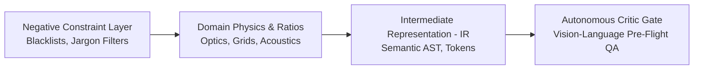

# The Real-World Generative Media Landscape & The Anti-Slop Manifesto
## Architectural Forensic Analysis: How Commercial Generation Systems Function in Production and How to Eliminate "AI Slop" to Achieve Human-Grade Craftsmanship Across All Modalities

> **Document ID:** `OPENGEN-ANTI-SLOP-REALWORLD-2026`  
> **Target Audience:** Systems Architects, Creative Engineers, AI Product Builders  
> **Core Focus:** Real-World Production Functionality, Modality Breakdown, Anti-Slop Engineering Heuristics, Human Craftsmanship Synthesis  
> **Status:** Definitive Industry Blueprint  

---

# 1. The Real-World Crisis of "AI Slop"

In the current generative AI landscape, the barrier to producing content has dropped to zero, resulting in a phenomenon universally termed **"AI Slop"**:
* **Visual Slop:** Hyper-saturated, airbrushed textures, 6-finger anomalies, waxy skin ("the Midjourney v4 look"), and products floating weightlessly without physical contact shadows.
* **Document & Text Slop:** Monotonous spreadsheet-like tables, generic bullet lists, juvenile emoji spam, and repetitive buzzword density (*"delve", "testament to", "unlocking", "beacon"*).
* **Presentation Slop:** The "Bullet Point Disease"—a slide with a generic title, three uninspired bullet points on the left, and an unrelated AI-generated stock image on the right.
* **Audio & Video Slop:** Monotone cadence devoid of human breath and pauses, equal-length 3-second cuts with robotic transitions, and a lack of sound effects (Foley) synchronization.

### Why Does AI Slop Happen? (The Root Cause)
1. **Mode Collapse & Statistical Averaging:** Foundation models predict the *most probable next token or latent vector*. The average of the internet is mediocre, generic, and cliché. Without explicit structural constraints, models drift toward the lowest common denominator.
2. **The "Direct-to-Bitmap / Direct-to-String" Fallacy:** Systems that ask an LLM or Diffusion model to spit out final user-facing artifacts directly fail because foundation models lack spatial reasoning, typographic geometry, camera physics, and editorial taste.
3. **Absence of a Deterministic Design Compiler:** Human creators never write a document or film a commercial in a single unfiltered stream. They use grid systems (Swiss 12-column grids), optical physics (aperture, focal length, directional lighting), acoustic mastering (EBU R128 loudness standards), and narrative pacing (retention hooks, tension arcs).

```mermaid
flowchart TD
    subgraph The Slop Pipeline [The Generic AI Trap]
        RawPrompt[Vague Prompt] --> RawModel[Unconstrained Model]
        RawModel --> SlopOutput[Generic AI Slop: Cluttered, Waxy, Monotonous]
    end

    subgraph The Human-Grade Pipeline [The OpenGen Anti-Slop Architecture]
        Input[Raw Brief / Data] --> Director[Creative Director & Negative Constraints]
        Director --> AST[Semantic Intermediate Representation - IR]
        AST --> DesignEngine[Algorithmic Design Engine: Grids, Physics, Ratios]
        DesignEngine --> Compiler[Deterministic Native Compiler: Typst, PPTX, Rust, FFmpeg]
        Compiler --> PreFlightCritic[Autonomous Quality Gate / Critic]
        PreFlightCritic -->|Pass| BespokeOutput[Human-Grade, Agency-Quality Artifact]
        PreFlightCritic -->|Fail / Slop Detected| Director
    end
```



---

# 2. Modality-by-Modality Breakdown: Functionality, Real-World Use, and Slop Elimination

---

## 2.1 Documents, Publications & Whitepapers

### Real-World Functionality & Industry Applications
* **Investment Memorandums & Due Diligence Reports:** Wall Street private equity, venture capital, and legal teams require high-density, rigorous PDF reports where data integrity, footnotes, and mathematical tables cannot break across page boundaries.
* **Corporate Whitepapers & ESG Publications:** Enterprise marketing assets that must strictly adhere to Swiss editorial grids, company typography scales, and asymmetric margin aesthetics.
* **Product Catalogs & Invoices:** Dynamic, database-driven publications containing thousands of SKUs with dot-leader price menus and barcode/QR vector stamps.

### Anatomy of Document Slop
* **Emoji Disease:** Placing rocketships (`🚀`), lightbulbs (`💡`), and checkmarks next to corporate headers.
* **The Spreadsheet Trap:** Dumping financial figures into rigid, harsh-bordered black-and-white grid tables that look like raw CSV dumps.
* **Widow and Orphan Text:** Headings trapped at the bottom of a page with their following paragraphs pushed to the next page; single words dangling alone on the final line of a section.

### How to Generate Humanly & Slop-Free
1. **The 80/20 "Hero vs. Streamlined" Hierarchy:**
   * Human editorial designers never treat every piece of data equally. Top-tier documents designate the top 20% of data as "Hero Callouts" (giant 32pt stats with thin sub-labels) and streamline the remaining 80% into clean, borderless dot-leader lists.
2. **Swiss Editorial Micro-Typography:**
   * Strict adherence to modular typographic scales (e.g., $1.25$ Major Third ratio: 10pt body $\to$ 12.5pt subhead $\to$ 15.6pt H3 $\to$ 19.5pt H2 $\to$ 24.4pt H1).
   * Generous asymmetric margins (e.g., 20% outer margin for annotations, 12% inner margin).
3. **Deterministic Typst Compilation (Replacing Chromium/Puppeteer):**
   * Bypassing HTML-to-PDF headless browsers entirely. Using **Typst** (Rust-based mathematical layout engine) compiles 50-page documents in $<50\text{ ms}$ with perfect widow/orphan budgeting and native vector crispness.
4. **Prompt Redlining:** Enforce strict system-level negative constraints:
   ```text
   FORBIDDEN: Emojis, colloquialisms, generic corporate buzzwords ('delve', 'testament', 'beacon', 'unleash').
   REQUIRED: Dot-leader pricing formats, muted neutral palettes (Slate/Zinc), explicit metric callout blocks.
   ```

### Real-World Reference Benchmarks
* **Stripe Press:** Benchmark for typographic elegance, generous margins, and intellectual prestige in book and report design.
* **Typst:** Modern typesetting engine superseding legacy LaTeX and heavy headless browsers.
* **IBM Docling:** Enterprise layout decomposition parser extracting structured semantics from complex documents.

---

## 2.2 Presentations & Pitch Decks

### Real-World Functionality & Industry Applications
* **Venture Capital Pitch Decks:** Fast-paced, narrative-driven decks (Sequoia, YCombinator format) focused on Problem, Solution, Market Sizing, Traction, and Unit Economics.
* **Enterprise Keynotes & All-Hands:** High-impact slides projected on massive 4K stage displays, demanding high-contrast typography, single focal points, and zero visual clutter.
* **Consulting & Board Decks (McKinsey/Bain Style):** Data-heavy horizontal cascades, executive summaries, and structured comparative matrices.

### Anatomy of Presentation Slop
* **The Bullet Point Disease:** The universal marker of lazy presentation design: 4 to 6 long sentences with circular bullet markers that audiences refuse to read while the speaker talks.
* **Flat Raster "Cardboards":** AI tools that generate a flat PNG image for each slide, making it impossible for a human to edit a typo, adjust a number, or update a logo.
* **Unanchored Floating Icons:** Random generic colored circles with generic icons (gears, targets, handshakes) that convey zero semantic meaning.

### How to Generate Humanly & Slop-Free
1. **The 6 Semantic Visual Components (Banning Bullet Points):**
   * Slop-free slide engines forbid raw bullet lists in their AST parser. Content must be programmatically transformed into one of six visual architectures:
     * **Big Stat Hero:** A massive number (64pt+) with a crisp 10-word takeaway.
     * **Comparison Split:** 2 or 3 distinct vertical columns contrasting "Before vs. After" or "Old World vs. New World".
     * **12-Column Responsive Bento Grid:** Asymmetric cards grouping related sub-points with varying visual weights (inspired by Apple product launches).
     * **Horizontal Stepper / Timeline:** Sequential phases with directional milestones.
     * **Quote / Social Proof Card:** High-contrast testimonial with avatar, name, and publication attribution.
     * **Matrix / Feature Checklist:** Clean grid with subtle checkmarks and muted cross-outs.
2. **The 60-30-10 Color Rule:**
   * 60% dominant canvas (deep charcoal or pristine eggshell off-white), 30% structural contrast (cards, dividers, borders), and only 10% high-energy accent color (electric cobalt, emerald, or amber) reserved exclusively for the core takeaway.
3. **Native OpenXML Shape Compilation:**
   * Compiling slide decks directly into native PowerPoint `.pptx` XML using `python-pptx` or Slidev AST. Every card is an editable vector rectangle; every header is an editable text box.

### Real-World Reference Benchmarks
* **Gamma.app:** Real-world market leader in fluid, responsive card decks generated with modern bento layouts.
* **Beautiful.ai:** Pioneered algorithmic layout constraints where elements dynamically resize and preserve whitespace as text changes.
* **Apple Keynote Events:** The gold standard of human keynote presentation: one idea per slide, 70% negative space, extreme typographic discipline.

---

## 2.3 Imagery, Studio Photography & Graphic Design

### Real-World Functionality & Industry Applications
* **E-Commerce & Amazon/Shopify Catalogs:** High-converting hero product imagery requiring clean white/lifestyle staging, zero edge halos, and realistic physics-based reflections.
* **Brand Identity & Vector Iconography:** Logos, app icons, and marketing spot illustrations that must exist as clean, scalable vector curves (SVG).
* **Editorial Advertising & Billboards:** High-resolution photorealistic imagery capturing authentic human skin, authentic expressions, and cinematic optical lighting.

### Anatomy of Image Slop
* **The "Plastic Wax" Sheen:** Hyper-smooth skin with zero pores, glowing eyes, and unnatural subsurface scattering that instantly triggers human disgust.
* **Floating Product Syndrome:** E-commerce products copy-pasted onto an AI background without contact shadows, making them look like stickers hovering in mid-air.
* **Gibberish Text & Deformed Hands:** Warped letters, nonsensical logos, and deformed fingers typical of older diffusion models.

### How to Generate Humanly & Slop-Free
1. **Optical Lens & Lighting Physics:**
   * Professional photography is defined by optics, not magical words like "photorealistic, 8k, hyper-detailed" (which actually trigger slop training data).
   * **Slop-Free Prompt Heuristics:**
     ```text
     Shot on Hasselblad H6D-100c, 85mm f/1.4 lens, 1/250s, ISO 64.
     Lighting: Profoto softbox key light 45 degrees camera-left, subtle rim light, soft negative fill camera-right.
     Color Grade: Kodak Portra 400 emulsion, authentic skin micro-texture, visible peach fuzz, zero digital airbrushing.
     ```
2. **Diffusion Transformers (DiT) & Flow Matching:**
   * Transitioning away from legacy U-Net architectures to **FLUX.1 (Dev/Schnell)** and **Stable Diffusion 3.5**. DiT models handle complex spatial prompt adherence, correct anatomy, and sharp typographical rendering inside images.
3. **Dual-Pass Contact Shadow & Relighting Synthesis:**
   * For studio product staging (the **Photoroom** paradigm):
     * *Step 1:* Sub-pixel foreground isolation via **SAM 2** or **BiRefNet**.
     * *Step 2:* Synthesize **Ambient Occlusion (AO)**: A razor-thin, pitch-black shadow directly beneath the base of the product where it touches the surface.
     * *Step 3:* Synthesize **Directional Cast Shadow**: A soft, feathered falloff shadow matching the virtual light angle of the background.
4. **Mathematical Vectorization for Graphics:**
   * Never output raster icons. Generate clean SVG code directly or pass raster silhouettes through **VTracer / Potrace** to produce pure cubic Bézier splines under $20\text{ KB}$.

### Real-World Reference Benchmarks
* **FLUX.1 (Black Forest Labs) & Midjourney v6:** Market champions for realistic texture, skin authenticity, and lighting physics.
* **Photoroom:** Benchmark for instantaneous background removal and e-commerce lighting/shadow reconstruction.
* **Recraft.ai:** Benchmark for creating clean brand vector graphics, 3D icons, and consistent SVG design systems.

---

## 2.4 Biomechanical Handwriting & Calligraphy

### Real-World Functionality & Industry Applications
* **High-Ticket Direct Mail Outreach:** Real estate, wealth management, and luxury sales teams send handwritten notes that achieve a **$98\%\text{ open rate}$** compared to $18\%$ for printed email/brochures.
* **Physical Pen Plotting (Direct-to-Paper):** Driving CNC hardware (AxiDraw) to hold a physical fountain pen or ballpoint pen and write physically on luxury cardstock.
* **Educational Study Notes & Annotation:** Generating human-looking margin annotations, corrections, and formula derivations on PDF textbooks.

### Anatomy of Handwriting Slop
* **The "Fake Font" Syndrome:** Using a handwriting font (`.ttf` / `.otf`) where every letter "e", "t", and "s" is mathematically identical, instantly revealing to the recipient that it is computer-generated.
* **Laser-Straight Baselines:** Words aligned on a mathematically straight axis across the entire page with zero human drift.
* **Uniform Stroke Weight:** Flat, constant pixel width that ignores pen angle, speed, and capillary ink behavior.

### How to Generate Humanly & Slop-Free
1. **Recurrent Neural Spline Synthesis (Alex Graves RNN):**
   * Generating handwriting not as a sequence of glyphs, but as a continuous temporal trajectory of 2D coordinates $(dx, dy)$ and pen-lift probabilities $(p)$. Every single character is an organic, unique creation influenced by the letters before and after it.
2. **Velocity-to-Thickness Pen Dynamics:**
   * In human biology, the hand moves quickly on straight downstrokes and slows down at sharp loops and directional changes.
   * **The Physical Ink Rule:** Modulate stroke thickness and opacity dynamically based on velocity $v = \sqrt{dx^2 + dy^2}$:
     $$\text{Thickness} = \frac{k_1}{\sqrt{v} + \epsilon}, \quad \text{Opacity} = k_2 \cdot (1 - e^{-v})$$
   * At high velocity, ink thins out; when the pen pauses or reverses, ink pools into a darker, capillary-bleed anchor.
3. **Markov-Chain Brownian Baseline Drift:**
   * Human writers experience neurological fatigue. openGen injects a stochastic Brownian motion drift into the baseline: lines subtly tilt downward or upward as the paragraph progresses, then organically reset at new paragraphs.
4. **Human Imperfections:**
   * Introducing micro-variations: a rare crossed-out word with a dual horizontal strike, an ink droplet smudge, or variable margins that hug the edge of the physical page.

### Real-World Reference Benchmarks
* **Calligrapher.ai:** Public demonstration of neural network stroke synthesis.
* **AxiDraw (Evil Mad Scientist Laboratories):** The premier hardware pen-plotting standard worldwide.
* **Handwrite.io / Letterfriend:** Commercial services generating millions in revenue by automating authentic direct-mail marketing notes.

---

## 2.5 Motion Graphics, Short-Form Video & Audio-Visual Media

### Real-World Functionality & Industry Applications
* **Direct-Response Short-Form Video (TikTok / Reels / YouTube Shorts):** $<30\text{ s}$ high-velocity ads designed to maximize average percentage viewed (APV) and click-through rates (CTR).
* **Autonomous Video Podcast Repurposing:** Ingesting 2-hour long-form interviews and instantly identifying, cropping, captioning, and publishing viral 45-second highlights.
* **AI Talking-Head Avatars & Dubbing:** Multilingual corporate training and global marketing where an executive's video is translated into 30 languages with seamless lip synchronization.

### Anatomy of Video Slop
* **The Equal-Scene Trap:** Every scene lasting exactly 3.0 seconds, inducing subconscious viewer trance and triggering instant scrolling.
* **The Uncanny "Wobbly Mouth":** Traditional GAN lip-sync models that stretch and warp the lower half of an avatar's face, creating blurry teeth and floating lips.
* **Robotic Silence:** Video clips with narration and background music, but completely devoid of tactile sound effects (Foley) when text pops onto the screen.

### How to Generate Humanly & Slop-Free
1. **The 5-Phase Direct-Response Retention Funnel:**
   * Professional short-form editors structure every video according to psychological drop-off curves:
     * **Phase 1: The Visual Hook ($0.0 - 2.5\text{ s}$):** Fast visual punch-in ($115\%$ scale), high-contrast keyword, and an audio sound effect (whoosh/impact).
     * **Phase 2: The Core Problem ($2.5 - 8.0\text{ s}$):** Empathizing with viewer frustration; fast-paced B-roll cuts ($1.2 - 1.8\text{ s}$ intervals).
     * **Phase 3: The Agitation / Pivot ($8.0 - 15.0\text{ s}$):** Speed ramp or dramatic audio pause (stripping music) to command total focus.
     * **Phase 4: The Proprietary Solution ($15.0 - 25.0\text{ s}$):** High-density visual proof, product demo, or bento feature cascade.
     * **Phase 5: The Frictionless CTA ($25.0 - 30.0\text{ s}$):** Direct, punchy instruction with an on-screen visual anchor.
2. **Latent-Space Diffusion Lip-Sync (ByteDance LatentSync):**
   * Eliminating GAN mouth warping. LatentSync works directly within the latent space of Stable Video Diffusion, conditioning mouth shape, jaw muscle movement, and teeth reflections on raw speech audio tokens down to the millisecond.
3. **Tri-Tier Acoustic Architecture:**
   * Human editors spend 50% of their time on sound. Video generation must enforce a 3-track hierarchy:
     * *Track 1 (Speech):* Centered, mastered to $-14\text{ LUFS}$, with dynamic compression.
     * *Track 2 (Foley SFX):* Subtle pops, page flips, camera clicks, and whooshes precisely locked to text animations.
     * *Track 3 (Background Music):* Automatically side-chained and ducked by $-12\text{ dB}$ whenever speech audio is active.
4. **J-Cuts and L-Cuts (Audio-Lead Transitions):**
   * Never cut audio and video simultaneously. In a J-cut, the incoming scene's audio is heard $250\text{ ms}$ before the video cut appears, creating seamless narrative flow.
5. **Dynamic LERP Face Tracking (9:16 Reframe):**
   * Reframe 16:9 widescreen footage to 9:16 vertical by tracking speaker facial bounding boxes using Linear Interpolation (LERP) smoothing ($\alpha = 0.08$), preventing jerky, robotic camera pans.

### Real-World Reference Benchmarks
* **ByteDance LatentSync:** The state-of-the-art open-source audio-to-video lip-syncing framework.
* **OpusClip & Submagic:** Market benchmarks for automated viral podcast clipping, word-locked karaoke subtitles, and auto-b-roll insertion.
* **Runway Gen-3 Alpha & Sora:** Benchmarks for cinematic text-to-video consistency and camera control.
* **MrBeast Editing Retention Curves:** The empirical gold standard for high-retention pacing, J-cuts, and visual punch-ins.

---

## 2.6 Voiceover, Music & Generative Audio

### Real-World Functionality & Industry Applications
* **Global Enterprise Localization:** Translating training media into 40+ accents while preserving the speaker's emotional tone and vocal identity.
* **Audiobook & Narrative Production:** Long-form expressive narration requiring multi-character distinction, subtle breathing, and dramatic pacing pauses.
* **Dynamic Background Scoring:** Procedural, royalty-free background soundtracks engineered to duck automatically under voiceovers.

### Anatomy of Audio Slop
* **The "GPS Navigation" Cadence:** Flat, monotone prosody with identical pitch inflections at the end of every sentence.
* **Surgically Clean Inhumanity:** Zero natural breathing, zero swallowing sounds, and unnatural silence between sentences that sounds eerie to the human ear.
* **Repetitive Stock Jingle Loops:** Cheesy, royalty-free acoustic guitar or corporate ukulele that feels cheap and disposable.

### How to Generate Humanly & Slop-Free
1. **Conversational Latent Audio Diffusion:**
   * Utilizing modern zero-shot TTS models (**ElevenLabs Conversational V2**, **Kokoro**, **CosyVoice**) that incorporate human prosody, breath tokens (`[gasp]`, `[sigh]`, `[chuckle]`), and natural pacing hesitation.
2. **Dynamic Punctuation-Based Timing:**
   * Injecting variable pauses based on editorial intent: $350\text{ ms}$ for commas, $750\text{ ms}$ for periods, and $1200\text{ ms}$ for dramatic paragraph breaks.
3. **Harmonic Saturation & Broadcast Mastering:**
   * Passing raw neural audio through a modern DSP chain:
     * High-pass filter at $80\text{ Hz}$ to eliminate sub-bass rumble.
     * Gentle tube saturation to add analog warmth.
     * EBU R128 Loudness Normalization to $-14\text{ LUFS}$ with a true peak ceiling at $-1.0\text{ dBFS}$.

### Real-World Reference Benchmarks
* **ElevenLabs:** Undisputed market leader for emotional nuance, zero-shot voice replication, and realistic speech cadence.
* **Suno v4 & Udio:** Revolutionized generative music by synthesizing studio-quality vocal tracks, full instrumental arrangements, and nuanced genre fusions.

---

## 2.7 Code, UI & Interactive Web Artifacts

### Real-World Functionality & Industry Applications
* **Generative Enterprise SaaS Dashboards:** Interactive client portals with live sorting, filtering, and data visualization.
* **Bento Marketing Landing Pages:** High-conversion web pages featuring glassmorphism cards, interactive calculators, and micro-interactions.
* **Rapid Prototyping:** Instantly turning a hand-drawn napkin sketch into fully functional React / Tailwind components.

### Anatomy of UI Slop
* **The Generic Bootstrap Syndrome:** Purple gradients, oversized unrounded buttons, and centered hero sections that look like a 2018 template.
* **Unstyled Data Tables:** Raw, overflowing HTML `<table>` elements with zero mobile responsiveness or search capabilities.
* **Broken State & Memory Leaks:** Uncontrolled React `useEffect` loops, unhandled promise rejections, and misaligned responsive breakpoints.

### How to Generate Humanly & Slop-Free
1. **Design System Token Binding (shadcn/ui + Tailwind):**
   * Code generators must not invent ad-hoc CSS. They must bind directly to a curated design token dictionary: semantic variables for background, foreground, border radius (`--radius: 0.5rem`), and palette hues.
2. **Strict Component AST Parsing:**
   * Passing generated UI code through a strict AST linter before rendering. Code containing unclosed tags, inline style hacks, or missing accessibility attributes (`aria-label`) is automatically flagged and rejected.
3. **Fluid Bento Grid Layouts:**
   * Enforcing standard CSS Grid patterns (`grid-cols-1 md:grid-cols-3 gap-6`) where cards dynamically stack on mobile viewports and arrange into harmonious bento boxes on desktop displays.

### Real-World Reference Benchmarks
* **v0.dev (Vercel):** The gold standard for generative UI, generating production-grade React, Tailwind CSS, and shadcn/ui components.
* **Bolt.new & Lovable.dev:** Full-stack browser environments compiling, running, and previewing complete web applications in real time.
* **Linear.app:** The industry's aesthetic benchmark for minimalist, high-contrast, dark-mode software interfaces.

---

# 3. The Universal "Anti-Slop" Engineering Playbook

To eliminate slop systematically across any generation pipeline, implement this **Four-Tier Architecture**:



### Tier 1: The Negative Constraint Filter (Style Redlining)
Never rely solely on positive prompting. Explicitly blacklist the statistical "slop vectors" of each domain:
* *In Text:* Ban buzzwords (*"delve", "testament", "tapestry", "unlocking", "game-changer"*), emojis, and conversational filler.
* *In Presentations:* Ban bulleted lists; enforce card components.
* *In Images:* Ban prompt junk (*"hyperrealistic, 8k, photorealistic"*); substitute with optical lens physics (*"85mm f/1.4, Kodachrome, directional softbox"*).

### Tier 2: The Physical & Mathematical Bridge
Ground every AI generator in deterministic physical and mathematical laws:
* **Visual Grids:** Swiss 12-column layouts, 60-30-10 color distribution, 60/40 content-to-whitespace ratio.
* **Optics & Shadows:** Dual-pass contact shadow synthesis (Ambient Occlusion + Directional Cast).
* **Biomechanics:** Velocity-dependent ink thinning and Markov Brownian baseline drift for handwriting.
* **Acoustics:** EBU R128 loudness mastering ($-14\text{ LUFS}$), side-chain ducking ($-12\text{ dB}$).

### Tier 3: The Intermediate Representation (AST) Principle
**Never let an AI spit out final deliverables directly.**
Always force the AI to emit a structured, typed Intermediate Representation (JSON AST). This AST is validated against your schema, optimized by algorithmic layout engines, and finally compiled through deterministic native software:
* Typst for documents (not headless Chrome).
* Native OpenXML shapes for slides (not flat PNG images).
* FFmpeg filtergraphs for video (not uncollected MoviePy numpy frames).
* SVG vector Béziers for graphics (not blurry raster bitmaps).

### Tier 4: The Autonomous Pre-Flight Creative Critic
Before any artifact is served to a human user, an autonomous Vision-Language Critic Agent inspects the rendered output against strict acceptance criteria:
* *Check 1 (Contrast & Legibility):* Does text maintain WCAG AA contrast ratio ($\ge 4.5:1$)?
* *Check 2 (Negative Space):* Is the slide or document crowded? (Reject if whitespace $<30\%$).
* *Check 3 (Anatomy & Physics):* Are there distorted limbs, warped logos, or floating objects without shadows?
* *Check 4 (Audio Pacing):* Is background music drowning out the spoken voiceover?

If any check fails, the critic sends specific spatial and structural feedback back to the generator for automated self-correction before the user ever sees it.

---

# 4. Summary Matrix: Slop Indicators vs. Human-Grade Architecture

| Content Modality | Typical AI Slop Indicator | The Root Engineering Cause | The Human-Grade Architecture Fix |
|---|---|---|---|
| **Documents (PDF)** | Emoji spam, raw CSV tables, widow headings | Direct markdown-to-HTML conversion via headless browser | **Typst Rust engine** + Swiss 12-column grid + 80/20 hero hierarchy |
| **Presentations** | 4-bullet lists, flat raster slide images | Lack of component abstraction; generating flat screenshots | **Native OpenXML shapes** (`python-pptx`) + 6 visual components |
| **Imagery** | Plastic skin, floating products, unreadable text | Generic prompts, missing shadow models, U-Net diffusion | **FLUX.1 DiT** + Optical lens physics + **SAM 2** dual-pass contact shadows |
| **Handwriting** | Identical repeating letter fonts, laser-straight baseline | Using static `.ttf` fonts instead of recurrent strokes | **Graves RNN** stroke vectors + Brownian baseline drift + Velocity ink physics |
| **Short-Form Video** | 3.0s equal scenes, wobbly mouth, silent cuts | Static templating and outdated GAN-based face warping | **5-phase retention funnel** + **LatentSync** diffusion + Tri-tier audio Foley |
| **Voiceover / Audio** | Robotic cadence, zero breaths, unmastered audio | Concatenative or flat autoregressive acoustic tokens | **Zero-shot conversational TTS** with breath tokens + EBU R128 DSP chain |
| **Web UI / Code** | Generic Bootstrap, broken hooks, unstyled tables | Unconstrained LLM HTML/CSS output | **Tailwind + shadcn/ui token binding** + AST linter + Bento grid layouts |

---

# 5. Conclusion & Actionable Next Steps

Human-grade generative AI is not achieved by waiting for larger foundation models; it is achieved through **domain-specific engineering, deterministic compilers, and strict creative constraints**. 

By systematically replacing unconstrained prompts with **Semantic Intermediate Representations**, enforcing **real-world physics and typography**, and running an **autonomous pre-flight critic**, your generation pipelines will consistently produce agency-grade, human-crafted assets that are entirely free of AI slop.
