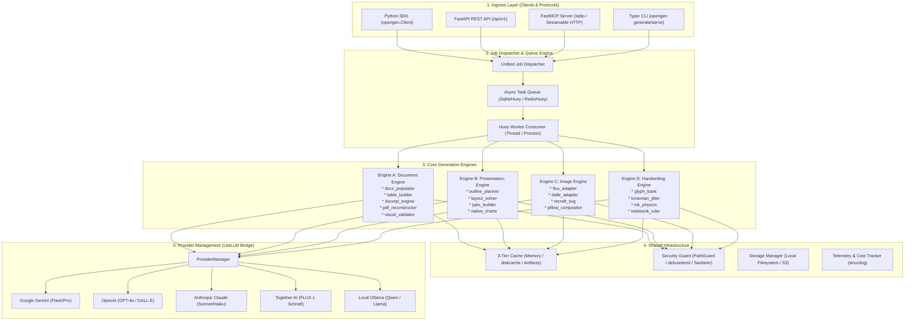
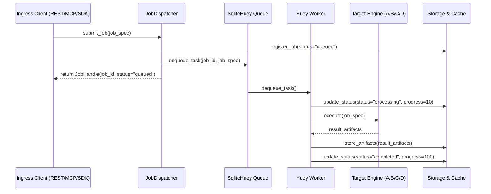
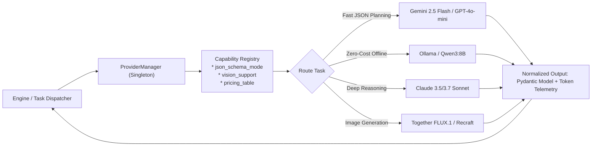

# 05. FINAL TARGET SYSTEM ARCHITECTURE SPECIFICATION

> **Document ID:** `OPENGEN-ARCH-005`  
> **Author:** Principal Software Architect, Senior Full-Stack Engineer, AI Infrastructure Engineer  
> **Project:** OpenGen Framework  
> **Date:** November 2026  
> **Architecture Pattern:** Clean Architecture / Hexagonal Ports & Adapters  

---

## 1. Architectural Philosophy & Manifesto

The final target OpenGen framework is built on four immutable engineering tenets:

1. **Deterministic Code Over LLM Hallucination:** LLMs are strictly utilized for high-level semantic reasoning, content extraction, and structured JSON planning. All rendering, OOXML tree manipulation, coordinate geometry math, table construction, and stroke physics are handled by deterministic Python code.
2. **Local-First, Zero-Daemon Execution:** OpenGen runs immediately after `pip install opengen` without mandatory cloud subscriptions, external Redis servers, or MongoDB clusters. Its default queue is SQLite-backed (`SqliteHuey`), its cache is disk-backed (`diskcache`), and its models can run 100% offline via `Ollama`. Production scale-out to Redis, Postgres, and S3 requires changing only configuration flags.
3. **Bring Your Own Key (BYOK) & Multi-Provider Independence:** A unified `ProviderManager` based on `LiteLLM` normalizes OpenAI, Anthropic, Google Gemini, Together AI, Fireworks, OpenRouter, and Ollama into standard Pydantic schema-validated I/O.
4. **Physical-World Grounding:** From editable native Office files (`.docx`, `.pptx`) that remain fully editable in Word and PowerPoint, to transparent vector PDFs designed to print real ink onto physical loose-leaf notebook paper (Engine D), OpenGen produces outputs designed for real-world corporate, academic, and creative workflows.

---

## 2. High-Level Architecture Diagram



---

## 3. Layered Component Specifications

### 3.1 Layer 1: Ingress Layer

The Ingress layer exposes the OpenGen capabilities across 4 unified interfaces. Every interface maps into identical domain service requests.

1. **Python SDK (`opengen.Client`):**
   ```python
   from opengen import OpenGenClient

   client = OpenGenClient()
   # Synchronous or asynchronous execution
   doc = client.documents.create(
       template="templates/invoice.docx",
       references=["data/statement.pdf"],
       output_format="docx"
   )
   print(doc.file_path, doc.cost_usd)
   ```
2. **FastAPI REST API (`/api/v1`):**
   - Versioned, OpenAPI-compliant endpoints:
     - `POST /api/v1/documents/generate`
     - `POST /api/v1/presentations/generate`
     - `POST /api/v1/images/generate`
     - `POST /api/v1/handwriting/generate`
     - `GET  /api/v1/jobs/{job_id}`
     - `POST /api/v1/jobs/{job_id}/resolve`
     - `GET  /api/v1/artifacts/{artifact_id}/download`
3. **FastMCP Server (`opengen.mcp`):**
   - Implements Anthropic Model Context Protocol standard (`mcp[cli]>=1.2.0`).
   - Supports both `stdio` (for Claude Code, Claude Desktop, Antigravity IDE) and `sse` (Streamable HTTP for network agents).
   - Auto-generates JSON-RPC tool schemas from Pydantic domain models.
4. **Typer CLI (`opengen`):**
   - `opengen serve [--port 8000] [--mcp]`
   - `opengen worker [--threads 4]`
   - `opengen document generate --template ./t.docx --ref ./data.pdf`
   - `opengen presentation generate "AI in Medicine" --slides 10`
   - `opengen image generate "Cyberpunk city" --format svg`
   - `opengen handwriting generate "Essay text..." --mode notebook-print`

---

### 3.2 Layer 2: Job Dispatcher & Queue Engine



- **Default Backend:** `SqliteHuey` operates against a single SQLite database file (`cache/queue.db`). No Redis or broker process is required. Thread-safe, multi-process safe, with atomic transactions.
- **Enterprise Scale-Out:** By setting `OPENGEN_QUEUE_BACKEND=redis` and `OPENGEN_REDIS_URL=redis://localhost:6379/0`, OpenGen instantly transforms into a distributed multi-node task worker system.

---

### 3.3 Layer 3: Generation Engines

#### Engine A: Document Generation Engine (`opengen.engines.document`)
- **Template Populator:** Reuses and enhances `docx_populator.py` and `docxtpl` for template preservation and dynamic Jinja2 array loops.
- **Table Builder:** Reuses `table_builder.py` with OOXML `cantSplit`, `tblHeader`, padding, and cell styling.
- **PDF Reconstructor:** Reuses `pdf_reconstructor.py` to convert PDF layouts into editable Word documents.
- **Reference Extractor:** Reuses `pymupdf_extractor.py`, `ocr_extractor.py`, and `information_extractor.py` for zero-token local fact harvesting.
- **Anti-Hallucination Mapper:** Reuses `mapper.py` and `validator.py` with user clarification pause-and-resume.
- **Visual Validator:** Reuses `inspector.py` and `auto_corrector.py` for 3-loop visual layout healing.
- **Cross-Platform PDF Export:** Adds WeasyPrint direct HTML+CSS to PDF pipeline.

#### Engine B: Presentation Generation Engine (`opengen.engines.presentation`)
- **Storytelling Planner:** Calls fast LLMs (`gemini-2.5-flash` / `gpt-4o-mini`) with strict JSON schema to generate outline, slide titles, body cards, statistics, and chart data.
- **Coordinate Geometry Solver:** Calculates pixel-perfect bounding boxes for 16:9 slides (13.333" x 7.5"). Solves card spacing, grid margins, multi-column alignment, and badge placement.
- **Font-Scaling Guard:** Measures character counts and dynamically reduces font size from 18pt down to 12pt if text would overflow card height.
- **Native Shape & Chart Builder:** Uses `python-pptx` to build genuine Microsoft PowerPoint shapes, text boxes, and Excel-backed native charts (Bar, Column, Line, Pie). Output files remain 100% editable in PowerPoint.
- **Slide-Level Regeneration:** Enables regenerating slide $N$ without modifying preceding or succeeding slides.

#### Engine C: Image Generation Engine (`opengen.engines.image`)
- **Provider Adapters:**
  - `TogetherFluxAdapter`: Together AI API routing to `black-forest-labs/FLUX.1-schnell` (Apache 2.0). Fast 4-step generation, high text spelling accuracy.
  - `OpenAIDalleAdapter`: OpenAI API routing to DALL-E 3 and GPT-Image-1.
  - `RecraftVectorAdapter`: Recraft AI API generating true scalable vector SVGs.
- **Compositor & Processing:** Pillow-based post-processor for aspect ratio normalization (1:1, 16:9, 9:16), EXIF stripping, and transparent PNG cutout masking.
- **Prompt Hash Cache:** Disk-backed cache of image prompts preventing redundant paid generations.

#### Engine D: Pure Realistic Handwriting Generation (`opengen.engines.handwriting`)
- **Multi-Glyph Contextual Alternate Bank:** 5-8 distinct handwritten variants per glyph. Enforces no duplicate variants within 3 characters of each other.
- **Brownian Baseline Drift & Slant:** Non-linear vertical baseline micro-jitter ($\Delta y \sim \mathcal{N}(0, 1.8\text{px})$) and continuous line slant drift ($\pm 1.2^\circ$).
- **Pen Physics & Fiber Bleed:** Pressure dynamics (darker downstrokes, lighter crossbars), realistic ballpoint blue (`#1C3B72`) and gel black palettes, and micro-roughness stroke edge simulation.
- **Direct-to-Notebook Printing Mode:** Renders 100% transparent RGBA canvas containing ONLY handwritten ink, calibrated down to the sub-millimeter of real-world physical loose-leaf paper (College Ruled: 7.1mm pitch; Wide Ruled: 8.7mm pitch). Enables feeding real notebook paper into standard home printers for zero-detection physical submission.
- **Synthetic Scanned Document Mode:** 300/600 DPI rendering with realistic paper texture, margin lines, binder hole punches, and camera perspective skew.

---

### 3.4 Layer 4: Shared Infrastructure

```
+-------------------------------------------------------------------------------+
|                            SHARED INFRASTRUCTURE                              |
+-------------------------------------------------------------------------------+
|  1. 3-Tier Cache Engine (opengen.cache)                                       |
|     * L1: In-memory LRU dict for hot request-scoped data                      |
|     * L2: diskcache.FanoutCache (SQLite-backed, persistent, LRU eviction)     |
|     * L3: Content-addressable immutable artifact store (SHA-256)             |
+-------------------------------------------------------------------------------+
|  2. Security Guard (opengen.security)                                         |
|     * PathGuard: pathlib.resolve().is_relative_to(ALLOWED_WORKSPACE_ROOT)     |
|     * DefusedXML: Defuses Billion Laughs and XML entity expansion attacks     |
|     * Decompression Bomb Guard: Max 100 MB uncompressed, max 10:1 ratio       |
|     * LogSanitizer: Scrubs sk-, AIza, Bearer keys from all logs               |
+-------------------------------------------------------------------------------+
|  3. Unified Telemetry & Token Accounting (opengen.telemetry)                  |
|     * structlog structured JSON logging with job_id and trace_id              |
|     * Exact provider token accounting + dynamic USD cost calculator           |
+-------------------------------------------------------------------------------+
```

---

### 3.5 Layer 5: Unified Provider Management (`LiteLLM` Bridge)



---

## 4. Domain Data Model Architecture

The domain models are strictly separated from HTTP schemas and database tables:

```
src/opengen/domain/
├── job.py              # JobId, JobStatus, JobPriority, JobResult
├── document.py         # DocumentSpec, TemplateProfile, FieldMapping, ValidationReport
├── presentation.py     # SlideDeck, SlideNode, ShapeGeometry, ChartData, ThemeSpec
├── image.py            # ImageSpec, ImageFormat, AspectRatio, VectorSVG
├── handwriting.py      # HandwritingSpec, RuledSpecs, PenProfile, PaperMode
├── provider.py         # ProviderConfig, ModelCapability, TokenUsage, CostReport
└── errors.py           # Tagged OpenGenError hierarchy
```

---
*End of Report 05.*
