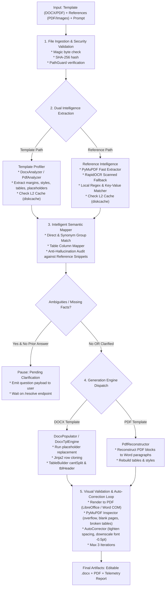

# 07. DOCUMENT GENERATION ENGINE (ENGINE A) IMPLEMENTATION PLAN

> **Document ID:** `OPENGEN-ENGA-007`  
> **Author:** Principal Software Architect, Senior Full-Stack Engineer, AI Infrastructure Engineer  
> **Project:** OpenGen Framework  
> **Date:** November 2026  
> **Engine:** Engine A (Document Generation)  

---

## 1. Engine Scope & Executive Overview

Engine A is the foundational document generation engine of OpenGen. It accepts structured input specifications, formatting templates (Word `.docx` or Adobe PDF), and one or more reference documents, extracting factual data, semantically mapping fields without hallucination, and generating professional, editable Microsoft Word (`.docx`) and high-fidelity PDF documents.

### Core Capabilities:
1. **Template Preservation:** Populates existing Word templates, preserving typography, margins, colors, embedded images, headers, footers, and complex multi-column tables.
2. **Jinja2 Dynamic Data Binding (`docxtpl`):** Enables dynamic array iteration across table rows (``), conditional sections, and rich text insertion.
3. **PDF Template Reconstruction:** Dissects PDF visual geometry, extracting headings, body paragraphs, and tables, rebuilding an editable `.docx` file matching the original PDF layout.
4. **Reference Knowledge Harvesting:** Extracts tables, key-values, dates, and entities from reference PDFs with page number tracking, confidence scores, and OCR fallback for scanned pages.
5. **Anti-Hallucination Semantic Mapping:** Strictly validates mapped facts against source text snippets, preventing the fabrication of names, dates, grades, or financial figures.
6. **Closed-Loop Visual Validation:** Renders documents to PDF and inspects geometry for overflow, blank pages, and clipped tables, executing auto-corrective layout adjustments up to 3 iterations.
7. **Partial / Section Regeneration:** Enables re-synthesizing specific sections or tables without re-running the entire document pipeline.

---

## 2. Architectural Pipeline & Data Flow



---

## 3. Detailed Subsystem Analysis & Implementation Plan

### 3.1 Subsystem 1: File Ingestion & Security Validation
- **Existing Files:** `app/modules/input_manager/validator.py` (136 LOC).
- **Target Location:** `src/opengen/security/validator.py` & `src/opengen/engines/document/ingest.py`.
- **Planned Enhancements:**
  1. Decouple validation from direct SQLite storage calls. The validator should return an immutable `ValidatedFile` domain object.
  2. Integrate `defusedxml` on all DOCX package unzipping to neutralize XML Entity Expansion (Billion Laughs) attacks.
  3. Enforce maximum uncompressed size limits (100 MB) and decompression ratio limits (10:1).
  4. Ensure paths are resolved via `Path.resolve().is_relative_to(ALLOWED_WORKSPACE_ROOT)` to eliminate path traversal risks.

### 3.2 Subsystem 2: Template Intelligence
- **Existing Files:**
  - `app/modules/template_intelligence/docx_analyzer.py` (262 LOC)
  - `app/modules/template_intelligence/pdf_analyzer.py` (246 LOC)
  - `app/modules/template_intelligence/profiler.py` (55 LOC)
- **Target Location:** `src/opengen/engines/document/template/`.
- **Planned Enhancements:**
  1. **Regex Placeholder Modernization:** Enhance `PLACEHOLDER_REGEX` to recognize modern bracket variants, e.g., `<<Field Name>>`, `{{field_name}}`, and `[field_name]`.
  2. **Cache Modernization:** Replace ad-hoc SQLite JSON storage with `diskcache.FanoutCache` under key `template:profile:<sha256>`.
  3. **Section Geometry Extraction:** Support mixed portrait and landscape sections in multi-section Word documents.

### 3.3 Subsystem 3: Reference Document Intelligence & OCR
- **Existing Files:**
  - `app/modules/reference_intelligence/pymupdf_extractor.py` (99 LOC)
  - `app/modules/reference_intelligence/ocr_extractor.py` (57 LOC)
  - `app/modules/reference_intelligence/information_extractor.py` (182 LOC)
  - `app/modules/reference_intelligence/docling_extractor.py` (63 LOC)
- **Target Location:** `src/opengen/engines/document/reference/`.
- **Planned Enhancements:**
  1. **Lazy Loading for OCR:** Lazy-load ONNX runtime and RapidOCR models only when a scanned, image-only page is detected (text length < 30 characters), eliminating startup overhead.
  2. **Docling Plugin Isolation:** Package IBM Docling behind an optional extra (`pip install opengen[docling]`). If installed, it provides state-of-the-art layout analysis for multi-column financial tables; if absent, the system seamlessly falls back to PyMuPDF.
  3. **Contextual Snippet Tracking:** Retain surrounding context ($\pm 50$ characters) for every extracted fact to empower the anti-hallucination validator.

### 3.4 Subsystem 4: Intelligent Semantic Mapping & Anti-Hallucination
- **Existing Files:**
  - `app/modules/intelligent_mapping/mapper.py` (306 LOC)
  - `app/modules/intelligent_mapping/validator.py` (50 LOC)
- **Target Location:** `src/opengen/engines/document/mapping/`.
- **Planned Enhancements:**
  1. **Dynamic Synonym Expansion:** Expand `SYNONYM_GROUPS` with multilingual synonyms (e.g., German, Spanish, French variants of standard fields like Date, Name, Amount).
  2. **Anti-Hallucination Fact Verification:** Before finalizing a mapping, `AntiHallucinationValidator` asserts that the exact value (or normalized date/currency equivalent) appears in the reference snippet. If unverified, the field status is flagged as `unverified` and user clarification is requested.
  3. **Table Column Alignment:** Implement Levenshtein-distance header matching to map reference table columns directly into template table columns.

### 3.5 Subsystem 5: DOCX Generation & Advanced Table Builder
- **Existing Files:**
  - `app/modules/document_generation/docx_populator.py` (205 LOC)
  - `app/modules/document_generation/table_builder.py` (76 LOC)
  - `app/modules/document_generation/pdf_reconstructor.py` (140 LOC)
- **Target Location:** `src/opengen/engines/document/`.
- **Planned Enhancements:**
  1. **Jinja2 Dynamic Row Expansion (`DocxTplEngine`):**
     - Build a dedicated wrapper around `docxtpl.DocxTemplate`.
     - When an array field is passed (e.g., `invoice_items: [...]`), `DocxTplEngine` iterates and duplicates table rows seamlessly.
  2. **XML Run Preservation:** Preserve character formatting (bold, italic, font face, color) when placeholders span across multiple XML runs (`<w:r>`).
  3. **OOXML Table Hardening:**
     - `w:cantSplit`: Applied to every table row to prevent rows from breaking awkwardly across page boundaries.
     - `w:tblHeader`: Applied to row 0 so table headers repeat automatically on multi-page tables.
     - `w:tcMar`: Standardizes cell padding (top/bottom: 6pt; left/right: 7pt).
     - Subtle zebra striping (`w:shd w:fill="F8FAFC"`) on alternating rows.

### 3.6 Subsystem 6: Visual Layout Validation & Auto-Correction Loop
- **Existing Files:**
  - `app/modules/visual_validation/inspector.py` (129 LOC)
  - `app/modules/visual_validation/auto_corrector.py` (96 LOC)
  - `app/modules/visual_validation/renderer.py` (130 LOC)
- **Target Location:** `src/opengen/engines/document/validation/`.
- **Planned Enhancements:**
  1. **WeasyPrint Cross-Platform PDF Generation:**
     - For documents generated from fresh structured JSON, implement a WeasyPrint pipeline using W3C Paged Media CSS (`@page { margin: 20mm; @bottom-right { content: counter(page); } }`).
  2. **Multi-Platform DOCX-to-PDF Converter:**
     - Tier 1: Windows Word COM automation (when running on Windows with Office installed).
     - Tier 2: Headless LibreOffice (`soffice --headless --convert-to pdf`).
     - Tier 3: Pure Python PDF fallback (PyMuPDF / ReportLab).
  3. **3-Iteration Visual Healing Loop:**
     - **Iteration 1:** Inspect rendered PDF bounding boxes for text overflow into margins ($y > \text{height} - 25\text{pt}$), blank trailing pages, or clipped table widths.
     - **Iteration 2 (Spacing):** Reduce paragraph `space_after` to 2pt, `space_before` to 0pt, and table cell padding by 30%.
     - **Iteration 3 (Typography):** Downscale body font sizes by 0.5pt (e.g., 11pt -> 10.5pt) to restore original page count.

### 3.7 Subsystem 7: Partial / Section Regeneration
- **Target Location:** `src/opengen/engines/document/regenerate.py` (New Component).
- **Functionality:**
  - Accepts `document_path`, `section_id` or `table_index`, and `new_data`.
  - Parses the existing generated `.docx` file, targets only the specified XML node, updates the content, and re-runs visual validation only on affected pages.
  - Reduces token and processing latency by >85% for small edits.

---

## 4. Reusability and Migration Blueprint for Engine A

```
OLD PATH                                                 NEW PATH
------------------------------------------------------   ------------------------------------------------------
app/modules/document_generation/table_builder.py    -->  src/opengen/engines/document/table_builder.py
app/modules/document_generation/docx_populator.py   -->  src/opengen/engines/document/docx_populator.py
app/modules/document_generation/pdf_reconstructor.py-->  src/opengen/engines/document/pdf_reconstructor.py
app/modules/template_intelligence/docx_analyzer.py  -->  src/opengen/engines/document/template/docx_analyzer.py
app/modules/template_intelligence/pdf_analyzer.py   -->  src/opengen/engines/document/template/pdf_analyzer.py
app/modules/reference_intelligence/pymupdf_extractor-->  src/opengen/engines/document/reference/pymupdf_extractor.py
app/modules/reference_intelligence/ocr_extractor.py -->  src/opengen/engines/document/reference/ocr_extractor.py
app/modules/intelligent_mapping/mapper.py           -->  src/opengen/engines/document/mapping/mapper.py
app/modules/intelligent_mapping/validator.py        -->  src/opengen/engines/document/mapping/validator.py
app/modules/visual_validation/inspector.py          -->  src/opengen/engines/document/validation/inspector.py
app/modules/visual_validation/auto_corrector.py     -->  src/opengen/engines/document/validation/auto_corrector.py
```

All 11 core files are preserved with zero rewrites, gaining clean modular structure, provider independence, and diskcache acceleration.

---
*End of Report 07.*
