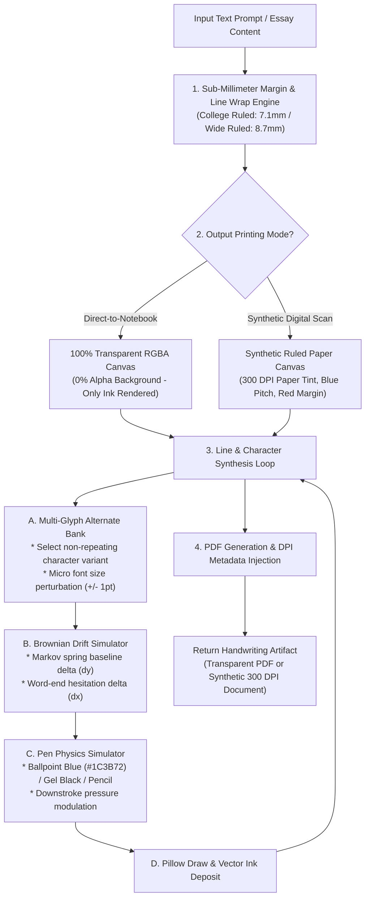

# 09B. REALISTIC HANDWRITING GENERATION ENGINE (ENGINE D) IMPLEMENTATION PLAN

> **Document ID:** `OPENGEN-ENGD-009B`  
> **Author:** Principal Software Architect, Senior Full-Stack Engineer, AI Infrastructure Engineer  
> **Project:** OpenGen Framework  
> **Date:** November 2026  
> **Engine:** Engine D (Pure Realistic Handwriting & Anti-Detection Printing)  

---

## 1. Engine Scope & Forensic Architecture

Engine D synthesizes forensic-grade realistic human handwriting designed to withstand manual visual inspection and automated digital OCR/AI handwriting detection.

Unlike naive scripts (such as `pywhatkit` or static TTF font substitutions) that produce laser-straight baselines, uniform stroke thickness, and identical repeated characters, Engine D is built on **6 fundamental biomechanical pillars**:

1. **Contextual Multi-Glyph Alternate Bank:** Never repeats the same character glyph within 3 character positions.
2. **Brownian Baseline Drift & Word Slant:** Employs a continuous Markov chain with a mean-reverting spring model for $Y$-axis drift ($\pm 1.5\,\text{px}$) and dynamic line slant ($-1.5^\circ$ to $+1.5^\circ$).
3. **Pen Dynamics & Pressure Velocity:** Calculates downstroke pressure on vertical stems (`d`, `f`, `h`, `k`, `l`, `t`, `p`, `b`, `q`, numbers) with higher alpha opacity ($245-255$) compared to upstrokes ($210-240$).
4. **Direct-to-Notebook Printing Mode (The Zero-Detection Mode):** Generates a 100% transparent vector PDF containing **only the handwritten ink layer**, calibrated down to the sub-millimeter for real physical lined notebook paper fed directly into printer trays.
5. **High-Resolution 300 DPI Synthetic Scan Emulation:** Simulates physical ruled lines, red margin, paper fiber texture, and subtle skew for digital PDF assignments.
6. **Human Imperfections (Optional):** Supports strike-through mistakes (neat crossed-out words followed by corrections) and margin compression.

---

## 2. Biomechanical Pipeline & Execution Flow

---

## 3. Paper Ruler Pitch Presets

Physical ruled paper dimensions are strictly defined in millimeters and converted to pixels at 300 DPI:

$$\text{pixels} = \left(\frac{\text{millimeters}}{25.4}\right) \times 300$$

| Preset Name | Line Pitch (mm) | Left Margin (mm) | Top Margin (mm) | Target Notebook Type |
|---|---|---|---|---|
| `college_ruled` | $7.1\,\text{mm}$ ($0.280\,\text{in}$) | $31.75\,\text{mm}$ ($1.25\,\text{in}$) | $25.4\,\text{mm}$ ($1.00\,\text{in}$) | Standard US College Ruled Loose-Leaf |
| `wide_ruled` | $8.7\,\text{mm}$ ($0.343\,\text{in}$) | $31.75\,\text{mm}$ ($1.25\,\text{in}$) | $25.4\,\text{mm}$ ($1.00\,\text{in}$) | Standard US Wide Ruled Elementary / Middle School |
| `narrow_ruled` | $6.35\,\text{mm}$ ($0.250\,\text{in}$) | $31.75\,\text{mm}$ ($1.25\,\text{in}$) | $25.4\,\text{mm}$ ($1.00\,\text{in}$) | Compact Legal Pad & Engineering Notebooks |
| `blank_page` | $8.0\,\text{mm}$ ($0.315\,\text{in}$) | $25.40\,\text{mm}$ ($1.00\,\text{in}$) | $25.4\,\text{mm}$ ($1.00\,\text{in}$) | Unruled Plain Paper / Sketch Journal |

---

## 4. Pen Physics Color & Opacity Palette

| Pen Type | Base RGB | Opacity Range | Downstroke Pressure Boost | Realistic Material Simulation |
|---|---|---|---|---|
| `ballpoint_blue` | `(28, 59, 114)` (`#1C3B72`) | $210 - 240$ (alpha) | $245 - 255$ | Classic BIC / Papermate oil-based blue ink |
| `ballpoint_black` | `(26, 30, 36)` (`#1A1E24`) | $215 - 245$ (alpha) | $248 - 255$ | Standard black ballpoint pen |
| `gel_pen_black` | `(15, 23, 42)` (`#0F172A`) | $240 - 255$ (alpha) | Saturated crisp | Pilot G2 water-based gel ink |
| `pencil` | `(58, 58, 58)` (`#3A3A3A`) | $180 - 220$ (alpha) | $210 - 235$ | #2 HB Graphite pencil core |

---

## 5. Client & Agent Interfaces

Engine D is exposed identically across all 4 framework interfaces:

- **Python SDK:** `client.handwriting.generate(text, paper_mode="direct_print_transparent", ruled_type="college_ruled")`
- **FastMCP Tool:** `tool_generate_handwriting(text, paper_mode, ruled_type, pen_type)`
- **REST API:** `POST /api/v1/handwriting/generate`
- **CLI Command:** `opengen handwriting generate "Text..." --paper-mode direct_print_transparent`

---
*End of Report 09B.*
