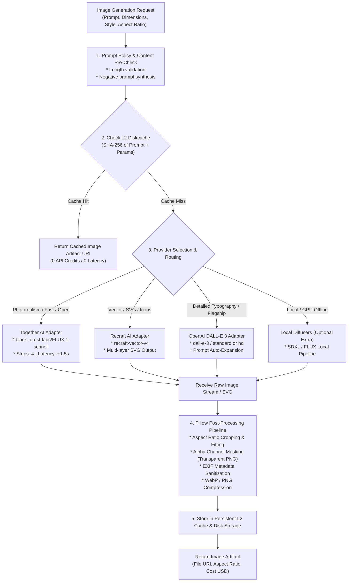

# 09. IMAGE GENERATION ENGINE (ENGINE C) IMPLEMENTATION PLAN

> **Document ID:** `OPENGEN-ENGC-009`  
> **Author:** Principal Software Architect, Senior Full-Stack Engineer, AI Infrastructure Engineer  
> **Project:** OpenGen Framework  
> **Date:** November 2026  
> **Engine:** Engine C (Image Generation)  

---

## 1. Engine Scope & Executive Overview

Engine C provides unified, multi-provider studio-grade image and vector asset generation.

Unlike naive wrappers that offer only standard raster generation, OpenGen distinguishes itself by supporting:
1. **Permissive Open-Weights Generation:** Fast 4-step generation via **FLUX.1 [schnell]** (Apache 2.0) through Together AI / BFL APIs (~$0.035 / image).
2. **Native Scalable Vector (SVG) Generation:** Direct generation of multi-layer, clean vector paths via **Recraft AI Vector V4** for corporate iconography, badges, and logos.
3. **High-Adherence Flagship Generation:** Automated prompt optimization and conversational image manipulation via **OpenAI DALL-E 3** and **GPT-Image-1**.
4. **Deterministic Post-Processing:** Pillow-based aspect ratio normalization, EXIF metadata sanitization, and transparent PNG alpha cutout generation.
5. **Prompt-Hash Persistent Caching:** Disk-backed caching of prompt and parameter hashes (`diskcache`), preventing redundant credit burn on identical requests.

---

## 2. Architectural Pipeline & Execution Flow



---

## 3. Subsystem Architecture & Detailed Specifications

### 3.1 Subsystem 1: Provider Adapters & Abstraction
- **Target Location:** `src/opengen/engines/image/providers/`.
- Every image adapter implements the `AbstractImageProvider` interface:

```python
from abc import ABC, abstractmethod
from typing import Optional
from pydantic import BaseModel

class ImageRequest(BaseModel):
    prompt: str
    negative_prompt: Optional[str] = None
    aspect_ratio: str = "1:1" # 1:1, 16:9, 9:16, 4:3, 3:4
    output_format: str = "png" # png, jpeg, webp, svg
    style: str = "realistic" # realistic, vector_illustration, digital_art, minimal
    transparent_background: bool = False

class ImageResponse(BaseModel):
    data_bytes: bytes
    mime_type: str
    width: int
    height: int
    provider_name: str
    model_name: str
    cost_usd: float

class AbstractImageProvider(ABC):
    @abstractmethod
    async def generate_image(self, request: ImageRequest) -> ImageResponse:
        pass
```

#### Provider Implementations:
1. **`TogetherFluxAdapter` (`together_flux.py`):**
   - Model: `black-forest-labs/FLUX.1-schnell`
   - Maps aspect ratio to exact pixel boundaries ($1024 \times 1024$, $1344 \times 768$, $768 \times 1344$).
   - Cost: ~$0.035 / image.
2. **`RecraftVectorAdapter` (`recraft_vector.py`):**
   - Model: `recraft-vector-v4`
   - Returns true vector paths (`image/svg+xml`).
   - Ideal for presentation slide icons, document diagrams, and branding assets.
3. **`OpenAIDalleAdapter` (`openai_dalle.py`):**
   - Model: `dall-e-3`
   - Enforces automatic revision prompt capture and HD toggle.
   - Cost: $0.040 (standard 1024) / $0.080 (HD).

---

### 3.2 Subsystem 2: Pillow Post-Processing Pipeline
- **Target Location:** `src/opengen/engines/image/compositor.py`.
- **Key Pipeline Steps:**
  1. **Aspect Ratio Normalization:** Computes target aspect ratio and applies smooth downscaling or center cropping if provider dimensions drift.
  2. **EXIF Metadata Stripping:** Eliminates sensitive camera/generation metadata from output binaries to ensure privacy.
  3. **Alpha Channel Masking (Transparent Cutouts):** If `transparent_background=True`, applies a flood-fill or rembg alpha mask to strip white/black backdrops for stickers, logos, and UI components.
  4. **Multi-Format Export:** Emits `.webp` for web performance, `.png` for lossless print quality, or `.svg` for vector assets.

---

### 3.3 Subsystem 3: Prompt Hashing & Persistent Caching
- **Target Location:** `src/opengen/engines/image/cache.py`.
- Generates a deterministic SHA-256 hash of all input parameters:
  $$\text{cache\_key} = \text{SHA-256}(\text{prompt} \,\|\, \text{aspect\_ratio} \,\|\, \text{style} \,\|\, \text{provider})$$
- Looks up key in `diskcache.FanoutCache`:
  - **Hit:** Returns image file from disk immediately. Latency: < 5ms. Cost: $0.00.
  - **Miss:** Invokes provider adapter, writes resulting bytes to disk, and indexes metadata.

---

### 3.4 Subsystem 4: Integration into Document & Presentation Engines
Engine C is designed both as a standalone service and as an asset producer for Engines A and B:
1. **Engine A (Document):** Auto-generates branded report header logos, illustration figures, and article cover images directly embedded into DOCX templates.
2. **Engine B (Presentation):** Auto-generates slide card icons (via Recraft SVG) and full-bleed hero background visuals (via FLUX.1) mapped into PPTX shapes.

---

## 4. Dependencies & Verification Plan

- **Required Dependencies:** `pillow>=10.4.0` (already installed), `httpx>=0.27.0` (already installed), `cairosvg>=2.7.1` (optional for SVG to PNG rasterization).
- **Unit & Integration Test Suite:** `tests/test_image_generation.py`
  - `test_image_request_validation()`: Verifies aspect ratio and format validation.
  - `test_prompt_hash_caching()`: Asserts identical requests hit cache without provider network calls.
  - `test_aspect_ratio_normalization()`: Verifies Pillow post-processing correctly formats dimensions.
  - `test_transparent_alpha_masking()`: Verifies RGBA channel output for transparent requests.

---
*End of Report 09.*
