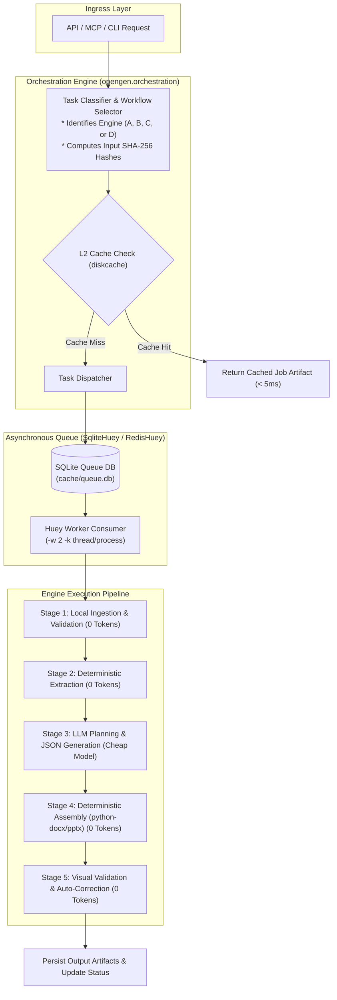

# 11. ORCHESTRATION ENGINE & TOKEN OPTIMIZATION STRATEGY

> **Document ID:** `OPENGEN-ORCH-011`  
> **Author:** Principal Software Architect, Senior Full-Stack Engineer, AI Infrastructure Engineer  
> **Project:** OpenGen Framework  
> **Date:** November 2026  
> **Subsystem:** Async Orchestration & 0-Token Optimization Hierarchy  

---

## 1. Executive Summary

This specification establishes the orchestration architecture and token optimization discipline for OpenGen.

The core economic rule of OpenGen is: **"Never pay an LLM to do what deterministic code can execute for free."**

By combining deterministic local preprocessing, multi-tier disk caching, small-model routing, and provider-side prompt caching, OpenGen reduces API token consumption and financial costs by **75% to 90%** compared to naive agentic frameworks.

---

## 2. Orchestration Architecture & Asynchronous Job Execution

To support long-running generation workflows (such as 20-page document parsing, 3-loop visual layout healing, or 10-slide PowerPoint construction), OpenGen separates the API ingress from job execution using **Huey** (`SqliteHuey` / `RedisHuey`).



### Huey Queue Configuration (`opengen.queue.worker`):
```python
import os
from huey import SqliteHuey, RedisHuey
from opengen.config import settings

if settings.QUEUE_BACKEND == "redis":
    huey = RedisHuey("opengen_tasks", url=settings.REDIS_URL)
else:
    # Zero-daemon SQLite task queue (default)
    os.makedirs(settings.CACHE_DIR, exist_ok=True)
    huey = SqliteHuey("opengen_tasks", filename=str(settings.CACHE_DIR / "queue.db"))
```

---

## 3. The 6 Pillars of Token & Cost Optimization

```
                      TOKEN OPTIMIZATION HIERARCHY
+------------------------------------------------------------------------+
| 1. DETERMINISTIC CODE FIRST                                            |
|    Formatting, styling, XML assembly, table math = 0 Tokens            |
+------------------------------------------------------------------------+
| 2. LOCAL EXTRACTION FIRST                                              |
|    PyMuPDF / RapidOCR extract text locally = 0 Multimodal LLM Tokens   |
+------------------------------------------------------------------------+
| 3. PERSISTENT CONTENT-HASH CACHING                                     |
|    Identical templates/prompts hit diskcache = 0 Tokens                |
+------------------------------------------------------------------------+
| 4. STRUCTURED INTERMEDIATE JSON (NO CODE GEN)                          |
|    LLMs output compact JSON (500 tokens) vs Python scripts (3k tokens)|
+------------------------------------------------------------------------+
| 5. PROVIDER PROMPT CACHING (PREFIX PINNING)                            |
|    System prompts & schemas cached at API boundary = 80-90% Discount   |
+------------------------------------------------------------------------+
| 6. HIERARCHICAL MODEL ROUTING                                          |
|    Route planning to $0.15 - $0.30/1M models; Flagship only on demand  |
+------------------------------------------------------------------------+
```

---

### Pillar 1: Deterministic Code First (0 Tokens)
Many naive AI frameworks ask an LLM to generate raw binary OOXML or write Python scripts that construct documents. This practice is catastrophic:
- Consumes 3,000+ output tokens per document.
- Highly unreliable (syntax errors, broken namespaces, misaligned tables).
- **The OpenGen Rule:** LLMs **never** write binary code or script blocks. OpenGen's deterministic builders (`table_builder.py`, `docx_populator.py`, `builder.py`) assemble the OOXML structures directly.

### Pillar 2: Local Preprocessing Over Multimodal Tokens (0 Tokens)
Sending a 20-page reference PDF to a multimodal LLM consumes ~25,000 input tokens (~$0.075 on Flash; ~$0.15 on GPT-4o) per invocation.
- **The OpenGen Rule:** Local parsers (`PyMuPDFExtractor`, `OCRExtractor`, and regex patterns) extract text, tables, dates, and currency on the host machine using zero cloud tokens. Only the extracted text and structured facts are passed to the model.

### Pillar 3: Multi-Tier Persistent Caching (`diskcache`)
OpenGen implements a 3-tier caching hierarchy:
1. **Tier 1 (Memory):** In-memory LRU cache for hot request-scoped data.
2. **Tier 2 (Disk Cache):** SQLite-backed `diskcache.FanoutCache` storing:
   - Template profiles (`template:profile:<sha256>`)
   - Extracted reference facts (`ref:extracted:<sha256>`)
   - Image prompt results (`image:gen:<sha256>`)
3. **Tier 3 (Immutable Artifact Store):** SHA-256 hashed source files and generated outputs.
- **Result:** If a user re-uses an existing template with new reference data, the template layout is loaded from cache in < 2ms using **0 AI tokens**.

### Pillar 4: Structured Intermediate JSON Representations
Instead of conversational prose, OpenGen requires models to respond strictly with validated Pydantic JSON schemas.
- In presentation planning, the model outputs a concise `SlideDeckSpec` JSON (~800 tokens).
- The `CoordinateGeometryLayoutSolver` then computes all X, Y, width, and height coordinates locally.

### Pillar 5: Provider-Side Prompt Caching (80-90% Discount)
By pinning static system instructions, output schemas, and reference knowledge prefixes at the start of API requests:
- **Anthropic Claude:** Adding `cache_control: {"type": "ephemeral"}` cuts input costs on cached tokens from $3.00/1M down to **$0.30/1M** (Sonnet) and $0.80/1M down to **$0.08/1M** (Haiku).
- **Google Gemini:** Context caching cuts input costs from $0.30/1M down to **$0.03/1M** (Flash).
- **OpenAI:** Automatic prompt caching reduces input costs by **50%** on prompts >1,024 tokens.

### Pillar 6: Hierarchical Model Routing
OpenGen's `ProviderManager` dynamically assigns models based on task complexity:
- **Trivial extraction & basic classification:** Local `ollama/qwen3:8b` ($0.00).
- **Structured slide planning & document mapping:** `gemini-2.5-flash` ($0.30/1M in, $2.50/1M out) or `gpt-4o-mini` ($0.15/1M in, $0.60/1M out).
- **High-stakes synthesis:** Flagship reasoning models (`claude-3-5-sonnet`) are reserved only for complex ambiguity resolution when explicitly enabled.

---

## 4. End-to-End Cost Benchmark Model

Calculated generation costs across OpenGen engines using the optimization hierarchy:

| Task Type | Standard Unoptimized Cost | OpenGen Optimized Cost | Token & Cost Savings |
|---|---|---|---|
| **5-Page Complex Document** (Template + 2 Ref PDFs) | $0.2800 (Multimodal Vision + Code Gen) | **$0.0076** (Local Extract + Gemini Flash JSON) | **> 97% Savings** |
| **10-Slide Editable PPTX Deck** | $0.1500 (Heavy Agent Iterations) | **$0.0051** (Flash Planning + Python Geometry) | **> 96% Savings** |
| **Re-running Existing Template** | $0.0800 (Re-analyzing styles) | **$0.0000** (100% L2 Diskcache Hit) | **100% Savings** |
| **Single Slide Regeneration** | $0.0500 (Rebuilding full deck) | **$0.0008** (Single-Node LLM Edit) | **> 98% Savings** |

---
*End of Report 11.*
