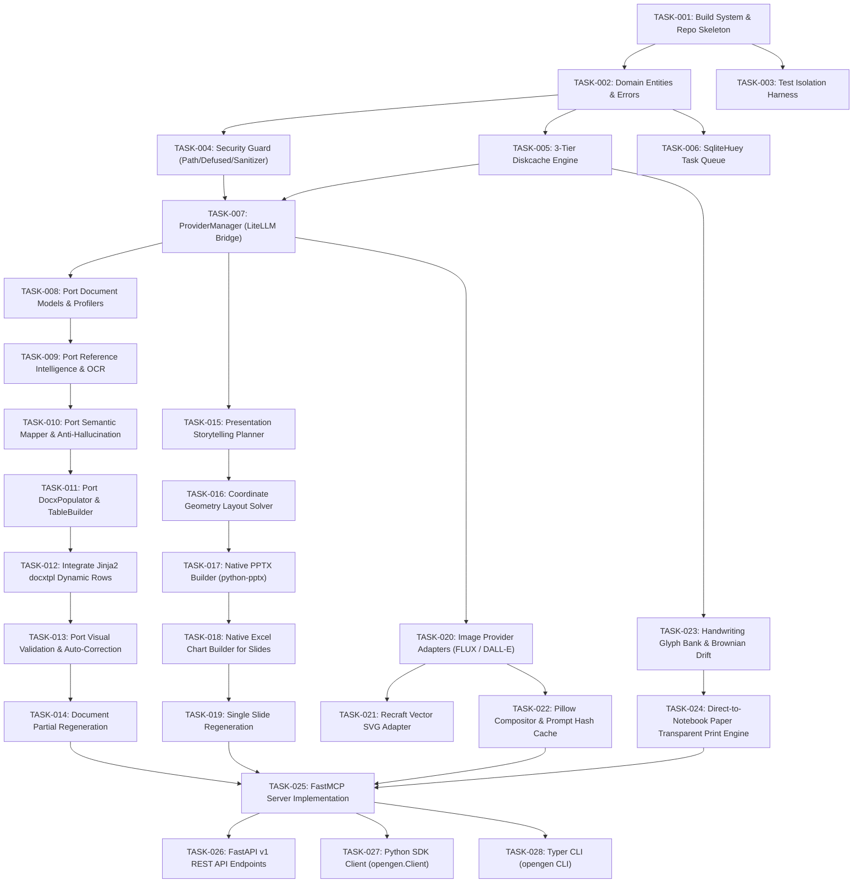

# 16. DETAILED ENGINEERING TASK BREAKDOWN

> **Document ID:** `OPENGEN-TASKS-016`  
> **Author:** Principal Software Architect, Senior Full-Stack Engineer, AI Infrastructure Engineer  
> **Project:** OpenGen Framework  
> **Date:** November 2026  
> **Task Structure:** Granular, agent-executable, test-driven units of work  

---

## 1. Overview & Task Dependency Graph

The transformation of OpenGen is broken down into **28 atomic engineering tasks**. Each task is designed to be independently implemented, unit-tested, and verified by an autonomous coding agent or software engineer.

---

## 2. Granular Task Specifications

---

### TASK ID: TASK-001
**TASK NAME:** Modern Build System, Packaging & Repository Skeleton Setup  
**PRIORITY:** P0 (Blocker)  
**CURRENT STATE:** Code resides in flat `app/` folder with `requirements.txt`. Cannot be installed via `pip install -e .`.  
**EXISTING FILES:** `requirements.txt`, `README.md`  
**FILES TO CREATE:** `pyproject.toml`, `src/opengen/__init__.py`, `LICENSE`  
**FILES TO MODIFY:** None  
**FILES TO REMOVE:** None  
**DESCRIPTION:** Establish standard Python packaging using Hatchling build backend. Define project metadata, required dependencies, and optional extras (`[docling]`, `[weasyprint]`, `[diffusers]`, `[dev]`). Initialize `src/opengen/` package directory skeleton.  
**IMPLEMENTATION REQUIREMENTS:**
- Implement `pyproject.toml` per Report 13 specification.
- Expose `src/opengen/__init__.py` with `__version__ = "1.0.0"`.
- Support `pip install -e .` without errors.  
**DEPENDENCIES:** Python 3.11+  
**REUSE OPPORTUNITIES:** Pin versions from existing `requirements.txt`.  
**TEST CASES:** Run `pip install -e .` and verify `python -c "import opengen; print(opengen.__version__)"`.  
**ACCEPTANCE CRITERIA:** `opengen` package is importable in the virtual environment.  
**COMPLEXITY:** Low  
**BLOCKING TASKS:** None  
**DEFINITION OF DONE:** `pyproject.toml` builds wheel cleanly; `import opengen` succeeds.

---

### TASK ID: TASK-002
**TASK NAME:** Domain Entities, Enums & Error Hierarchy  
**PRIORITY:** P0 (Blocker)  
**CURRENT STATE:** Pydantic models are scattered across `app/models/` and mixed with API DTOs.  
**EXISTING FILES:** `app/models/template_profile.py`, `app/models/extracted_info.py`, `app/models/mapping.py`, `app/models/validation_report.py`, `app/models/token_report.py`  
**FILES TO CREATE:**
- `src/opengen/domain/errors.py`
- `src/opengen/domain/job.py`
- `src/opengen/domain/document.py`
- `src/opengen/domain/presentation.py`
- `src/opengen/domain/image.py`
- `src/opengen/domain/handwriting.py`
- `src/opengen/domain/provider.py`  
**FILES TO MODIFY:** None  
**FILES TO REMOVE:** None  
**DESCRIPTION:** Create clean, zero-external-IO domain models and a strongly-typed OpenGen exception hierarchy.  
**IMPLEMENTATION REQUIREMENTS:**
- Define `OpenGenError`, `SecurityViolationError`, `ProviderError`, `LayoutValidationError`.
- Consolidate template geometry, extracted knowledge, and mapping reports into `document.py`.
- Define presentation specs (`SlideDeckSpec`, `SlideCard`, `ChartSpec`) in `presentation.py`.
- Define image specs (`ImageRequest`, `ImageResponse`) in `image.py`.
- Define handwriting specs (`HandwritingProfile`, `RuledPaperSpecs`) in `handwriting.py`.  
**DEPENDENCIES:** Pydantic V2  
**REUSE OPPORTUNITIES:** Direct porting of existing model classes from `app/models/`.  
**TEST CASES:** Unit test validating serialization and schema generation of all domain models.  
**ACCEPTANCE CRITERIA:** All domain classes serialize/deserialize cleanly with strict typing.  
**COMPLEXITY:** Low  
**BLOCKING TASKS:** TASK-001  
**DEFINITION OF DONE:** All domain models in `src/opengen/domain/` compile and pass type checks.

---

### TASK ID: TASK-003
**TASK NAME:** Isolated Test Harness & Global State Sandboxing  
**PRIORITY:** P0 (Blocker)  
**CURRENT STATE:** Tests share `.ai-document-memory/metadata.db`, causing 2 cross-run assertion failures.  
**EXISTING FILES:** `tests/test_end_to_end.py`, `tests/test_input_manager.py`  
**FILES TO CREATE:** `tests/conftest.py`  
**FILES TO MODIFY:** `tests/test_end_to_end.py`, `tests/test_input_manager.py`  
**FILES TO REMOVE:** None  
**DESCRIPTION:** Implement session and per-test fixtures in `conftest.py` creating isolated temporary directories for SQLite databases, caches, and upload files.  
**IMPLEMENTATION REQUIREMENTS:**
- Use `tempfile.mkdtemp` and `monkeypatch` to redirect `OPENGEN_CACHE_DIR` and `OPENGEN_UPLOAD_DIR`.
- Isolate SQLite database per test session.
- Fix `test_cache_invalidation_on_file_change` and `test_duplicate_detection`.  
**DEPENDENCIES:** `pytest>=8.3.0`  
**REUSE OPPORTUNITIES:** Reuses existing test cases in `tests/`.  
**TEST CASES:** Execute `python -m pytest` twice consecutively and assert 0 failures.  
**ACCEPTANCE CRITERIA:** All existing 22 tests pass with 100% green status.  
**COMPLEXITY:** Medium  
**BLOCKING TASKS:** TASK-001, TASK-002  
**DEFINITION OF DONE:** Pytest executes without state contamination across repeated runs.

---

### TASK ID: TASK-004
**TASK NAME:** Security Guard (PathGuard, DefusedXML, LogSanitizer)  
**PRIORITY:** P0 (Critical Security)  
**CURRENT STATE:** Basic filename regex in `validator.py`; no XML entity expansion defense; potential key logging.  
**EXISTING FILES:** `app/modules/input_manager/validator.py`  
**FILES TO CREATE:**
- `src/opengen/security/path_guard.py`
- `src/opengen/security/xml_guard.py`
- `src/opengen/security/sanitizer.py`
- `src/opengen/security/network_guard.py`  
**FILES TO MODIFY:** None  
**FILES TO REMOVE:** None  
**DESCRIPTION:** Implement strict path traversal blocking via `is_relative_to(ALLOWED_WORKSPACE)`, XML Entity Expansion (Billion Laughs) defense via `defusedxml`, log sanitizer filter scrubbing API keys, and SSRF guard.  
**IMPLEMENTATION REQUIREMENTS:**
- Implement `PathGuard.assert_safe_path()` resolving real paths and symlinks.
- Implement `SafePackageExtractor` parsing OOXML packages with `defusedxml`.
- Implement `LogSanitizerFilter` scrubbing `sk-`, `AIza`, `together_`, and `Bearer`.
- Implement `assert_safe_remote_url` blocking loopback, RFC1918, and `169.254.169.254`.  
**DEPENDENCIES:** `defusedxml>=0.7.1`  
**REUSE OPPORTUNITIES:** Port filename sanitization logic from `validator.py`.  
**TEST CASES:** `tests/test_security.py` asserting path escapes throw `SecurityViolationError`.  
**ACCEPTANCE CRITERIA:** Blocks traversal, Billion Laughs XML, and sanitizes keys in logs.  
**COMPLEXITY:** Medium  
**BLOCKING TASKS:** TASK-002  
**DEFINITION OF DONE:** Security test suite passes 100% of malicious payload test cases.

---

### TASK ID: TASK-005
**TASK NAME:** 3-Tier Persistent Cache Engine (`diskcache`)  
**PRIORITY:** P1 (Performance)  
**CURRENT STATE:** Custom SQLite queries in `storage.py` storing JSON strings without LRU or TTL.  
**EXISTING FILES:** `app/modules/memory_cache/storage.py`  
**FILES TO CREATE:** `src/opengen/cache/disk_store.py`  
**FILES TO MODIFY:** None  
**FILES TO REMOVE:** None  
**DESCRIPTION:** Implement a 3-tier caching hierarchy backed by `diskcache.FanoutCache`. Support fast in-memory L1, persistent SQLite L2 with LRU eviction and size limits (5 GB), and immutable L3 artifact storage.  
**IMPLEMENTATION REQUIREMENTS:**
- Provide typed methods: `get_template_profile(hash)`, `set_template_profile(hash, data)`.
- Support tag-based invalidation and TTL.
- Guarantee multi-process safety.  
**DEPENDENCIES:** `diskcache>=5.6.3`  
**REUSE OPPORTUNITIES:** Port schema concepts from `storage.py`.  
**TEST CASES:** `tests/test_cache.py` verifying cache hits, eviction, and process safety.  
**ACCEPTANCE CRITERIA:** Sub-millisecond retrieval of cached profiles and extractions.  
**COMPLEXITY:** Low  
**BLOCKING TASKS:** TASK-002  
**DEFINITION OF DONE:** DiskCacheManager successfully passes unit test suite.

---

### TASK ID: TASK-006
**TASK NAME:** Zero-Daemon Async Task Queue (`SqliteHuey` / `RedisHuey`)  
**PRIORITY:** P1 (Infrastructure)  
**CURRENT STATE:** Relies on `fastapi.BackgroundTasks` inside web worker processes.  
**EXISTING FILES:** `app/web/routes.py`  
**FILES TO CREATE:** `src/opengen/queue/worker.py`, `src/opengen/queue/tasks.py`  
**FILES TO MODIFY:** None  
**FILES TO REMOVE:** None  
**DESCRIPTION:** Configure Huey async task queue. Provide `SqliteHuey` as default zero-daemon broker storing tasks in SQLite, with one-line config toggle to `RedisHuey`.  
**IMPLEMENTATION REQUIREMENTS:**
- Implement `@huey.task()` wrappers for engine generation jobs.
- Support job status polling, progress updates, and error capture.
- Support task timeouts (default: 300s).  
**DEPENDENCIES:** `huey>=2.5.0`  
**REUSE OPPORTUNITIES:** Reuses job state definitions from `api_schemas.py`.  
**TEST CASES:** `tests/test_queue.py` verifying background task queuing and completion.  
**ACCEPTANCE CRITERIA:** Tasks execute asynchronously outside web request lifecycles.  
**COMPLEXITY:** Medium  
**BLOCKING TASKS:** TASK-002, TASK-005  
**DEFINITION OF DONE:** Huey worker executes background tasks and stores results in cache.

---

### TASK ID: TASK-007
**TASK NAME:** Unified Provider Manager (`LiteLLM` Multi-Provider Bridge)  
**PRIORITY:** P0 (Core Foundation)  
**CURRENT STATE:** Hardcoded `google-generativeai` and raw `urllib` Ollama calls in `ai_router.py`.  
**EXISTING FILES:** `app/modules/token_optimization/ai_router.py`, `app/modules/token_optimization/tracker.py`  
**FILES TO CREATE:**
- `src/opengen/providers/manager.py`
- `src/opengen/providers/registry.py`
- `src/opengen/telemetry/cost_tracker.py`  
**FILES TO MODIFY:** None  
**FILES TO REMOVE:** None  
**DESCRIPTION:** Implement `ProviderManager` wrapping `LiteLLM`. Standardize structured JSON response decoding across Google Gemini, OpenAI, Claude, Together AI, and Ollama. Implement task routing, fallback chains, and exact USD cost tracking.  
**IMPLEMENTATION REQUIREMENTS:**
- Implement `generate_structured(prompt, response_model, model, fallbacks)`.
- Support BYOK per-request API key injection.
- Implement rate table in `registry.py` with dynamic cost calculation.  
**DEPENDENCIES:** `litellm>=1.55.0`  
**REUSE OPPORTUNITIES:** Reuses token tracking concepts from `tracker.py`.  
**TEST CASES:** `tests/test_provider_manager.py` with mocked provider responses.  
**ACCEPTANCE CRITERIA:** Validates structured Pydantic models from LLM responses; tracks costs.  
**COMPLEXITY:** High  
**BLOCKING TASKS:** TASK-002, TASK-004  
**DEFINITION OF DONE:** Successfully routes JSON generation tasks with automatic fallback.

---

### TASK ID: TASK-008
**TASK NAME:** Port Document Template Profilers (DOCX & PDF)  
**PRIORITY:** P1 (Engine A)  
**CURRENT STATE:** Located in `app/modules/template_intelligence/`.  
**EXISTING FILES:** `app/modules/template_intelligence/docx_analyzer.py`, `pdf_analyzer.py`, `profiler.py`  
**FILES TO CREATE:**
- `src/opengen/engines/document/template/docx_analyzer.py`
- `src/opengen/engines/document/template/pdf_analyzer.py`
- `src/opengen/engines/document/template/profiler.py`  
**FILES TO MODIFY:** None  
**FILES TO REMOVE:** None  
**DESCRIPTION:** Port existing DOCX and PDF template analyzers into `src/opengen/engines/document/template/`. Connect caching to `DiskCacheManager`.  
**IMPLEMENTATION REQUIREMENTS:**
- Preserve 100% of existing regex patterns and geometry extraction.
- Replace SQLite cache calls with `DiskCacheManager`.
- Return domain `TemplateProfile` objects.  
**DEPENDENCIES:** `python-docx`, `fitz (PyMuPDF)`  
**REUSE OPPORTUNITIES:** Port existing files with zero logic rewrites.  
**TEST CASES:** `tests/test_template_analysis.py` asserting profile geometry matches fixtures.  
**ACCEPTANCE CRITERIA:** Extracts styles, margins, headers, tables, and placeholders accurately.  
**COMPLEXITY:** Low  
**BLOCKING TASKS:** TASK-002, TASK-005  
**DEFINITION OF DONE:** Analyzers compile and pass existing template profiling tests.

---

### TASK ID: TASK-009
**TASK NAME:** Port Reference Document Intelligence & OCR Extractor  
**PRIORITY:** P1 (Engine A)  
**CURRENT STATE:** Located in `app/modules/reference_intelligence/`.  
**EXISTING FILES:** `app/modules/reference_intelligence/pymupdf_extractor.py`, `ocr_extractor.py`, `information_extractor.py`, `docling_extractor.py`  
**FILES TO CREATE:**
- `src/opengen/engines/document/reference/pymupdf_extractor.py`
- `src/opengen/engines/document/reference/ocr_extractor.py`
- `src/opengen/engines/document/reference/extractor.py`
- `src/opengen/engines/document/reference/docling_extractor.py`  
**FILES TO MODIFY:** None  
**FILES TO REMOVE:** None  
**DESCRIPTION:** Port reference extraction modules. Re-point AI entity extraction calls to `ProviderManager`. Implement lazy loading for RapidOCR.  
**IMPLEMENTATION REQUIREMENTS:**
- Fast local text and table extraction via PyMuPDF.
- Lazy initialization of RapidOCR ONNX runtime.
- Retain page numbers and confidence scores.  
**DEPENDENCIES:** `fitz`, `rapidocr`, `onnxruntime`  
**REUSE OPPORTUNITIES:** Port existing code directly.  
**TEST CASES:** `tests/test_reference_extraction.py` validating digital and scanned PDFs.  
**ACCEPTANCE CRITERIA:** Accurately extracts facts, tables, and dates with 0 cloud tokens for digital docs.  
**COMPLEXITY:** Medium  
**BLOCKING TASKS:** TASK-002, TASK-007  
**DEFINITION OF DONE:** Extraction pipeline passes unit tests for both digital and scanned PDFs.

---

### TASK ID: TASK-010
**TASK NAME:** Port Semantic Mapping & Anti-Hallucination Validator  
**PRIORITY:** P1 (Engine A)  
**CURRENT STATE:** Located in `app/modules/intelligent_mapping/`.  
**EXISTING FILES:** `app/modules/intelligent_mapping/mapper.py`, `validator.py`  
**FILES TO CREATE:**
- `src/opengen/engines/document/mapping/mapper.py`
- `src/opengen/engines/document/mapping/validator.py`  
**FILES TO MODIFY:** None  
**FILES TO REMOVE:** None  
**DESCRIPTION:** Port intelligent semantic mapper and anti-hallucination verification into `src/opengen/engines/document/mapping/`. Connect AI ambiguity resolution to `ProviderManager`.  
**IMPLEMENTATION REQUIREMENTS:**
- Preserve `SYNONYM_GROUPS` and candidate scoring heuristics.
- Validate that mapped values exist in reference text snippets.
- Flag conflicts and trigger user clarification requests.  
**DEPENDENCIES:** `src/opengen/providers/manager.py`  
**REUSE OPPORTUNITIES:** Direct port of existing mapper and anti-hallucination code.  
**TEST CASES:** `tests/test_mapping.py` verifying direct, semantic, and conflicting field matches.  
**ACCEPTANCE CRITERIA:** Blocks unverified sensitive values; generates clarification questions.  
**COMPLEXITY:** Medium  
**BLOCKING TASKS:** TASK-002, TASK-007  
**DEFINITION OF DONE:** Passes all existing anti-hallucination test cases.

---

### TASK ID: TASK-011
**TASK NAME:** Port DocxPopulator & Advanced TableBuilder  
**PRIORITY:** P1 (Engine A)  
**CURRENT STATE:** Located in `app/modules/document_generation/`.  
**EXISTING FILES:** `app/modules/document_generation/docx_populator.py`, `table_builder.py`, `pdf_reconstructor.py`  
**FILES TO CREATE:**
- `src/opengen/engines/document/table_builder.py`
- `src/opengen/engines/document/docx_populator.py`
- `src/opengen/engines/document/pdf_reconstructor.py`  
**FILES TO MODIFY:** None  
**FILES TO REMOVE:** None  
**DESCRIPTION:** Port OOXML table builder, template populator, and PDF reconstructor into `src/opengen/engines/document/`.  
**IMPLEMENTATION REQUIREMENTS:**
- Enforce `w:cantSplit` and `w:tblHeader` on all generated tables.
- Preserve 100% of original template styles, fonts, and headers/footers.
- Reconstruct PDF visual layouts into editable Word paragraphs.  
**DEPENDENCIES:** `python-docx`, `lxml`  
**REUSE OPPORTUNITIES:** Direct port of existing high-quality OOXML manipulation code.  
**TEST CASES:** `tests/test_docx_generation.py` asserting generated DOCX is valid and styled.  
**ACCEPTANCE CRITERIA:** Generated Word document matches template styles and prevents broken tables.  
**COMPLEXITY:** Medium  
**BLOCKING TASKS:** TASK-002, TASK-004  
**DEFINITION OF DONE:** Passes unit tests for template preservation and PDF reconstruction.

---

### TASK ID: TASK-012
**TASK NAME:** Jinja2 Dynamic Row Expansion (`DocxTplEngine`)  
**PRIORITY:** P1 (Engine A Feature)  
**CURRENT STATE:** `docxtpl` is installed in `requirements.txt` but not utilized in code.  
**EXISTING FILES:** None  
**FILES TO CREATE:** `src/opengen/engines/document/template/docxtpl_engine.py`  
**FILES TO MODIFY:** `src/opengen/engines/document/docx_populator.py`  
**FILES TO REMOVE:** None  
**DESCRIPTION:** Implement isolated Jinja2 template merger supporting dynamic table row expansion (``), conditional sections, and rich text runs.  
**IMPLEMENTATION REQUIREMENTS:**
- Wrap `docxtpl.DocxTemplate` behind an isolated interface.
- Automatically detect Jinja2 syntax tags vs plain bracket placeholders.
- Apply `TableBuilder` OOXML properties on rendered dynamic tables.  
**DEPENDENCIES:** `docxtpl>=0.19.0`, `jinja2`  
**REUSE OPPORTUNITIES:** Interfaces with `table_builder.py`.  
**TEST CASES:** `tests/test_docxtpl_rendering.py` with dynamic 5-row table expansion.  
**ACCEPTANCE CRITERIA:** Iterates array data and clones table rows without corrupting styles.  
**COMPLEXITY:** Medium  
**BLOCKING TASKS:** TASK-011  
**DEFINITION OF DONE:** Successfully expands array data into styled Word tables.

---

### TASK ID: TASK-013
**TASK NAME:** Port Visual Validation, Renderer & Auto-Correction Loop  
**PRIORITY:** P1 (Engine A)  
**CURRENT STATE:** Located in `app/modules/visual_validation/`.  
**EXISTING FILES:** `app/modules/visual_validation/renderer.py`, `inspector.py`, `auto_corrector.py`  
**FILES TO CREATE:**
- `src/opengen/engines/document/validation/renderer.py`
- `src/opengen/engines/document/validation/inspector.py`
- `src/opengen/engines/document/validation/auto_corrector.py`  
**FILES TO MODIFY:** None  
**FILES TO REMOVE:** None  
**DESCRIPTION:** Port visual document validation. Inspect rendered PDF pages for overflow, blank pages, and clipped tables. Execute 3-loop auto-correction tightening paragraph spacing and font sizes.  
**IMPLEMENTATION REQUIREMENTS:**
- Retain PyMuPDF page inspection heuristics.
- Retain Word COM and headless LibreOffice conversion pipelines.
- Add WeasyPrint direct HTML-to-PDF export option.  
**DEPENDENCIES:** `fitz`, `python-docx`  
**REUSE OPPORTUNITIES:** Direct port of existing visual validation logic.  
**TEST CASES:** `tests/test_visual_validation.py` asserting overflow detection and correction.  
**ACCEPTANCE CRITERIA:** Auto-corrects overflowing document back to target page count.  
**COMPLEXITY:** Medium  
**BLOCKING TASKS:** TASK-011  
**DEFINITION OF DONE:** Passes auto-correction loop unit test.

---

### TASK ID: TASK-014
**TASK NAME:** Document Section & Partial Regeneration  
**PRIORITY:** P2 (Engine A Feature)  
**CURRENT STATE:** Missing. Must regenerate entire document for minor changes.  
**EXISTING FILES:** None  
**FILES TO CREATE:** `src/opengen/engines/document/regenerate.py`  
**FILES TO MODIFY:** `src/opengen/engines/document/docx_populator.py`  
**FILES TO REMOVE:** None  
**DESCRIPTION:** Implement targeted partial regeneration. Accepts an existing DOCX file, targets a specific section or table index, updates only that node, and re-validates affected pages.  
**IMPLEMENTATION REQUIREMENTS:**
- Target specific XML paragraph/table nodes without re-generating full document.
- Save modified document and run visual check on edited page.  
**DEPENDENCIES:** `python-docx`, `lxml`  
**REUSE OPPORTUNITIES:** Reuses `table_builder.py` and `inspector.py`.  
**TEST CASES:** `tests/test_document_regeneration.py` modifying table 1 in-place.  
**ACCEPTANCE CRITERIA:** Updates specific section in < 1 second; preserves rest of document.  
**COMPLEXITY:** Medium  
**BLOCKING TASKS:** TASK-011, TASK-013  
**DEFINITION OF DONE:** Targeted node update succeeds without altering adjacent sections.

---

### TASK ID: TASK-015
**TASK NAME:** Presentation Storytelling & Outline Planner (Engine B)  
**PRIORITY:** P1 (Engine B Foundation)  
**CURRENT STATE:** Missing. Zero presentation code in repository.  
**EXISTING FILES:** None  
**FILES TO CREATE:** `src/opengen/engines/presentation/planner.py`  
**FILES TO MODIFY:** None  
**FILES TO REMOVE:** None  
**DESCRIPTION:** Implement LLM slide deck planner. Accepts topic, target slide count, and source documents, producing a structured `PresentationDeckSpec` JSON schema (titles, cards, metrics, charts).  
**IMPLEMENTATION REQUIREMENTS:**
- Calls `ProviderManager` with `response_model=PresentationDeckSpec`.
- Generates 16:9 narrative structures (Hero, Section, 2-Col, 3-Col, Metrics, Charts).  
**DEPENDENCIES:** `src/opengen/providers/manager.py`  
**REUSE OPPORTUNITIES:** Reuses domain models from `src/opengen/domain/presentation.py`.  
**TEST CASES:** `tests/test_presentation_planner.py` asserting valid JSON schema output.  
**ACCEPTANCE CRITERIA:** Generates complete 8-12 slide deck outline matching Pydantic spec.  
**COMPLEXITY:** Medium  
**BLOCKING TASKS:** TASK-002, TASK-007  
**DEFINITION OF DONE:** Produces fully validated `PresentationDeckSpec` from user prompt.

---

### TASK ID: TASK-016
**TASK NAME:** Coordinate Geometry Layout Solver (Engine B)  
**PRIORITY:** P1 (Engine B Core)  
**CURRENT STATE:** Missing.  
**EXISTING FILES:** None  
**FILES TO CREATE:** `src/opengen/engines/presentation/layout_solver.py`  
**FILES TO MODIFY:** None  
**FILES TO REMOVE:** None  
**DESCRIPTION:** Implement deterministic coordinate geometry solver for 16:9 slides (13.333" x 7.5"). Solves exact X, Y, Width, and Height for 1, 2, 3, and 4-column cards and implements dynamic font-scaling overflow guard.  
**IMPLEMENTATION REQUIREMENTS:**
- Implement mathematical layout formulas from Report 8.
- Dynamically scale down font sizes (18pt -> 12pt) if text exceeds card height.
- Output absolute coordinates in inches for `python-pptx`.  
**DEPENDENCIES:** Pure Python math  
**REUSE OPPORTUNITIES:** None  
**TEST CASES:** `tests/test_layout_solver.py` asserting non-overlapping bounding boxes.  
**ACCEPTANCE CRITERIA:** Zero shape overlap; zero text overflow past slide margins.  
**COMPLEXITY:** Medium  
**BLOCKING TASKS:** TASK-002, TASK-015  
**DEFINITION OF DONE:** Passes geometric boundary assertions across all 7 layout types.

---

### TASK ID: TASK-017
**TASK NAME:** Native PPTX Builder (`python-pptx`)  
**PRIORITY:** P1 (Engine B Core)  
**CURRENT STATE:** Missing.  
**EXISTING FILES:** None  
**FILES TO CREATE:**
- `src/opengen/engines/presentation/builder.py`
- `src/opengen/engines/presentation/themes.py`  
**FILES TO MODIFY:** None  
**FILES TO REMOVE:** None  
**DESCRIPTION:** Build native PowerPoint presentation from solved geometry. Creates genuine shapes, text frames with word wrap, cards, and theme color palettes. Output remains 100% editable in PowerPoint.  
**IMPLEMENTATION REQUIREMENTS:**
- Use `python-pptx` to construct 16:9 presentations.
- Apply corporate themes (`modern_corporate`, `ocean_blue`, `warm_editorial`, `dark_tech`).
- Guarantee every element is an editable native shape (no flattened images).  
**DEPENDENCIES:** `python-pptx>=1.0.2`  
**REUSE OPPORTUNITIES:** Uses output from `layout_solver.py`.  
**TEST CASES:** `tests/test_pptx_builder.py` verifying PPTX opens and contains editable text.  
**ACCEPTANCE CRITERIA:** Generated `.pptx` file opens in Microsoft PowerPoint without repair warnings.  
**COMPLEXITY:** High  
**BLOCKING TASKS:** TASK-016  
**DEFINITION OF DONE:** Successfully generates multi-slide editable `.pptx` presentation.

---

### TASK ID: TASK-018
**TASK NAME:** Native Excel-Backed Chart Builder for Slides  
**PRIORITY:** P1 (Engine B Feature)  
**CURRENT STATE:** Missing.  
**EXISTING FILES:** None  
**FILES TO CREATE:** `src/opengen/engines/presentation/charts.py`  
**FILES TO MODIFY:** `src/opengen/engines/presentation/builder.py`  
**FILES TO REMOVE:** None  
**DESCRIPTION:** Implement native PowerPoint chart injection using `python-pptx.chart.data.CategoryChartData`. Supports Bar, Column, Line, and Pie charts backed by real embedded Excel worksheets.  
**IMPLEMENTATION REQUIREMENTS:**
- Add native charts via `slide.shapes.add_chart()`.
- Populate category labels and numerical data series.
- Style chart colors to match presentation theme palette.  
**DEPENDENCIES:** `python-pptx`  
**REUSE OPPORTUNITIES:** Interfaces with `builder.py`.  
**TEST CASES:** `tests/test_pptx_charts.py` verifying chart XML structure.  
**ACCEPTANCE CRITERIA:** Double-clicking chart in PowerPoint opens editable Excel datasheet.  
**COMPLEXITY:** Medium  
**BLOCKING TASKS:** TASK-017  
**DEFINITION OF DONE:** Injects editable Excel-backed charts into PowerPoint slides.

---

### TASK ID: TASK-019
**TASK NAME:** Slide-Level Single Slide Regeneration  
**PRIORITY:** P2 (Engine B Feature)  
**CURRENT STATE:** Missing.  
**EXISTING FILES:** None  
**FILES TO CREATE:** `src/opengen/engines/presentation/regenerate.py`  
**FILES TO MODIFY:** None  
**FILES TO REMOVE:** None  
**DESCRIPTION:** Implement slide-level regeneration. Allows users to modify a single slide (e.g. rewrite content or switch to chart) without rebuilding the entire deck.  
**IMPLEMENTATION REQUIREMENTS:**
- Locate specific slide index in existing `.pptx`.
- Clear shapes on that slide and rebuild layout in-place.
- Complete execution in < 1.5 seconds.  
**DEPENDENCIES:** `python-pptx`  
**REUSE OPPORTUNITIES:** Reuses `layout_solver.py` and `builder.py`.  
**TEST CASES:** `tests/test_pptx_regenerate.py` modifying slide 2 of a 5-slide deck.  
**ACCEPTANCE CRITERIA:** Modifies targeted slide; leaves surrounding slides untouched.  
**COMPLEXITY:** Medium  
**BLOCKING TASKS:** TASK-017, TASK-018  
**DEFINITION OF DONE:** In-place slide regeneration unit test passes.

---

### TASK ID: TASK-020
**TASK NAME:** Image Provider Adapters (FLUX.1 Schnell & DALL-E 3)  
**PRIORITY:** P1 (Engine C Core)  
**CURRENT STATE:** Missing.  
**EXISTING FILES:** None  
**FILES TO CREATE:**
- `src/opengen/engines/image/providers/base.py`
- `src/opengen/engines/image/providers/together_flux.py`
- `src/opengen/engines/image/providers/openai_dalle.py`  
**FILES TO MODIFY:** None  
**FILES TO REMOVE:** None  
**DESCRIPTION:** Implement image provider adapters for Together AI (`FLUX.1-schnell` Apache 2.0) and OpenAI (`DALL-E 3`). Standardize request and response data models.  
**IMPLEMENTATION REQUIREMENTS:**
- Implement `AbstractImageProvider` interface.
- Map aspect ratios (1:1, 16:9, 9:16) to valid provider pixel dimensions.
- Capture generated bytes, mime-type, and cost metrics.  
**DEPENDENCIES:** `httpx>=0.27.0`  
**REUSE OPPORTUNITIES:** Reuses `src/opengen/domain/image.py`.  
**TEST CASES:** `tests/test_image_providers.py` with mocked provider responses.  
**ACCEPTANCE CRITERIA:** Returns standardized `ImageResponse` with valid byte stream.  
**COMPLEXITY:** Medium  
**BLOCKING TASKS:** TASK-002, TASK-007  
**DEFINITION OF DONE:** Generates image bytes from both Together FLUX and OpenAI adapters.

---

### TASK ID: TASK-021
**TASK NAME:** Recraft Native Vector (SVG) Adapter  
**PRIORITY:** P2 (Engine C Feature)  
**CURRENT STATE:** Missing.  
**EXISTING FILES:** None  
**FILES TO CREATE:** `src/opengen/engines/image/providers/recraft_vector.py`  
**FILES TO MODIFY:** None  
**FILES TO REMOVE:** None  
**DESCRIPTION:** Implement Recraft AI Vector V4 adapter for generating scalable, clean vector SVG assets for logos, iconography, and diagram shapes.  
**IMPLEMENTATION REQUIREMENTS:**
- Request `image/svg+xml` from Recraft API.
- Validate returned XML with `defusedxml`.
- Save as clean `.svg` file.  
**DEPENDENCIES:** `httpx`, `defusedxml`  
**REUSE OPPORTUNITIES:** Reuses `AbstractImageProvider`.  
**TEST CASES:** `tests/test_recraft_vector.py` validating SVG output paths.  
**ACCEPTANCE CRITERIA:** Emits scalable vector SVG asset without raster artifacts.  
**COMPLEXITY:** Medium  
**BLOCKING TASKS:** TASK-020  
**DEFINITION OF DONE:** Returns valid vector SVG files suitable for embedding in documents/slides.

---

### TASK ID: TASK-022
**TASK NAME:** Pillow Compositor & Prompt-Hash Persistent Cache  
**PRIORITY:** P1 (Engine C Core)  
**CURRENT STATE:** Missing.  
**EXISTING FILES:** None  
**FILES TO CREATE:**
- `src/opengen/engines/image/compositor.py`
- `src/opengen/engines/image/cache.py`
- `src/opengen/engines/image/engine.py`  
**FILES TO MODIFY:** None  
**FILES TO REMOVE:** None  
**DESCRIPTION:** Implement Pillow post-processing (aspect ratio normalization, EXIF stripping, transparent PNG cutout masking) and SHA-256 prompt-hash persistent caching via `diskcache`.  
**IMPLEMENTATION REQUIREMENTS:**
- Generate SHA-256 hash of prompt and styling parameters.
- Cache hit returns local file in < 5ms with $0.00 cost.
- Strip EXIF tags for privacy; apply alpha masking for transparent cutouts.  
**DEPENDENCIES:** `pillow>=10.4.0`, `diskcache`  
**REUSE OPPORTUNITIES:** Reuses `DiskCacheManager` from TASK-005.  
**TEST CASES:** `tests/test_image_engine.py` testing prompt cache hits and aspect ratio cropping.  
**ACCEPTANCE CRITERIA:** Repeated identical prompts return cached URI without network calls.  
**COMPLEXITY:** Medium  
**BLOCKING TASKS:** TASK-005, TASK-020  
**DEFINITION OF DONE:** Complete `ImageEngine` operational with post-processing and caching.

---

### TASK ID: TASK-023
**TASK NAME:** Handwriting Glyph Bank & Brownian Drift Simulator (Engine D)  
**PRIORITY:** P1 (Engine D Core)  
**CURRENT STATE:** Missing.  
**EXISTING FILES:** None  
**FILES TO CREATE:**
- `src/opengen/engines/handwriting/glyph_bank.py`
- `src/opengen/engines/handwriting/drift.py`
- `src/opengen/engines/handwriting/physics.py`  
**FILES TO MODIFY:** None  
**FILES TO REMOVE:** None  
**DESCRIPTION:** Implement core handwriting synthesis physics. Contextual alternate glyph bank (5-8 variants per char) preventing identical repeated letters within 3 characters; Brownian motion vertical baseline micro-jitter ($\Delta y$); pen downstroke velocity pressure dynamics.  
**IMPLEMENTATION REQUIREMENTS:**
- Deterministic glyph selection with no immediate repeats.
- Markov chain mean-reverting baseline drift ($\pm 1.8\text{px}$).
- Ballpoint blue (`#1C3B72`) and gel black palettes with alpha pressure dynamics.  
**DEPENDENCIES:** `pillow`, `numpy`  
**REUSE OPPORTUNITIES:** None  
**TEST CASES:** `tests/test_handwriting_physics.py` asserting no duplicate glyphs in words.  
**ACCEPTANCE CRITERIA:** Visual inspection reveals human-like irregularity and non-repeating characters.  
**COMPLEXITY:** High  
**BLOCKING TASKS:** TASK-002  
**DEFINITION OF DONE:** Renders handwritten sentences with dynamic drift and multi-glyph variability.

---

### TASK ID: TASK-024
**TASK NAME:** Direct-to-Notebook Paper Transparent Printing Engine  
**PRIORITY:** P1 (Engine D Unique Feature)  
**CURRENT STATE:** Missing.  
**EXISTING FILES:** None  
**FILES TO CREATE:**
- `src/opengen/engines/handwriting/ruler.py`
- `src/opengen/engines/handwriting/engine.py`  
**FILES TO MODIFY:** None  
**FILES TO REMOVE:** None  
**DESCRIPTION:** Implement the anti-detection Direct-to-Notebook printing engine. Generates a 100% transparent vector PDF containing ONLY ink strokes, calibrated to the exact sub-millimeter pitch of real-world lined paper (College Ruled: 7.1mm; Wide: 8.7mm). Enables feeding real notebook paper into home printers for zero-detection submission. Also implements 300 DPI synthetic scan mode.  
**IMPLEMENTATION REQUIREMENTS:**
- Sub-millimeter margin and line pitch calibration (College, Wide, Narrow).
- Transparent RGBA canvas export to PDF without background pixels.
- Synthetic paper texture and margin rendering for digital scan mode.  
**DEPENDENCIES:** `pillow`, `reportlab` or `weasyprint`  
**REUSE OPPORTUNITIES:** Reuses `drift.py` and `glyph_bank.py`.  
**TEST CASES:** `tests/test_handwriting_ruler.py` verifying exact millimeter line spacing.  
**ACCEPTANCE CRITERIA:** Transparent PDF prints ink directly onto physical loose-leaf notebook paper lines.  
**COMPLEXITY:** High  
**BLOCKING TASKS:** TASK-023  
**DEFINITION OF DONE:** Generates both transparent print-ready and high-res scanned PDFs.

---

### TASK ID: TASK-025
**TASK NAME:** FastMCP Server Implementation (AI Agent Tools)  
**PRIORITY:** P0 (Core Ingress)  
**CURRENT STATE:** Missing.  
**EXISTING FILES:** None  
**FILES TO CREATE:**
- `src/opengen/mcp/server.py`
- `src/opengen/mcp/tools/document_tools.py`
- `src/opengen/mcp/tools/presentation_tools.py`
- `src/opengen/mcp/tools/image_tools.py`
- `src/opengen/mcp/tools/handwriting_tools.py`  
**FILES TO MODIFY:** None  
**FILES TO REMOVE:** None  
**DESCRIPTION:** Implement Model Context Protocol (MCP) server using `FastMCP`. Expose 10 standard tools (`create_document`, `create_presentation`, `generate_image`, `generate_handwriting`, `get_generation_status`, etc.) supporting `stdio` and Streamable HTTP.  
**IMPLEMENTATION REQUIREMENTS:**
- Expose all 10 MCP tools per Report 12 specification.
- Auto-generate schemas from domain Pydantic models.
- Support execution in Claude Code and Google Antigravity IDE environments.  
**DEPENDENCIES:** `mcp[cli]>=1.2.0`  
**REUSE OPPORTUNITIES:** Calls underlying engines A, B, C, and D directly.  
**TEST CASES:** `tests/test_mcp_server.py` testing JSON-RPC handshake and tool calls.  
**ACCEPTANCE CRITERIA:** MCP server initializes and successfully runs tools over `stdio`.  
**COMPLEXITY:** Medium  
**BLOCKING TASKS:** TASK-011, TASK-017, TASK-022, TASK-024  
**DEFINITION OF DONE:** Passes MCP tool invocation tests; connectable from Claude Desktop.

---

### TASK ID: TASK-026
**TASK NAME:** FastAPI v1 REST API Endpoints & Lifespan Setup  
**PRIORITY:** P1 (Web Ingress)  
**CURRENT STATE:** Flat, unversioned `/api/` routes in `app/web/routes.py`.  
**EXISTING FILES:** `app/web/routes.py`, `app/main.py`  
**FILES TO CREATE:**
- `src/opengen/api/app.py`
- `src/opengen/api/v1/routes.py`
- `src/opengen/api/v1/schemas.py`  
**FILES TO MODIFY:** None  
**FILES TO REMOVE:** None  
**DESCRIPTION:** Implement versioned REST API (`/api/v1/`) with lifespan handlers. Expose generation endpoints for documents, presentations, images, handwriting, and asynchronous job status polling.  
**IMPLEMENTATION REQUIREMENTS:**
- Enforce OpenAPI documentation tags and schemas.
- Route long-running generation requests to Huey queue.
- Mount static dashboard UI under `/static`.  
**DEPENDENCIES:** `fastapi>=0.115.0`  
**REUSE OPPORTUNITIES:** Refactor routes from `app/web/routes.py`.  
**TEST CASES:** `tests/test_api_v1.py` executing HTTP requests via `TestClient`.  
**ACCEPTANCE CRITERIA:** All endpoints return 200/202 responses with valid JSON payloads.  
**COMPLEXITY:** Medium  
**BLOCKING TASKS:** TASK-006, TASK-025  
**DEFINITION OF DONE:** REST API passes full integration test suite with `TestClient`.

---

### TASK ID: TASK-027
**TASK NAME:** Python SDK Client (`opengen.Client`)  
**PRIORITY:** P1 (SDK Ingress)  
**CURRENT STATE:** Missing. No top-level SDK client.  
**EXISTING FILES:** None  
**FILES TO CREATE:**
- `src/opengen/client.py`
- `src/opengen/clients/documents.py`
- `src/opengen/clients/presentations.py`
- `src/opengen/clients/images.py`
- `src/opengen/clients/handwriting.py`  
**FILES TO MODIFY:** `src/opengen/__init__.py`  
**FILES TO REMOVE:** None  
**DESCRIPTION:** Build clean, developer-facing Python SDK client (`from opengen import OpenGenClient`). Supports direct in-process execution or remote HTTP REST API execution with synchronous and asynchronous methods.  
**IMPLEMENTATION REQUIREMENTS:**
- Expose `client.documents.*`, `client.presentations.*`, `client.images.*`, `client.handwriting.*`.
- Return clean Pydantic domain result objects.  
**DEPENDENCIES:** `httpx`  
**REUSE OPPORTUNITIES:** Calls domain services or REST API transparently.  
**TEST CASES:** `tests/test_sdk_client.py` exercising SDK methods.  
**ACCEPTANCE CRITERIA:** Developers can generate documents or presentations in 3 lines of Python.  
**COMPLEXITY:** Medium  
**BLOCKING TASKS:** TASK-026  
**DEFINITION OF DONE:** SDK tests pass 100%; top-level export verified.

---

### TASK ID: TASK-028
**TASK NAME:** Typer Command-Line Interface (`opengen` CLI)  
**PRIORITY:** P1 (CLI Ingress)  
**CURRENT STATE:** Missing. Only `run_server.py` launcher exists.  
**EXISTING FILES:** None  
**FILES TO CREATE:** `src/opengen/cli/main.py`  
**FILES TO MODIFY:** None  
**FILES TO REMOVE:** None  
**DESCRIPTION:** Implement rich Typer CLI (`opengen`). Provides commands: `serve`, `mcp`, `worker`, `document generate`, `presentation generate`, `image generate`, `handwriting generate`, and `config check`.  
**IMPLEMENTATION REQUIREMENTS:**
- Register CLI entrypoint in `pyproject.toml` (`opengen = "opengen.cli.main:app"`).
- Provide interactive console progress bars with `rich`.  
**DEPENDENCIES:** `typer>=0.12.5`, `rich`  
**REUSE OPPORTUNITIES:** Wraps `OpenGenClient` and Huey runner.  
**TEST CASES:** `tests/test_cli.py` using Typer `CliRunner`.  
**ACCEPTANCE CRITERIA:** `opengen --help` lists all generation commands.  
**COMPLEXITY:** Low  
**BLOCKING TASKS:** TASK-027  
**DEFINITION OF DONE:** CLI command suite executes and passes automated test runs.

---
*End of Report 16.*
