# 17. PHASED IMPLEMENTATION ROADMAP & RELEASE MILESTONES

> **Document ID:** `OPENGEN-ROADMAP-017`  
> **Author:** Principal Software Architect, Senior Full-Stack Engineer, AI Infrastructure Engineer  
> **Project:** OpenGen Framework  
> **Date:** November 2026  
> **Target Release:** OpenGen v1.0.0 Public Launch  

---

## 1. Executive Summary & Phase Sequence

The transformation of OpenGen is structured into **11 disciplined, phased milestones** (Phases 0 through 10).

Development follows a strict dependency hierarchy:
- Core build, isolation, and infrastructure must be established first.
- The working document engine (Engine A) is ported and decoupled before new engines are built.
- Greenfield engines (B, C, D) are constructed upon the shared infrastructure.
- Ingress protocols (MCP, REST, SDK, CLI) expose the completed engines.
- Hardening, benchmarking, and documentation finalize the framework for open-source release.

```mermaid
flowchart LR
    P0["Phase 0:\nAudit & Plan"] --> P1["Phase 1:\nCore & Infra"]
    P1 --> P2["Phase 2:\nProvider Mgr"]
    P2 --> P3["Phase 3:\nEngine A Docx"]
    P3 --> P4["Phase 4:\nEngine B Pptx"]
    P4 --> P5["Phase 5:\nEngines C & D"]
    P5 --> P6["Phase 6:\nFastMCP"]
    P6 --> P7["Phase 7:\nREST / SDK / CLI"]
    P7 --> P8["Phase 8:\nOptimization"]
    P8 --> P9["Phase 9:\nSecurity"]
    P9 --> P10["Phase 10:\nOS Launch"]
```

---

## 2. Granular Phase Specifications

---

### PHASE 0: Codebase Audit, Architecture & Planning Finalization
- **Objectives:** Execute deep forensic inspection of existing prototype; complete technical research synthesis; produce comprehensive 19-report implementation blueprint.
- **Existing Reusable Components:** Entire codebase at `f:\document generator\opengen`.
- **Required Modifications:** None (zero source code edits during audit phase).
- **New Components:** `implementation-plan/` directory with 19 reports.
- **Task IDs:** AUDIT-001 (Completed).
- **Dependencies:** None.
- **Risks:** Scope creep; inaccurate inventory. (Mitigated by source-file inspection).
- **Testing Requirements:** Observational testing via `pytest -v` (diagnosed cross-run state issues).
- **Acceptance Criteria:** All 19 reports generated and validated; developer review approved.
- **Expected Deliverables:** Complete, production-grade architectural plan.

---

### PHASE 1: Core Framework, Build System & Shared Infrastructure
- **Objectives:** Establish `src/opengen/` layout; configure Hatchling build system; implement isolated test harness; set up `diskcache` persistent cache and `SqliteHuey` task queue; harden security.
- **Existing Reusable Components:** Packaging metadata from `requirements.txt`.
- **Required Modifications:** Clean up directory creation side-effects from `config.py`.
- **New Components:** `pyproject.toml`, `conftest.py`, `src/opengen/domain/`, `src/opengen/cache/`, `src/opengen/queue/`, `src/opengen/security/`.
- **Task IDs:** TASK-001, TASK-002, TASK-003, TASK-004, TASK-005, TASK-006.
- **Dependencies:** PHASE 0 approval.
- **Risks:** Breaking existing test paths.
- **Testing Requirements:** Isolated pytest fixtures pass with 100% green status; zero cross-test pollution.
- **Acceptance Criteria:** `pip install -e .` succeeds; `DiskCacheManager` and `SqliteHuey` operational.
- **Expected Deliverables:** Modern Python package skeleton with working cache, queue, and security guards.

---

### PHASE 2: Unified Provider Manager (`LiteLLM` Bridge)
- **Objectives:** Build centralized AI gateway supporting Google Gemini, OpenAI, Claude, Together AI, and Ollama under standard Pydantic schema validation.
- **Existing Reusable Components:** Token tracking concepts from `app/modules/token_optimization/tracker.py`.
- **Required Modifications:** Replace hardcoded `urllib` and Google SDK logic.
- **New Components:** `src/opengen/providers/manager.py`, `registry.py`, `cost_tracker.py`.
- **Task IDs:** TASK-007.
- **Dependencies:** PHASE 1 (Domain entities & security sanitizer).
- **Risks:** Provider API rate limits or model deprecations.
- **Testing Requirements:** Unit tests with mocked provider responses asserting fallback chains.
- **Acceptance Criteria:** Successfully validates structured JSON outputs across all providers with exact cost accounting.
- **Expected Deliverables:** Multi-provider gateway supporting BYOK and automatic fallback.

---

### PHASE 3: Document Generation Engine (Engine A) Porting & Expansion
- **Objectives:** Port existing template preservation, OOXML table builder, PDF reconstruction, and visual validation into `src/opengen/engines/document/`. Integrate Jinja2 `docxtpl` dynamic row expansion and partial regeneration.
- **Existing Reusable Components:** > 1,800 lines of tested code in `app/modules/{document_generation, template_intelligence, reference_intelligence, intelligent_mapping, visual_validation}`.
- **Required Modifications:** Decouple from legacy SQLite singleton; connect to `ProviderManager` and `DiskCacheManager`.
- **New Components:** `docxtpl_engine.py`, `regenerate.py`, `engine.py`.
- **Task IDs:** TASK-008, TASK-009, TASK-010, TASK-011, TASK-012, TASK-013, TASK-014.
- **Dependencies:** PHASE 1, PHASE 2.
- **Risks:** Regressing existing high-quality table manipulation or visual validation loops.
- **Testing Requirements:** All 22 original tests ported and passing in new namespace.
- **Acceptance Criteria:** Generates styled Word documents, expands dynamic Jinja2 tables, and executes 3-loop visual layout healing.
- **Expected Deliverables:** Complete, decoupled Engine A ready for headless execution.

---

### PHASE 4: Presentation Generation Engine (Engine B)
- **Objectives:** Construct complete PowerPoint generation system. Build storytelling planner, 16:9 coordinate geometry solver, native PPTX shape builder, native Excel-backed charts, and single-slide regeneration.
- **Existing Reusable Components:** Theme color representations from domain models.
- **Required Modifications:** None (greenfield engine).
- **New Components:** `src/opengen/engines/presentation/{planner, layout_solver, builder, charts, themes, regenerate}.py`.
- **Task IDs:** TASK-015, TASK-016, TASK-017, TASK-018, TASK-019.
- **Dependencies:** PHASE 1, PHASE 2.
- **Risks:** Text overflowing slide cards; PowerPoint shape repair errors.
- **Testing Requirements:** Bounding box non-overlap assertions; native Excel chart XML verification.
- **Acceptance Criteria:** Outputs 100% native, editable `.pptx` presentations that open without errors in PowerPoint.
- **Expected Deliverables:** Production-grade Presentation Engine (Engine B).

---

### PHASE 5: Image Generation (Engine C) & Handwriting Synthesis (Engine D)
- **Objectives:**
  - Build Engine C: Together FLUX.1 [schnell] (Apache 2.0), OpenAI DALL-E 3, Recraft SVG vector adapter, Pillow compositor, and prompt-hash diskcache.
  - Build Engine D: Multi-glyph contextual alternate picker (no duplicate letters within 3 chars), Brownian baseline drift, ballpoint/gel pen physics, and Direct-to-Notebook transparent printing mode (College & Wide ruled paper).
- **Existing Reusable Components:** `pillow` raster manipulation.
- **Required Modifications:** None (greenfield engines).
- **New Components:** `src/opengen/engines/image/` and `src/opengen/engines/handwriting/`.
- **Task IDs:** TASK-020, TASK-021, TASK-022, TASK-023, TASK-024.
- **Dependencies:** PHASE 1, PHASE 2.
- **Risks:** Misalignment of millimeter line pitch on physical printers.
- **Testing Requirements:** Millimetric line pitch assertions ($7.1\text{ mm} \pm 0.05\text{ mm}$); glyph non-repetition assertions; image prompt cache hit tests.
- **Acceptance Criteria:** Transparent PDF prints ink directly onto physical notebook paper lines; image engine returns SVGs and photorealistic rasters.
- **Expected Deliverables:** Production-grade Image Engine (Engine C) and Handwriting Engine (Engine D).

---

### PHASE 6: Model Context Protocol (MCP) Server Integration
- **Objectives:** Implement `FastMCP` server exposing 10 agentic tools across all 4 engines over `stdio` and Streamable HTTP.
- **Existing Reusable Components:** All completed generation engines (A, B, C, D).
- **Required Modifications:** None.
- **New Components:** `src/opengen/mcp/{server, tools/}.py`.
- **Task IDs:** TASK-025.
- **Dependencies:** PHASE 3, PHASE 4, PHASE 5.
- **Risks:** MCP protocol version incompatibilities.
- **Testing Requirements:** Automated JSON-RPC handshake and tool execution tests.
- **Acceptance Criteria:** OpenGen tools appear and execute seamlessly in Claude Code and Google Antigravity IDE.
- **Expected Deliverables:** Official OpenGen MCP Server.

---

### PHASE 7: REST API, Python SDK & Typer CLI
- **Objectives:** Deploy versioned FastAPI REST endpoints (`/api/v1/`); implement developer-friendly `OpenGenClient` SDK; build rich Typer CLI (`opengen`).
- **Existing Reusable Components:** Static dashboard assets in `app/web/static/`.
- **Required Modifications:** Version legacy web routes into `/api/v1/`.
- **New Components:** `src/opengen/api/`, `src/opengen/client.py`, `src/opengen/cli/`.
- **Task IDs:** TASK-026, TASK-027, TASK-028.
- **Dependencies:** PHASE 6.
- **Risks:** Inconsistent parameter naming between SDK and CLI.
- **Testing Requirements:** API integration tests using `TestClient`; CLI runner tests.
- **Acceptance Criteria:** REST API, Python SDK, and CLI execute identical workflows with unified results.
- **Expected Deliverables:** Complete multi-modal ingress client suite.

---

### PHASE 8: Token Optimization & Benchmarking
- **Objectives:** Verify that 0-token deterministic code executes for formatting, OCR, and geometry; benchmark prompt caching discounts; measure latency and memory footprint.
- **Existing Reusable Components:** Token accounting from `src/opengen/telemetry/`.
- **Required Modifications:** Fine-tune system prompt prefixes to maximize provider-side caching.
- **New Components:** `tests/benchmarks/{bench_latency, bench_memory, bench_tokens}.py`.
- **Dependencies:** PHASE 7.
- **Risks:** Cloud provider price adjustments.
- **Testing Requirements:** Automated benchmark suite asserting < 350 MB RAM and > 80% token savings.
- **Acceptance Criteria:** 5-page document generates for < $0.01; 10-slide deck generates for < $0.006.
- **Expected Deliverables:** Benchmark report and verified token optimization telemetry.

---

### PHASE 9: Security Hardening & Production Reliability
- **Objectives:** Execute security penetration tests (path traversal, zip bomb, XML Billion Laughs, SSRF); verify API key redaction in logs; test headless LibreOffice timeout recovery.
- **Existing Reusable Components:** `src/opengen/security/` guards.
- **Required Modifications:** Plug any identified boundary leaks.
- **New Components:** `tests/test_security_audit.py`.
- **Dependencies:** PHASE 8.
- **Risks:** Edge-case zip bomb variants.
- **Testing Requirements:** Bandit AST security scan; 100% pass on malicious payload tests.
- **Acceptance Criteria:** Zero critical/high vulnerabilities; strict path containment verified.
- **Expected Deliverables:** Hardened, production-ready framework.

---

### PHASE 10: Documentation & Open-Source Release
- **Objectives:** Author comprehensive technical documentation; create interactive examples; publish clean README; prepare Docker deployment files.
- **Existing Reusable Components:** Insights from `OPENGEN_COMPREHENSIVE_RESEARCH_REPORT.md`.
- **Required Modifications:** Update root `README.md` to reflect the complete multi-engine framework.
- **New Components:** `docs/`, `docker-compose.yml`, `Dockerfile`, `examples/`.
- **Dependencies:** PHASE 9.
- **Risks:** Insufficient onboarding documentation for self-hosters.
- **Testing Requirements:** Fresh `docker compose up` test verifying end-to-end functionality.
- **Acceptance Criteria:** Clear quickstart guides for Python SDK, REST API, MCP, and CLI.
- **Expected Deliverables:** OpenGen v1.0.0 Public Release.

---
*End of Report 17.*
