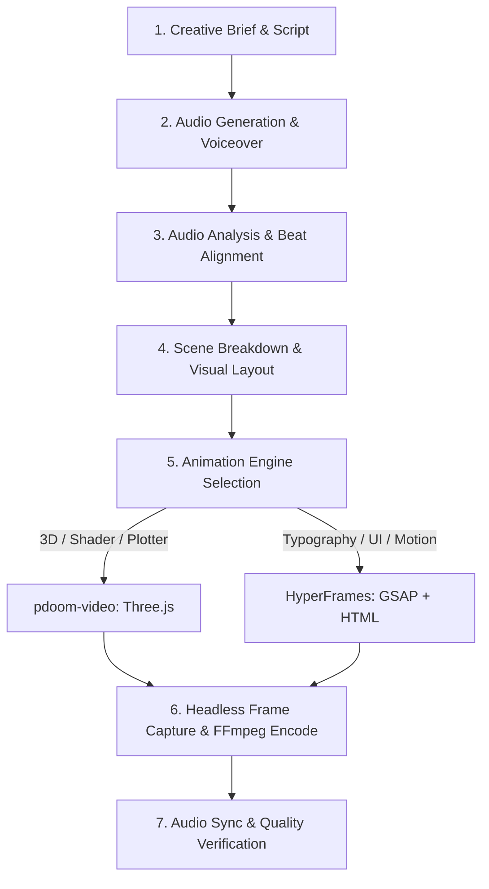

# AGENTS.md: AI VIDEO PRODUCTION STUDIO INSTRUCTIONS

> **CRITICAL RULE FOR ALL FUTURE AI AGENTS:**
> **DO NOT** re-scan or analyze the entire codebases of the sub-repositories (`hyperframes`, `pdoom-video`, `raea`, `VoiceStudio`).
> All architectural patterns, module capabilities, CLI commands, and integration interfaces are already discovered, validated, and documented in this file and companion files (`MODULE_REGISTRY.md`, `STUDIO_CONFIG.md`, `WORKFLOWS.md`, `INTEGRATION_MAP.md`).
> Read this file first before executing any video generation or editing task.

---

## 1. STUDIO OVERVIEW & ARCHITECTURE

This workspace is a unified, multi-engine **AI Animated Video Production Studio**. It combines specialized open-source tools into an automated video generation pipeline designed for Instagram Reels (9:16), cinematic advertisements, 3D motion graphics, kinetic typography, and educational content.

```
+-------------------------------------------------------------------------+
|                         STUDIO ORCHESTRATOR                             |
|               (Prompt -> Script -> Scenes -> Dispatch)                  |
+-------------------------------------------------------------------------+
        |                                   |                    |
        v                                   v                    v
+-------------------+             +------------------+  +-----------------+
|   VOICESTUDIO     |             |   PDOOM-VIDEO    |  |   HYPERFRAMES   |
| (Voice, SFX, ASR) |             | (Three.js/Anime) |  |   (GSAP / HTML) |
+-------------------+             +------------------+  +-----------------+
        |                                   |                    |
        +-----------------+                 |                    |
                          |                 |                    |
                          v                 v                    v
                +---------------------------------------------------------+
                |                    RENDERING PIPELINE                   |
                |     Headless Chrome / Playwright -> FFmpeg -> MP4       |
                +---------------------------------------------------------+
```

### Module Roles & Repositories
1. **`hyperframes/`**: HTML/CSS/GSAP deterministic video rendering engine. Used for kinetic typography, UI animations, slideshows, lower thirds, multi-track audio synchronization, and Remotion-style compositions without React overhead.
2. **`pdoom-video/`**: Three.js (v0.186) + Anime.js (v4.5) + WebGL shader engine. Used for 3D scenes, particle fields, bloom/grain post-processing, audio-reactive motion, and single-stroke plotter typography. Already has `node_modules` installed.
3. **`VoiceStudio/`**: Local AI voice generation, zero-shot voice cloning, TTS (OmniVoice, Kokoro, ChatterBox), Whisper transcription, and SFX (`moss_sfx`). Offers an OpenAI-compatible API (`/v1/audio/speech`).
4. **`raea/`**: Native Rust + Bevy 0.20 + WGPU engine. High-performance GPU-native renderer for React/TSX. Canary status on Windows; used when native Bevy 3D/WGPU hardware rendering is needed.

---

## 2. REPOSITORY ENTRY POINTS & INVOCATION

### A. HyperFrames (`./hyperframes`)
- **CLI Command**: `npx hyperframes <subcommand>` (runs instantly via global npm cache).
- **Core Commands**:
  - `npx hyperframes render -c <path_to_html> -o <output.mp4>`: Render HTML/GSAP composition to MP4.
  - `npx hyperframes preview --port 3002`: Start interactive live studio preview.
  - `npx hyperframes audio <file.mp3>`: Analyze audio onsets, hits, loudness, and silence.
  - `npx hyperframes normalize-audio --reference <ref> --target <target> --write`: Normalize loudness to EBU R128 (-14 LUFS).
  - `npx hyperframes tts "<text>" -o <speech.mp3>`: Fast local speech generation via Kokoro-82M.
  - `npx hyperframes beats <audio.mp3>`: Extract beat grid into JSON.

### B. pdoom-video (`./pdoom-video`)
- **Core Renderer**: `pdoom-video/app/scripts/render.ts`
- **Invocation** (from `pdoom-video/app` using Bun):
  - **Render Video (9:16 Portrait Reel)**:
    ```powershell
    cd "pdoom-video\app"
    bun scripts/render.ts video --from 0 --to 15 --fps 30 --out ../../out/reel_3d.mp4
    ```
  - **Render Video (16:9 Landscape)**:
    ```powershell
    bun scripts/render.ts video --from 0 --to 15 --landscape --out ../../out/promo_16x9.mp4
    ```
  - **Render Single Frame Screenshot (Inspection)**:
    ```powershell
    bun scripts/render.ts stills --t 4.5 --out ../../out/inspect_frame.png
    ```
  - **Render Contact Sheet**:
    ```powershell
    bun scripts/render.ts sheet --from 0 --to 15 --n 16 --cols 4 --out ../../out/sheet.png
    ```
- **Audio & Lyrics Analysis** (`pdoom-video/analysis`):
  - Uses `uv` for python tools: `align.py` (Whisper CTC forced alignment), `analyze.py` (Demucs stem separation & beat tracking).

### C. VoiceStudio (`./VoiceStudio`)
- **Local API Server**: `VoiceStudio/backend/main.py`
  - Start API: `python -m uvicorn main:app --host 127.0.0.1 --port 3900`
  - Health check: `http://127.0.0.1:3900/health`
- **OpenAI-Compatible TTS/STT Endpoint**:
  - `POST http://127.0.0.1:3900/v1/audio/speech`
  - Body: `{"model": "omnivoice", "input": "Hello world", "voice": "narrator"}`
- **Fallback / Zero-Setup TTS**:
  - `npx hyperframes tts "<text>" -o <output.mp3>` (built-in, uses local Kokoro-82M without starting a server).

### D. raea (`./raea`)
- **Engine Status**: Rust workspace. Windows binary installed via `irm https://raea.io/install.ps1 | iex`.
- **Command**: `raea render <file.tsx> -o <out.mp4>`
- **Quality Gate**: `raea check <video.mp4>`

---

## 3. STUDIO ENVIRONMENT & SYSTEM CONTEXT

- **OS**: Windows 11 / x86_64
- **Node.js**: `v26.7.0` (Installed)
- **Bun**: `1.4.3` (Installed)
- **Python**: `3.13.9` (Installed)
- **UV Package Manager**: `0.13.0` (Installed)
- **FFmpeg**: `9.0.2-full_build-www.gyan.dev` with `libx264`, `nvenc` (Installed in PATH)
- **Chrome**: `C:\Program Files\Google\Chrome\Application\chrome.exe` (Installed)
- **GPU**: NVIDIA GeForce RTX 3050 Laptop GPU (4GB VRAM, CUDA 13.3) + Intel UHD Graphics.

---

## 4. STANDARD VIDEO GENERATION WORKFLOW

Every video production task must follow this 7-step pipeline:



1. **Brief & Script**: Define duration (15s, 30s, 60s), aspect ratio (9:16 default for Reels), tone, and message.
2. **Voice & SFX**: Generate narration using VoiceStudio or `npx hyperframes tts`.
3. **Audio Alignment**: Analyze timing using `npx hyperframes audio` or `pdoom-video/analysis/align.py` to extract word-level timestamps and beat markers.
4. **Scene Breakdown**: Divide video into scenes (typically 2-4 seconds per scene for fast-paced Reels).
5. **Animation Execution**:
   - Use **Three.js + GLSL** (`pdoom-video`) for 3D products, camera moves, and particle fields.
   - Use **GSAP + Anime.js** (`hyperframes`) for kinetic typography, vector graphics, cards, and data badges.
6. **Rendering**:
   - Render deterministically to MP4 at 1080x1920 (30 FPS default, CRF 18).
7. **Quality Check**:
   - Verify with contact sheet (`bun scripts/render.ts sheet`) or `npx hyperframes inspect`.
   - Ensure audio loudness matches social standards (-14 LUFS, -1.5 dBTP peak).

---

## 5. AGENT TOKEN EFFICIENCY RULES

1. **NEVER run open directory traversals or file dumps** on `VoiceStudio/`, `raea/`, `hyperframes/`, or `pdoom-video/`.
2. Refer to `MODULE_REGISTRY.md` to pick tools and interfaces.
3. Check `STUDIO_CONFIG.md` for output paths, default dimensions, and encoding presets.
4. Check `WORKFLOWS.md` for copy-paste templates and pipeline patterns.
5. Inspect source files **only** if writing a custom scene or debugging an explicit error.
6. Keep rendered scratch files and WIP logs in `out/` or project-specific subdirectories.
