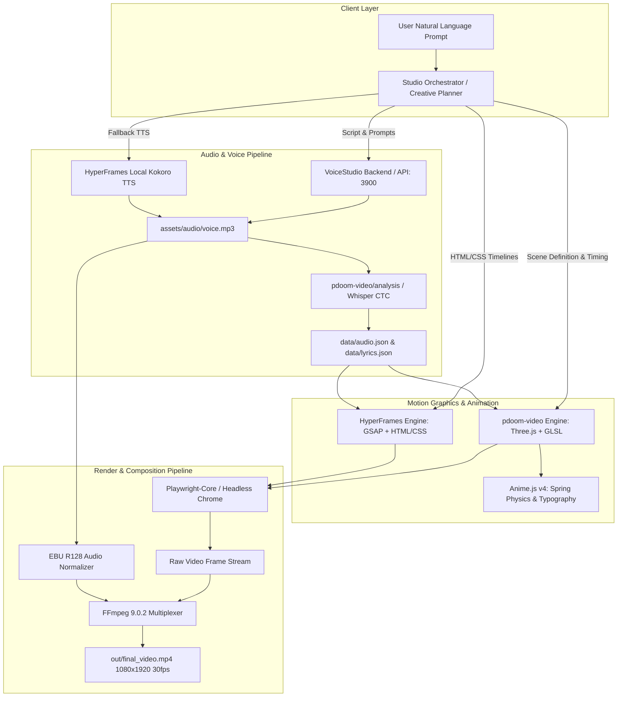

# INTEGRATION MAP: INTER-MODULE COMMUNICATION

This document defines the technical integration protocols, data exchange formats, and architectural topology connecting all modules in the AI Animated Video Production Studio.

---

## 1. STUDIO ARCHITECTURE TOPOLOGY



---

## 2. DATA EXCHANGE FORMATS & CONTRACTS

### A. Voice & Audio Contract (`audio.json`)
The animation engines (`pdoom-video`, `hyperframes`) read audio telemetry from structured JSON:

```json
{
  "duration": 15.00,
  "tempo": 128.0,
  "beats": [0.0, 0.468, 0.937, 1.406, 1.875],
  "downbeats": [0.0, 1.875, 3.750],
  "events": [
    { "type": "kick", "time": 0.00 },
    { "type": "snare", "time": 0.937 },
    { "type": "vocal_onset", "time": 1.20 }
  ],
  "loudness": {
    "integrated_lufs": -14.2,
    "true_peak": -1.5
  }
}
```

### B. Subtitle & Kinetic Typography Contract (`lyrics.json`)
Used for deterministic, word-by-word and character-by-character text wipes:

```json
[
  {
    "line": "AI video production studio",
    "start": 0.50,
    "end": 2.80,
    "words": [
      { "w": "AI", "start": 0.50, "end": 0.85 },
      { "w": "video", "start": 0.90, "end": 1.35 },
      { "w": "production", "start": 1.40, "end": 2.10 },
      { "w": "studio", "start": 2.15, "end": 2.80 }
    ]
  }
]
```

### C. Scene Timeline Blueprint (`src/timeline.ts`)
The `pdoom-video` engine maps scene windows to time intervals:

```ts
export const timeline = [
  { id: 'hook', scene: 'HookScene', from: 0.0, to: 3.2, transition: 'glsl_dissolve' },
  { id: 'feature_3d', scene: 'Product3D', from: 3.2, to: 8.5, transition: 'whip_pan' },
  { id: 'typography', scene: 'KineticText', from: 8.5, to: 12.0, transition: 'cut' },
  { id: 'outro', scene: 'OutroLogo', from: 12.0, to: 15.0, transition: 'fade_to_black' }
];
```

---

## 3. ENGINE RESPONSIBILITY MATRIX

| Technology | Location | Primary Responsibility |
|---|---|---|
| **Three.js** | `pdoom-video/app/node_modules/three` | 3D models, scene lighting, procedural particles, camera controls, post-processing shaders. |
| **Anime.js** | `pdoom-video/app/node_modules/animejs` | Elastic motion, mathematical easings, SVG morphing, glyph animations. |
| **GSAP** | `hyperframes` / CDN / npm | Complex sequential DOM timelines, SVG vector graphics, coordinate tweens. |
| **Remotion Evaluation** | `hyperframes/skills/remotion-to-hyperframes` | Remotion is evaluated as redundant and heavier. HyperFrames provides native HTML/CSS/GSAP composition with Remotion conversion skills and zero React bundler overhead. |
| **FFmpeg** | System PATH (`ffmpeg`) | Hardware-accelerated frame ingestion, audio-video multiplexing, LUFS normalization, MP4 packaging. |

---

## 4. ERROR HANDLING & RESILIENCE

1. **Process Timeouts**: Long rendering passes run detached or in background tasks; progress is monitored via file output rather than holding locks.
2. **Audio Fallbacks**: If VoiceStudio API is uninitialized or busy, the studio orchestrator falls back automatically to local `npx hyperframes tts` (Kokoro-82M) without stopping the pipeline.
3. **Headless Browser Crash Recovery**: Headless Chrome rendering processes isolated frame batches (chunks of 8-16 frames) with automatic retry on disconnect.
4. **Volume Ceiling Protection**: Audio normalization applies automatic limiting to prevent exceeding -1.5 dBTP even when boosting quiet dialogue.
