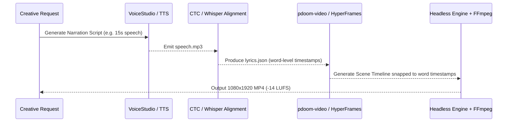

# PRODUCTION WORKFLOWS (`WORKFLOWS.md`)

This guide provides step-by-step, actionable production workflows for generating diverse video formats using the studio's engines.

---

## 1. INSTAGRAM REELS (15s, 30s, 60s)

### Specification
- **Resolution**: 1080 × 1920 (9:16 vertical)
- **Frame Rate**: 30 FPS
- **Pacing**: Cut or visual transition every 1.5 - 2.5 seconds
- **Hook Duration**: 0.0s - 2.5s (high-impact visual text + sound hit)

### Execution Pipeline



### Commands:
```powershell
# Step 1: Generate Voiceover (Kokoro or VoiceStudio)
npx hyperframes tts "Here is why AI video changes everything in 2026." -o assets/audio/reel_voice.mp3

# Step 2: Extract Onsets & Beat Timing
npx hyperframes audio assets/audio/reel_voice.mp3 --json > data/audio.json

# Step 3: Render Reel (9:16 vertical via pdoom-video engine)
cd "pdoom-video\app"
bun scripts/render.ts video --from 0 --to 15 --fps 30 --out ../../out/final_reel_15s.mp4
```

---

## 2. CINEMATIC PRODUCT ADVERTISEMENT (3D SHOWCASE)

### Specification
- **Engine**: `pdoom-video` (Three.js + GLSL Post-FX)
- **Key Techniques**:
  - glTF 3D model loading with PBR metallic/roughness materials.
  - Orbiting camera motion with smooth ease-in-out bezier curves.
  - Directional studio key lighting + moving rim lights.
  - Post-processing: GLSL Bloom pass (intensity 0.6) + 35mm film grain + subtle halation.

### Scene Composition Blueprint (`app/src/scenes/product.ts`):
```ts
import * as THREE from 'three';
import { Scene, type Frame } from '../engine/scene';
import { GLTFLoader } from 'three/addons/loaders/GLTFLoader.js';

export default class ProductShowcase extends Scene {
  mesh?: THREE.Group;
  
  async init() {
    const loader = new GLTFLoader();
    const gltf = await loader.loadAsync('/assets/models/product.glb');
    this.mesh = gltf.scene;
    this.ctx.scene3d.add(this.mesh);
  }

  render(f: Frame, out: THREE.WebGLRenderTarget) {
    if (this.mesh) {
      // Smooth continuous 3D rotation
      this.mesh.rotation.y = f.t * 0.5;
      // Camera dolly zoom
      this.ctx.camera.position.z = 5.0 - Math.sin(f.t * 0.8) * 0.8;
    }
    return { bloom: 0.65, grain: 0.15 };
  }
}
```

### Render Command:
```powershell
cd "pdoom-video\app"
bun scripts/render.ts video --from 0 --to 30 --fps 60 --samples auto --out ../../out/product_ad.mp4
```

---

## 3. KINETIC TYPOGRAPHY & TEXT TRANSITIONS

### Specification
- **Engine**: `pdoom-video` (opentype.js plotter fonts) OR `hyperframes` (GSAP text splits).
- **Key Techniques**:
  - Word-level karaoke wipes matching voiceover track.
  - Spring-physics letter entrances using Anime.js (`targets: '.letter', translateY: [40, 0], opacity: [0, 1]`).
  - Single-stroke vector paths drawn with dynamic dash-offset animations.

### HyperFrames GSAP Typography Composition (`composition.html`):
```html
<!DOCTYPE html>
<html lang="en">
<head>
  <style>
    * { box-sizing: border-box; margin: 0; padding: 0; }
    body {
      width: 1080px; height: 1920px;
      background: #0a0a0f; color: #ffffff;
      font-family: 'Inter', sans-serif;
      display: flex; align-items: center; justify-content: center;
    }
    .headline { font-size: 84px; font-weight: 800; text-transform: uppercase; line-height: 1.1; }
    .word { display: inline-block; opacity: 0; transform: translateY(50px); }
  </style>
  <script src="https://cdnjs.cloudflare.com/ajax/libs/gsap/3.12.5/gsap.min.js"></script>
</head>
<body>
  <div class="headline">
    <span class="word w1">Create.</span>
    <span class="word w2">Animate.</span>
    <span class="word w3">Dominate.</span>
  </div>
  <script>
    const tl = gsap.timeline();
    tl.to(".w1", { opacity: 1, y: 0, duration: 0.4, ease: "back.out(1.7)" }, 0.2)
      .to(".w2", { opacity: 1, y: 0, duration: 0.4, ease: "back.out(1.7)" }, 0.8)
      .to(".w3", { opacity: 1, y: 0, duration: 0.5, ease: "back.out(2)" }, 1.4);
  </script>
</body>
</html>
```

### Render Command:
```powershell
npx hyperframes render -c composition.html -o out/typography_reel.mp4
```

---

## 4. EDUCATIONAL EXPLAINER VIDEO

### Specification
- **Aspect Ratio**: 16:9 (1920 × 1080) or 9:16 for educational Shorts.
- **Engine**: `hyperframes` (HTML/CSS/GSAP) for structural clarity and diagram animations.
- **Key Techniques**:
  - Infographic callout cards and animated SVG charts.
  - Side-by-side comparison tables.
  - Lower-third title badges and presenter captions.
  - EBU R128 audio normalization ensuring narration voice is crystal clear over background music.

### Audio Normalization Command:
```powershell
# Normalize educational voiceover to exact -14 LUFS standard
npx hyperframes normalize-audio --reference target_ref.mp3 --target raw_voice.mp3 --write
```

---

## 5. AUTOMATED BATCH VIDEO RENDERING

When rendering multiple variations (e.g., A/B ad creatives, multiple language narrations, or variable text overlays):

```powershell
# Render multiple scenes across timeline in one automated run
$scenes = @("hook", "feature1", "feature2", "cta")
foreach ($scene in $scenes) {
    Write-Host "Rendering scene: $scene"
    cd "pdoom-video\app"
    bun scripts/render.ts video --only $scene --out "../../out/batch_$scene.mp4"
}

# Concatenate scenes with FFmpeg
ffmpeg -f concat -safe 0 -i scenes.txt -c copy ../../out/final_stitched_reel.mp4
```

---

## 6. QUALITY CHECK GATEWAY

Before publishing or delivering any video:

1. **Visual Verification**: Render a 16-frame contact sheet to quickly verify typography alignment, color contrast, and safe zones:
   ```powershell
   bun scripts/render.ts sheet --from 0 --to 15 --n 16 --cols 4 --out ../../out/qc_sheet.png
   ```
2. **Audio Verification**:
   - Check dialogue intelligibility.
   - Verify -14 LUFS integrated volume and -1.5 dBTP peak.
3. **Format Verification**:
   - Ensure pixel format is `yuv420p` (`ffprobe -v error -show_entries stream=pix_fmt out/final_reel.mp4`).
