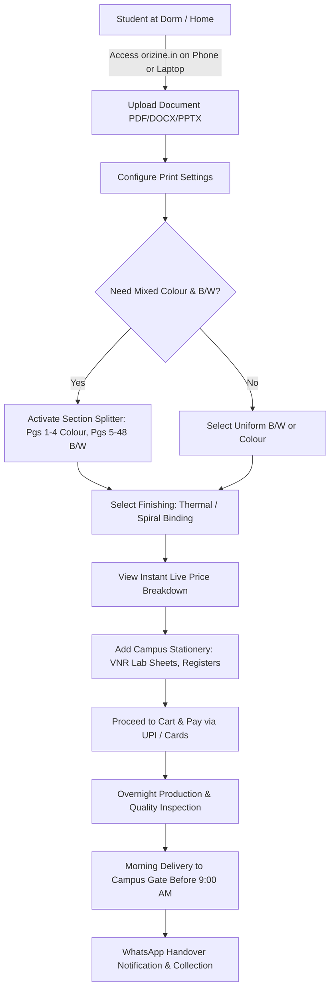

# ORIZINE PLATFORM: COMPLETE PRODUCT ANALYSIS & SPECIFICATION
**Document ID:** `ORIZINE-PROD-2026-v1`  
**Target Platform:** [orizine.in](https://www.orizine.in)  
**Primary Hub:** Gandi Maisamma, Hyderabad, Telangana  
**Partner Institutions:** VNR VJIET, CBIT, MGIT, BVRIT  

---

## 1. PRODUCT OVERVIEW & BUSINESS MODEL

Orizine (branded as **Orizine Instaprint**) is a specialized digital document printing, custom binding, and campus stationery delivery platform engineered specifically for college students and academic faculty in Hyderabad, India.

```
+-----------------------------------------------------------------------------------+
|                                  ORIZINE PLATFORM                                 |
+-----------------------------------------------------------------------------------+
| 1. Cloud Web Platform   | 2. Section Splitter Engine | 3. Campus Logistics Network |
| • Drag & Drop Upload    | • Multi-Section Range      | • Overnight Batch Print     |
| • 200MB Multi-Format    | • Mixed B&W / Colour       | • Free Morning Gate Drop    |
| • Instant Price Quote   | • Thermal / Spiral Bind    | • WhatsApp / Call Handover  |
+-----------------------------------------------------------------------------------+
```

### The Core Problem It Solves
1. **The Xerox Counter Nightmare**: Traditional campus Xerox shops suffer from extreme morning congestion (30–60 minute queues), uncalibrated toner, frequent paper jams, and erratic opening hours.
2. **The "All-Colour" Pricing Trap**: Standard print shops force students to pay ₹10/page for an entire 50-page manual even if only 3 pages have colour circuit diagrams.
3. **Fragmented Errands**: Students must visit separate stores for assignment printing, record binding, special college sheets, and daily stationery.
4. **The Orizine Solution**: Order online from home or dorm before midnight (11:59 PM); configure exact sections; choose thermal or spiral binding; add lab sheets and stationery to the same cart; receive a sealed package directly at the college gate before 9:00 AM for **₹0 delivery fee**.

---

## 2. WEBSITE PAGE INVENTORY & ARCHITECTURE

| Route | Page Title / Purpose | Core Interactive Features | Technical State |
|---|---|---|---|
| **`/`** | Homepage & Brand Hero | Dynamic metric counters (683+ students, 489+ orders, 1,936+ pages, 99.8% on-time), 3-step feature walkthrough, live sample receipt, customer trust badges. | Next.js Server & Client Hydration |
| **`/order/upload`** | Document Ingestion | Multi-file drag & drop, format validation (`.pdf`, `.docx`, `.pptx`, `.jpg`, `.png`), 200MB size ceiling, file preview queue. | File API + Pre-Upload Validation |
| **`/order/configure`** | Print Config & Section Splitter | Per-file settings, Section Splitter (independent page ranges, B&W vs Colour, Duplex toggle), binding selector, live price recalculator. | Client-side reactive price matrix |
| **`/calculator`** | Standalone Pricing Estimator | Sliders & steppers for pages, copies, color mode, 75 GSM vs 100 GSM bond, binding selection, live quotation breakdown. | Pure interactive client state |
| **`/stationery`** | Campus Essentials Store | Category filters (Copier Paper, VNR Lab Sheets, Notebooks & Registers), instant "Add" buttons, zero delivery fee tag. | Server-rendered catalog + CartContext |
| **`/cart`** | Unified Checkout Bag | Merged print jobs + physical stationery items, delivery slot selection (Morning Drop), promo code input, Razorpay trigger. | LocalStorage + Cloud synced cart |
| **`/shipping-policy`**| Logistics & Delivery Rules | Scheduled gate locations for VNR, CBIT, MGIT, BVRIT; morning delivery timeline; cutoff schedules; student handover protocol. | Static Informational |
| **`/my-orders`** | Student Dashboard | Real-time order progress timeline (`Order Placed` → `Printing & Bound` → `Dispatched` → `Delivered at Gate`). | Authenticated Supabase/API state |
| **`/pdf-editor`** | Student PDF Studio (Free) | Free web tools for students to merge, split, compress, and organize lab manual PDFs prior to printing. | Client-side WebAssembly PDF engine |

---

## 3. COMPLETE CUSTOMER JOURNEY



---

## 4. DEEP-DIVE: UPLOAD & CONFIGURATION EXPERIENCE

### A. File Import Capabilities
- **Supported File Formats**: `.pdf`, `.docx`, `.pptx`, `.jpg`, `.png`.
- **Upload Limit**: Up to **200 MB per file / batch order**.
- **Security & Privacy**: 256-bit TLS encryption in transit; **automatic document purging from servers within 24–48 hours** following physical order completion.

### B. The Section Splitter (Signature Innovation)
This is Orizine's primary technological differentiator. In traditional shops, a student printing an engineering manual must print the entire file in expensive colour or sacrifice diagrams in black and white.

- **How It Works**:
  1. Student clicks **"Split Section"**.
  2. Defines custom page ranges (e.g., Section 1 = `1–4`, Section 2 = `5–48`).
  3. Sets **Color Mode** per section:
     - Section 1: Full Vibrant Colour (₹5.00/page).
     - Section 2: Black & White Duplex (₹2.50/sheet).
  4. Sets **Orientation & Sides**: Single-sided vs Duplex (2-sided).
  5. Live total updates instantaneously without page reloads.

---

## 5. AUTHENTIC PRICING BREAKDOWN

All rates verified directly against the live Orizine platform (`/calculator` and `/stationery`):

### Document Printing Rates
| Service Item | Pricing Specification | Student Value Benefit |
|---|---|---|
| **Black & White (1-Sided)** | **₹2.00 / page** | Standard single-sided prints on 75 GSM |
| **Black & White (2-Sided)** | **₹2.50 / sheet** | **Major Savings**: Both sides printed for just ₹2.50 total |
| **Full Colour (1-Sided)** | **₹5.00 / page** | High-density vibrant graphics & charts |
| **Paper Upgrade (Bond 100 GSM)** | **+₹1.00 / page** | Premium certificate and thesis submission quality |

### Binding & Finishing Rates
| Binding Type | Price | Description |
|---|---|---|
| **Loose Sheets** | **₹0.00** | Neat stack in protective envelope |
| **Stick File** | **₹20.00 / copy** | Quick slip-on spine file for assignments |
| **Spiral Binding** | **₹40.00 / copy** | Metal/plastic coil with clear transparent front and opaque back cover |
| **Thermal Book Binding** | **₹40.00 / copy** | Heat-sealed professional book spine for major lab records & thesis |

---

## 6. CAMPUS STATIONERY STORE CATALOGUE

All products are delivered in the same morning delivery package with **zero extra shipping charges**:

| Product Name | Category | Badge / Tag | Regular Price (MRP) | Orizine Student Price | Discount | Description |
|---|---|---|---|---|---|---|
| **A4 Sheets (Pack of 10+)** | Copier Paper | `LOOSE PACK` | ₹10.00 | **₹7.50** | **25% OFF** | 75 GSM bright white copier sheets (min 10 sheets, ₹0.75/sh) |
| **VNR First Three Pages** | VNR Lab Sheets | `VNR VJIET SPECIAL` | ₹8.00 | **₹5.00** | **38% OFF** | Official VNR Title Page, Index & Certificate set |
| **VNR Record Sheets (10 pk)** | VNR Lab Sheets | `LAB COMPLIANT` | ₹15.00 | **₹12.00** | **20% OFF** | Pre-ruled double-sided lab record sheets |
| **Spiral Notebook (250 pgs)** | Notebooks | `TOP RATED` | ₹200.00 | **₹165.00** | **18% OFF** | Micro-perforated ruled sheets, 360° flat opening |
| **Spiral Register (500 pgs)** | Registers | `JUMBO REGISTER` | ₹400.00 | **₹330.00** | **18% OFF** | Extra-thick 500-page register for long-term project notes |
| **Rough Notebook (100 pgs)** | Notebooks | `DAILY ROUGH` | ₹40.00 | **₹30.00** | **25% OFF** | 100-page handy ruled notebook for daily rough work |
| **Rough Notebook (200 pgs)** | Notebooks | `SEMESTER STANDARD` | ₹55.00 | **₹40.00** | **27% OFF** | 200-page standard notebook for semester course notes |
| **Rough Register (300 pgs)** | Registers | `HEAVY DUTY` | ₹70.00 | **₹50.00** | **29% OFF** | 300-page heavy-duty register for math & derivations |

---

## 7. CART, PAYMENT & CHECKOUT SYSTEM

- **Unified Cart**: Print configurations (with PDF file hashes and page metadata) sit alongside physical stationery items in a single synchronized cart.
- **Payment Gateway**: **Razorpay** (PCI-DSS Level 1 compliant, RBI authorized).
- **Payment Methods**: UPI (Google Pay, PhonePe, Paytm, BHIM), Debit/Credit Cards, NetBanking.
- **Order Tracking**: Real-time status in student dashboard (`Submitted` → `In Production` → `Dispatched` → `Arrived at Gate`).

---

## 8. CAMPUS DELIVERY & LOGISTICS NETWORK

- **Supported Colleges & Designated Handover Gates**:
  1. **VNR VJIET**: Gate 1 / Main Entrance
  2. **CBIT Hyderabad**: Main Campus Gate / Bus Bay
  3. **MGIT Hyderabad**: Campus Entrance Gate
  4. **BVRIT Hyderabad**: College Main Gate / Security Reception
- **Delivery Protocol**:
  - **Midnight Cutoff**: Orders placed up to **11:59 PM**.
  - **Delivery Window**: Arrives between **7:30 AM and 9:00 AM**, exactly one hour before morning lectures commence.
  - **Notification**: Automatic WhatsApp message and phone call from delivery executive upon arrival at the gate.
  - **Peer Handover**: Friends can pick up assignments by quoting the 6-character Order ID.
  - **Delivery Fee**: **100% FREE Campus Morning Drop (₹0)** during launch.

---

## 9. BRAND IDENTITY & DESIGN SYSTEM

- **Primary Brand Color**: Vibrant Orizine Orange (`#FF7A1A` / `rgb(255, 122, 26)`).
- **Secondary Accents**: Coral Red (`#FF383C`), Electric Sky (`#38BDF8`), Emerald Success (`#10B981`).
- **Dark Canvas Background**: Deep Slate (`#07080B` to `#0F172A`).
- **Typography**: Clean Modern Sans-Serif (Inter / SF Pro / Geist) with Monospaced Numerals for pricing.
- **Signature UI Aesthetics**: Floating glassmorphism cards, pill-shaped action badges, 3D browser viewports with subtle drop-shadows (`box-shadow: 0 25px 80px rgba(0,0,0,0.4)`), smooth cursor clicks.

---

## 10. UNIQUE SELLING PROPOSITIONS (USPs) TO HIGHLIGHT

1. **Section Splitter**: The only platform that lets you split diagrams into colour and code into B&W within the same PDF.
2. **Transparent, Predictable Pricing**: B&W from ₹2/page, 2-sided at ₹2.50/sheet, colour ₹5/page, binding flat ₹40.
3. **Guaranteed Pre-9 AM Campus Delivery**: Direct to college gate with zero delivery fee.
4. **All-in-One Campus Cart**: Combine custom lab manual prints with VNR record sheets and registers in one checkout.
5. **Zero Morning Xerox Chaos**: No running between shops, no standing in 50-person queues.

---

## 11. FEATURES EXCLUDED FROM THIS COMMERCIAL

- *No generic cartoon drama or sleeping student tropes* (as requested: strictly focused on UI, 3D website, and product experience).
- *No unauthenticated error states* (showcase smooth logged-in customer flow).
- *No complex legal terms or refund edge-cases* (keep marketing punchy and focused on user empowerment).
