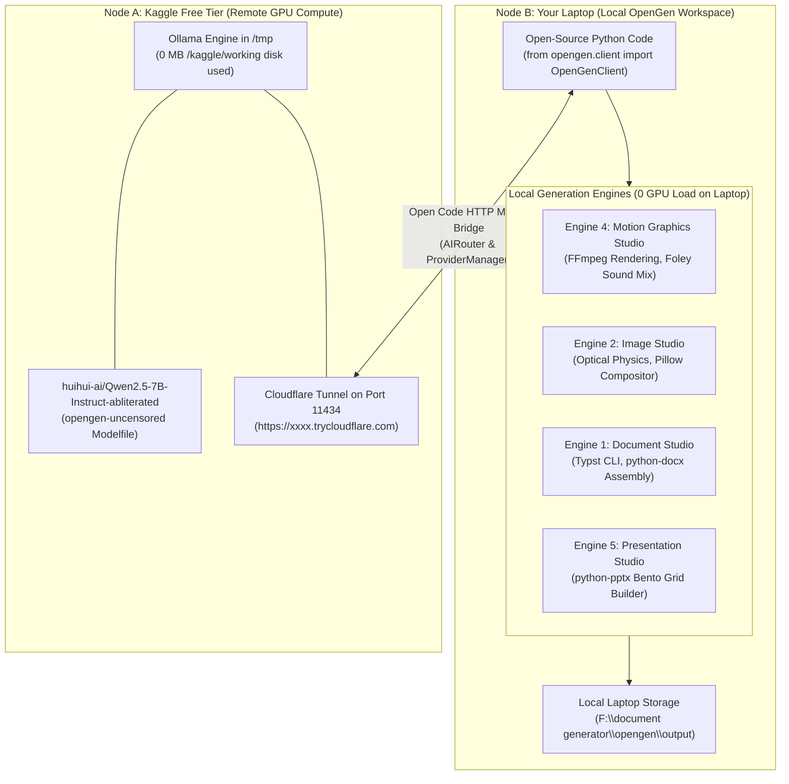

# OPENGEN HYBRID SPLIT-BRAIN ARCHITECTURAL PLAN
## Running the Uncensored Model on Kaggle GPU & Controlling Generation Directly from Your Laptop via Open Code

> **Architecture:** Hybrid Split-Brain (Laptop Orchestrator + Remote Kaggle GPU Model)  
> **Target Framework:** OpenGen Multi-Modal Generative Framework (`F:\document generator\opengen`)  
> **Model:** `huihui-ai/Qwen2.5-7B-Instruct-abliterated` (Ollama: `opengen-uncensored`)  
> **Status:** APPROVED ARCHITECTURAL SPECIFICATION & OPERATING PROCEDURE  

---

## 1. System Architecture: The Split-Brain Model

Instead of trying to run heavy 15GB model weights on your laptop or trying to manage files inside Kaggle's ephemeral filesystem, OpenGen splits the workload into two specialized nodes connected via open code:



### Why This Is the Best Engineering Strategy:
1. **0 MB RAM / VRAM overhead on your laptop:** Your laptop remains cool and fast because all neural network token inference runs on Kaggle’s Tesla T4 (16GB VRAM).
2. **Local File Ownership:** You don't have to download files from Kaggle. All generated `.mp4` video ads, `.png` studio photography, `.docx` files, and `.pptx` decks are synthesized and saved **directly onto your laptop's hard drive**.
3. **100% Uncensored:** The model on Kaggle has its refusal vectors surgically ablated, ensuring that scriptwriting, marketing hooks, and product descriptions never encounter moralizing refusals or conversational chatter.
4. **Zero Cloud API Costs:** The entire pipeline runs on 100% open-source code and free GPU compute.

---

## 2. Step-by-Step Execution Plan

### Step 1: Start the Model Server on Kaggle
1. Open [kaggle.com/code](https://www.kaggle.com/code) $\to$ **New Notebook**.
2. Settings: **GPU T4 x 1**, **Internet ON**.
3. Run this single cell:

```bash
# Clone repository and launch model-only server
!git clone https://github.com/sschandra2006/opengen.git /kaggle/working/opengen
%cd /kaggle/working/opengen
!curl -fsSL https://ollama.com/install.sh | sh
!python deploy/kaggle/serve_model_only.py
```

*Kaggle will pull the model, apply the zero-chatter template, and print your public URL:*
```text
===========================================================================
[KAGGLE UNCENSORED MODEL ENDPOINT READY]:
https://random-subdomain.trycloudflare.com
===========================================================================
```

---

### Step 2: Link Your Laptop to Kaggle (One Line in `.env`)
On your laptop, open `F:\document generator\opengen\.env` and set:

```ini
OLLAMA_BASE_URL=https://random-subdomain.trycloudflare.com
OLLAMA_MODEL=opengen-uncensored
OPENGEN_DEFAULT_PRIMARY_MODEL=ollama/opengen-uncensored
OPENGEN_DEFAULT_LOCAL_MODEL=ollama/opengen-uncensored
```

---

### Step 3: Test Connection with Open Code
On your laptop terminal, run the bridge diagnostic tool:

```powershell
python scripts\test_model_bridge.py
```

You will see:
```text
[OK] HTTP Ping Succeeded in 280ms
[OK] Available models on server: ['opengen-uncensored:latest']
[OK] Model response: STATUS|ONLINE|LATENCY_TEST
[SUCCESS] OpenGen on your laptop is successfully connected to the uncensored model!
```

---

### Step 4: Run Open Code on Your Laptop to Generate Videos & Images

Now, write your Python code directly on your laptop (e.g. `examples/generate_multimodal_local.py`):

```python
from opengen.client import OpenGenClient

# 1. Initialize client locally
client = OpenGenClient()

# 2. Generate a 15-second Video Ad (Motion Graphics Studio)
# Kaggle's uncensored model plans the script, hooks, and Foley cues;
# FFmpeg renders the MP4 and mixes audio locally on your laptop!
video = client.motion.generate_ad(
    brief="Commercial ad for an extreme neon racing tournament. Dramatic hook, kinetic typography, heavy bass drops.",
    target_duration=15.0,
    target_aspect="9:16"
)
print(f"Video saved on laptop: {video.mp4_path}")

# 3. Generate a Studio Image (Image Studio)
# Optical prompt director applies camera physics, saves PNG to your laptop
image = client.images.generate(
    prompt="A luxury frosted glass perfume bottle on raw black slate, surrounded by gentle water mist and soft rim lighting",
    aspect_ratio="1:1",
    style="photorealistic",
    apply_optical_physics=True
)
print(f"Image saved on laptop: {image.file_path}")

# 4. Generate an Executive Presentation (Presentation Studio)
deck = client.presentations.generate(
    topic="Autonomous Multi-Modal Intelligence Systems",
    slide_count=5,
    theme="executive_dark"
)
print(f"PowerPoint saved on laptop: {deck.file_path}")
```
