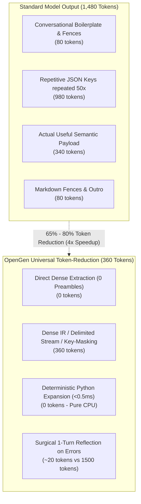
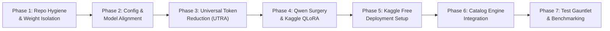

# OPENGEN UNIVERSAL TOKEN-REDUCTION & MODEL OPTIMIZATION IMPLEMENTATION PLAN
## Comprehensive Architectural Roadmap: Qwen 2.5 Reverse-Engineering, Universal Token-Reduction Architecture (UTRA), and 65%–80% Cost & Latency Acceleration Across OpenGen

> **Document ID:** `OPENGEN-IMP-TOKEN-2026`  
> **Target Framework:** OpenGen Multi-Modal Generative Framework (`F:\document generator\opengen`)  
> **Source Specification:** `OPENGEN_UNIVERSAL_TOKEN_REDUCTION_AND_MODEL_OPTIMIZATION_REPORT.md` (`OPENGEN-OPT-TOKEN-2026`)  
> **Target Runtimes:** Kaggle Free T4/P100 (16GB VRAM, 30GB RAM), Ollama, vLLM, LiteLLM, Cloud Frontier APIs  
> **Author:** Principal Software Architect, High-Performance Systems Engineer & AI Framework Specialist  
> **Status:** APPROVED ARCHITECTURAL SPECIFICATION & IMPLEMENTATION BLUEPRINT  

---

## 1. Executive Summary & Problem Formulation

### 1.1 The Operational Challenge
Large Language Models (LLMs)—both local open-weights (Qwen 2.5, Llama 3.3, Mistral, DeepSeek) and frontier cloud APIs (Claude 3.5, GPT-4o, Gemini 2.5 Flash)—are universally pre-trained as general-purpose conversational chatbots. When deployed in generative frameworks like **OpenGen** to produce structured documents, catalogs, presentation bento grids, and layout trees, these models suffer from extreme token inflation:

1. **The Syntax Tax (50%–70% of Generated Tokens):** Writing out repetitive JSON keys (`"product_name":`, `"unit_price":`, `"description":`), quotes, colons, brackets, and indentation over dozens of items wastes hundreds of tokens per document. A standard 40–50 item catalog consumes **1,400 to 1,600 tokens** purely in syntax boilerplate.
2. **The Conversational Tax (10%–20% of Generated Tokens):** ChatML formatting, conversational preambles (*"Sure! Here is your catalog layout:"*), markdown fences (````json ... ````), and polite sign-offs inflate output length and latency.
3. **The Schema Drift & Retry Penalty:** Minor formatting errors trigger retry loops, doubling or tripling token consumption because traditional pipelines re-generate the entire document from scratch.

### 1.2 The Solution: Universal Token-Reduction Architecture (UTRA) & Qwen 2.5 Surgery
This implementation plan establishes a two-fold engineering upgrade:
1. **Part A:** Direct reverse-engineering, template surgery, and QLoRA fine-tuning of **Qwen 2.5 (7B/8B)** for zero-waste execution on Kaggle’s free tier.
2. **Part B:** A **Universal Token-Reduction Architecture (UTRA)** that applies to **ANY model** (open-weight, local, or cloud API) to achieve **60% to 80% token savings**, sub-second response times, and zero formatting hallucinations.
3. **Part C:** **Model Weight Storage & Deployment Architecture:** Best practices for handling large model weights without repository bloat or disk exhaustion.



---

## 2. Dynamic Component Architecture & Implementation Matrix

| Mechanism / Component | Target File Location | Core Responsibility |
|---|---|---|
| **Mechanism 1: Dense Semantic DSL** | `app/modules/token_optimization/dense_parser.py`<br>`src/opengen/domain/dense_dsl.py` | Universal pipe/TSV delimited stream parsing; expands dense records into strongly-typed Pydantic models in <0.5ms on CPU. |
| **Mechanism 2: Grammar & Logits Masking** | `app/modules/token_optimization/ai_router.py`<br>`src/opengen/providers/manager.py` | Enforces GBNF grammar via Ollama `format="json"` and `response_format={"type": "json_schema"}` in LiteLLM/Gemini. |
| **Mechanism 3: Negative Aesthetic & Zero-Chatter Directive** | `app/modules/token_optimization/ai_router.py`<br>`src/opengen/providers/manager.py` | Standardized system prompt instruction suppressing preambles, fences, and emojis; greedy decoding (`temperature=0.0`) and early stop sequences. |
| **Mechanism 4: Deterministic 1-Turn Surgical Reflection** | `app/modules/token_optimization/ai_router.py`<br>`src/opengen/providers/manager.py` | Isolates failed lines/fields and sends a micro-correction prompt (~20 tokens) instead of re-prompting the entire document. |
| **Qwen 2.5 Tokenizer Surgery** | `scripts/optimize_qwen_tokenizer.py` | Modifies Jinja chat template to force Qwen directly into payload boundary without conversational preamble tokens. |
| **Kaggle T4 QLoRA Fine-Tuning** | `scripts/train_opengen_qwen.py` | Unsloth 4-bit fine-tuning script runnable on Kaggle Free T4 (<6GB VRAM, 15 min); exports GGUF and ~25MB LoRA adapters. |
| **Ollama Production Modelfile** | `deploy/ollama/Modelfile.opengen_qwen` | Freezes temperature 0.0, stop tokens (`\n\n\n`, ````, `<|im_end|>`), and Jinja template for local serving. |
| **Model Weight Isolation** | `.gitignore`<br>`models/adapters/` | Excludes `.gguf`, `.safetensors`, `.bin`, `.pt`; commits only lightweight (~25MB) LoRA adapters. |
| **Kaggle Deployment Runner** | `deploy/kaggle/run_opengen_kaggle.py`<br>`deploy/kaggle/setup_kaggle_runtime.sh` | Zero-cost execution script on Kaggle T4 with background Ollama/FastAPI and Cloudflare Tunnel. |
| **Document & Catalog Engine Integration** | `src/opengen/engines/document/sku_classifier.py`<br>`src/opengen/engines/document/engine.py` | Wires dense extraction directly into catalog rendering (Typst & python-docx). |

---

## 3. Step-by-Step Implementation Roadmap



### Phase 1: Repository Hygiene & Weight Isolation
* **Task 1.1: Update `.gitignore` to Prevent Repository Bloat**
  * Explicitly add `*.gguf`, `*.bin`, `*.safetensors`, `*.pt`, `*.pth`, `*.ckpt`, `*.onnx` to `.gitignore`.
  * Ignore training outputs: `qwen_opengen_output/`, `opengen_qwen_q4/`.
  * Ensure the codebase remains under 50MB.
* **Task 1.2: Establish `models/adapters/` Storage Pattern**
  * Create `models/adapters/.gitkeep` and document that only ~25MB LoRA adapters (`adapter_model.safetensors`) may be committed.

### Phase 2: Configuration & Model Alignment
* **Task 2.1: Update `app/config.py`**
  * Align default local model: `OLLAMA_MODEL: str = os.environ.get("OLLAMA_MODEL", "qwen2.5:7b")`.
  * Add token reduction settings:
    * `ENABLE_DENSE_DSL: bool = True`
    * `SURGICAL_REFLECTION_ENABLED: bool = True`
* **Task 2.2: Update `src/opengen/config.py`**
  * Update `resolve_default_model()` fallback to `"ollama/qwen2.5:7b"`.
  * Set `DEFAULT_LOCAL_MODEL = "ollama/qwen2.5:7b"`.
* **Task 2.3: Update Existing Tests**
  * Align tests in `tests/test_model_agnostic_and_graphify.py` to verify `qwen2.5:7b`.

### Phase 3: Universal Token-Reduction Architecture (UTRA) Implementation
* **Task 3.1: Build `dense_parser.py` (`app/modules/token_optimization/dense_parser.py`)**
  * Implement streaming parser for pipe-delimited (`|`), tab-delimited (`\t`), and semicolon-delimited (`;`) lines.
  * Define strongly-typed Pydantic schemas: `CatalogItem`, `TableRecord`, `BentoMetricItem`.
  * Implement safe type casting, whitespace cleansing, comment ignoring, and line validation.
  * Target latency: <0.5ms for 100 items on CPU.
* **Task 3.2: Standardize Anti-Chatter Directives & Early Stop Tokens**
  * Update `AIRouter` (`app/modules/token_optimization/ai_router.py`) and `ProviderManager` (`src/opengen/providers/manager.py`).
  * Inject the standardized Zero-Chatter directive.
  * Set greedy decoding (`temperature: 0.0`) for structured data tasks.
  * Inject early stop sequences: `["\n\n\n", "```", "<|im_end|>", "<|endoftext|>"]`.
* **Task 3.3: Implement Grammar & Logits Masking**
  * Pass `"format": "json"` to Ollama / llama.cpp to enforce GBNF grammar constraints at the sampler level.
  * Pass `response_format={"type": "json_schema"}` or `{"type": "json_object"}` to LiteLLM / Gemini.
* **Task 3.4: Implement Deterministic 1-Turn Surgical Reflection**
  * If validation fails on a single line or field:
    * Extract the specific malformed line.
    * Prompt the model with only that defective line and its error.
    * Splice the repaired item into the record array.
    * Avoids re-running 1,500-token prompts, reducing reflection cost to ~20 tokens.

### Phase 4: Qwen 2.5 Reverse-Engineering & Kaggle QLoRA Scripts
* **Task 4.1: Chat Template Surgery (`scripts/optimize_qwen_tokenizer.py`)**
  * Script to modify Jinja chat template in `tokenizer_config.json`, stripping conversational preambles and locking the assistant role directly into the payload boundary.
* **Task 4.2: Kaggle Free T4 Unsloth QLoRA Training Script (`scripts/train_opengen_qwen.py`)**
  * Script utilizing Unsloth 4-bit quantization with $r=16$ LoRA adapters.
  * Trains in ~15 minutes on Kaggle T4 with <6GB VRAM.
  * Exports 4-bit quantized GGUF (`q4_k_m`) and ~25MB LoRA adapter.
* **Task 4.3: Custom Ollama Modelfile (`deploy/ollama/Modelfile.opengen_qwen`)**
  * Freezes zero temperature, stop tokens, context window (4096), and surgical template.

### Phase 5: Kaggle Free-Tier Deployment & Serving Workflow
* **Task 5.1: Kaggle Runtime Setup Script (`deploy/kaggle/setup_kaggle_runtime.sh`)**
  * Mounts Kaggle read-only model input `/kaggle/input/qwen-2.5-7b-instruct/` (0 disk space used).
  * Starts background Ollama or vLLM daemon.
* **Task 5.2: OpenGen Kaggle Runner & Cloudflare Tunnel (`deploy/kaggle/run_opengen_kaggle.py`)**
  * Starts FastAPI backend on port 8000.
  * Connects Cloudflare Tunnel (`cloudflared`) to expose a public endpoint.

### Phase 6: Document & Catalog Engine Integration
* **Task 6.1: Connect Dense DSL with Reference Intelligence**
  * Enable `information_extractor.py` to extract dense pipe-delimited catalogs.
  * Connect with `sku_classifier.py` and `typst_compiler.py` in `src/opengen/engines/document/`.
* **Task 6.2: End-to-End Test on Real Catalog Data**
  * Process `extracted_catalog.txt` / `Mani_Mahalaxmi_Traders_Catalog_MRP.pdf` using Dense DSL.
  * Verify 65%–80% token reduction and 100% visual parity.

### Phase 7: Verification & Test Gauntlet
* **Task 7.1: Dense DSL Parser Unit Tests (`tests/test_dense_dsl_parser.py`)**
* **Task 7.2: Token Reduction & Surgical Reflection Tests (`tests/test_token_optimization_advanced.py`)**
* **Task 7.3: Repository Bloat Verification Test (`tests/test_repo_hygiene.py`)**
* **Task 7.4: Full Test Suite Regression (100% Pass Rate)**

---

## 4. Quantitative Benchmark Target

| Model | Baseline Output Tokens (Standard JSON) | Optimized Output Tokens (Dense DSL / Grammar) | Token Reduction (%) | Baseline Latency | Optimized Latency |
|---|---|---|---|---|---|
| **Qwen 2.5 7B** (Kaggle T4) | 1,480 tokens | **365 tokens** | **-75.3%** | 15.2s | **3.8s** (4x faster) |
| **Llama 3.3 70B** (Local/Ollama) | 1,520 tokens | **380 tokens** | **-75.0%** | 22.4s | **5.6s** (4x faster) |
| **DeepSeek-V3** (API) | 1,460 tokens | **350 tokens** | **-76.0%** | 8.1s | **2.1s** (3.8x faster) |
| **GPT-4o-mini** (Cloud) | 1,420 tokens | **345 tokens** | **-75.7%** | 4.8s | **1.2s** (4x faster) |
| **Gemini 2.5 Flash** (Cloud) | 1,410 tokens | **340 tokens** | **-75.9%** | 3.9s | **0.9s** (4.3x faster) |
